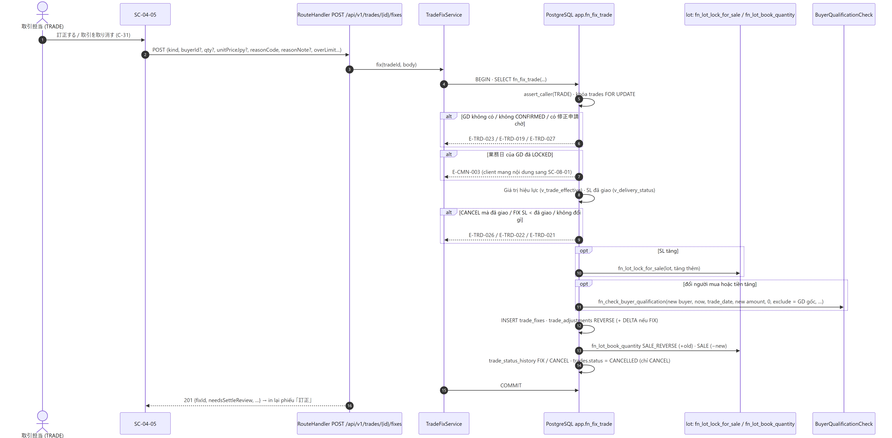
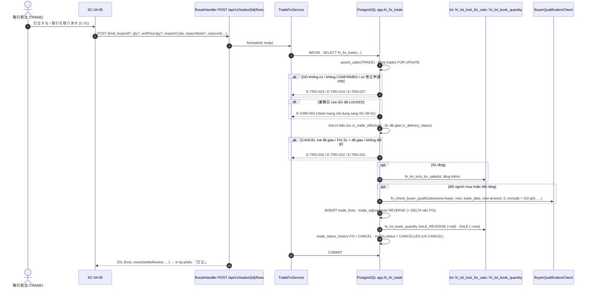

# TRADE_SAME_DAY_FIX — 当日訂正 / 取消 bằng REVERSE / DELTA (ngày chưa khóa)

> Biểu mẫu: **BM-2-901-53 v01** — Detail Design (Chart + Description) · SUN ASTERISK VIETNAM CO., LTD · ISO/IEC 27001:2013 & ISO 9001:2015

---

## 1. History of change

| No | Version | Action | Mục / Bước | Nội dung thay đổi | Ngày | Người sửa | Approve |
|---|---|---|---|---|---|---|---|
| 1 | 0.1.0 | Add new | — | Khởi tạo (LAB-4 P3) | 2026-11-25 | phuongnnm-23344 | |
| 2 | 0.1.1 | Update | §2 | FB-EXP-236: nhúng ảnh PNG `./assets/TRADE_SAME_DAY_FIX_sequence.png` xuất từ khối Mermaid (`scripts/export-mermaid-png.py`); Mermaid vẫn là nguồn | 2026-11-25 | phuongnnm-23344 |  |

---

## 2. Sequence diagram

Nguồn: khối Mermaid dưới (bản để sửa); ảnh sinh từ chính khối đó bằng `python scripts/export-mermaid-png.py TRADE_SAME_DAY_FIX` — sửa Mermaid thì chạy lại để hai bản không lệch.

**File nguồn của sơ đồ:** khối Mermaid trong file này.

---

## 3. Description

- Sửa (訂正) hoặc hủy (取消) một GD đã 確定 **khi 業務日 của GD chưa khóa**, tại bàn GD (SC-04-05, mở từ SC-04-04): có lý do, giữ lịch sử, **không duyệt 2 cấp** (FR-AITAI-03, PRM-127, M17). Sau khóa ngày chỉ còn 修正申請 (SC-08-01).
- **Không ghi đè** (luật 4, ADR-004): GD gốc giữ nguyên số liệu; sinh `trade_fixes` + `trade_adjustments` REVERSE (đảo giá trị hiệu lực hiện tại, người mua cũ) + DELTA (giá trị mới, người mua mới); 取消 chỉ có REVERSE. Sổ SL lô có dòng hoàn / trừ.
- Người thứ hai: không ở lúc sửa; dòng có tiền thay đổi lớn nhất của một người mua (税込) ≥ ngưỡng 2 cấp của quy chế **hoặc** đổi 買受人 → ✖ ở checklist 日次締め tới khi 照合事務局 bấm 確認済 (Q-SC0405-01 [Customer giả lập, 2026-11-25], ADJUST_DB 4.32).

---

## 4. Detail function

### 4.1. Kiểm request và GD gốc

| Trường | Giá trị |
|---|---|
| Input | `tradeId`, body (API-TRD-008 §3) |
| Output | `v_trade` đã khóa, `v_effective`, `v_delivered` → 4.2 |

**Error**

| Điều kiện lỗi | Xử lý | Status code |
|---|---|---|
| Chưa đăng nhập / không TRADE | `E-CMN-001` / `E-CMN-002` | 401 / 403 |
| `reasonCode` trống / không thuộc `FIX_REASON` | `E-TRD-020` | 422 |
| `reasonCode = OTHER` mà `reasonNote` trống / > 200 | `E-TRD-008` | 422 |
| GD không tồn tại | `E-TRD-023` | 404 |
| `trades.status ≠ CONFIRMED` | `E-TRD-019: {状態}` | 409 |
| Có `correction_requests` của GD ở `SUBMITTED` / `FIRST_APPROVED` | `E-TRD-027` | 409 |
| `business_days.status` của `trades.business_date` = `LOCKED` | `E-CMN-003` — client giữ nội dung, nút mang sang SC-08-01 (khách #5) | 423 |

**Detail**

| No | Nội dung xử lý |
|---|---|
| 1 | `assert_caller(TRADE)`; `SELECT … FROM trades WHERE id = … FOR UPDATE` |
| 2 | `v_effective :=` dòng `v_trade_effective` của GD (người mua, SL, đơn giá hiệu lực sau các lần sửa trước) |
| 3 | `v_delivered :=` SL đã giao (`v_delivery_status`) |

### 4.2. Tính nội dung mới và kiểm nghiệp vụ

| Trường | Giá trị |
|---|---|
| Input | `p_kind`, giá trị mới, `v_effective`, `v_delivered` |
| Output | `v_new` (buyer, qty, price, amount), `v_qty_increase` → 4.3 |

**Error**

| Điều kiện lỗi | Xử lý | Status code |
|---|---|---|
| `CANCEL` và `v_delivered > 0` | `E-TRD-026` (dẫn SC-06-04) | 409 |
| `FIX` và giá trị mới = hiệu lực | `E-TRD-021` | 422 |
| SL mới ≤ 0 / sai số lẻ / đơn giá < 1 | `E-TRD-009` / `E-TRD-010` / `E-TRD-011` | 422 |
| SL mới < `v_delivered` | `E-TRD-022: {v_delivered}{unit}` | 409 |
| SL tăng vượt SL khả dụng của lô | `E-TRD-002` (qua `fn_lot_lock_for_sale`) | 409 |
| Người mua mới không hợp lệ / vượt 参加上限 không lý do | `E-TRD-003`..`008` (qua 2.4) | 422 |

**Detail**

| No | Nội dung xử lý |
|---|---|
| 1 | Giá trị không gửi = giữ giá trị hiệu lực |
| 2 | `v_qty_increase := new_qty − eff_qty`; > 0 → `fn_lot_lock_for_sale(lot, v_qty_increase, v_day)`; ≤ 0 → chỉ khóa dòng lô |
| 3 | Đổi người mua **hoặc** tiền tăng → `fn_check_buyer_qualification(new_buyer, now(), trades.trade_date, new_amount, 0, p_exclude_trade_id = tradeId, …)`; giảm tiền cùng người mua → không kiểm |

### 4.3. Ghi 当日訂正 và dòng điều chỉnh

| Trường | Giá trị |
|---|---|
| Input | `v_trade`, `v_effective`, `v_new` |
| Output | `v_fix_id`, id REVERSE / DELTA → 4.4 |

**Error**

| Điều kiện lỗi | Xử lý | Status code |
|---|---|---|
| Trigger `DAY_LOCKED` (ngày bị khóa giữa chừng) | `E-CMN-003`, rollback; client giữ nội dung | 423 |
| Trigger kiểm `amount_delta = qty × price` thất bại | Log `ERROR`, `E-CMN-004`, rollback | 500 |

**Detail**

| No | Nội dung xử lý |
|---|---|
| 1 | `v_max_buyer_diff_incl :=` max theo người mua của |Δ tiền 税込| (thuế suất của GD gốc, làm tròn xuống); đổi người mua → người cũ = tiền cũ, người mới = tiền mới; `CANCEL` = tiền 税込 của GD |
| 2 | `INSERT trade_fixes (trade_id, business_date = trades.business_date, kind, change = {before, after} (NULL khi CANCEL), reason_code, reason_note, max_buyer_diff_incl_jpy, buyer_changed)` |
| 3 | `INSERT trade_adjustments` **REVERSE**: `buyer_id` cũ, `unit_price_jpy` cũ, `qty_delta = −eff_qty`, `amount_delta_jpy = −eff_amount`, `source = SAME_DAY`, `fix_id`, `tax_rate_id` của GD gốc, `rule_version_id` của ngày, `business_date` = ngày mở, `period_id` = kỳ chứa `trades.trade_date` |
| 4 | `FIX`: `INSERT` **DELTA**: người mua / đơn giá mới, `qty_delta = new_qty`, `amount_delta_jpy = floor(new_qty × new_price)`, các cột còn lại như REVERSE |
| 5 | Sổ SL: `fn_lot_book_quantity(lot, 'SALE_REVERSE', +eff_qty, NULL, reverse_id, v_day)`; `FIX` thêm `fn_lot_book_quantity(lot, 'SALE', −new_qty, trade_id, NULL, v_day)` — lô `CLOSED` có SL lại → `PUBLISHED` (Q-LOT-05) |

### 4.4. Trạng thái GD, commit

| Trường | Giá trị |
|---|---|
| Input | Kết quả 4.3 |
| Output | 201 `{fixId, kind, adjustments[], needsSettleReview, displayNo}` |

**Error**

| Điều kiện lỗi | Xử lý | Status code |
|---|---|---|
| `40P01` / `40001` | Rollback, `E-CMN-006` | 409 |

**Detail**

| No | Nội dung xử lý |
|---|---|
| 1 | `FIX`: `fn_record_trade_event(FIX, CONFIRMED → CONFIRMED, reason)`. `CANCEL`: `UPDATE trades SET status = 'CANCELLED'` (chỉ cột trạng thái — số liệu không đổi) + `fn_record_trade_event(CANCEL, CONFIRMED → CANCELLED, reason)` |
| 2 | `needsSettleReview := v_max_buyer_diff_incl ≥ rule_parameters.CORR_TWO_LEVEL_THRESHOLD_JPY OR buyer_changed` — để client hiện câu [14]; checklist 日次締め đọc trực tiếp `trade_fixes` |
| 3 | `COMMIT`; log `INFO trade.fixed kind={…} tradeNo={…} review={bool}`; client gọi API-TRD-004 in lại phiếu có chữ 「訂正」 / 「取消」 |

---

## 5. Other Notes

- **Function này KHÔNG:** sửa GD của ngày đã khóa (→ 修正申請, module settle); duyệt; tự sinh REVERSE / DELTA từ ngoại lệ giao hàng (module delivery — ADR-004 dùng chung bảng).
- **Kỳ:** điều chỉnh mang `period_id` = kỳ của GD gốc (`trade_date`); 当日訂正 luôn cùng ngày nên kỳ gốc còn `OPEN` (Gate 1 C-02).
- **Lệch prototype:** prototype không có 当日訂正 — mọi sửa đi 修正申請 (D11, M17).
- **Điều kiện hoàn thành (LAB-5):** (a) 訂正 SL 30 → 28 kg → `trade_fixes` + REVERSE −30 + DELTA +28, sổ lô +30 / −28, GD gốc giữ 30; (b) 取消 GD chưa giao → REVERSE −30, sổ +30, `trades.status = CANCELLED`, không DELTA; (c) 取消 GD đã giao 12 kg → 409 `E-TRD-026`; (d) đổi 買受人 sang 売買参加者 承認 失効 → 422 `E-TRD-006`; (e) đổi 買受人 cùng giá → `buyer_changed = true`, `needsSettleReview = true`; (f) ngày bị khóa lúc bấm → 423, không dòng nào ghi; (g) sửa lần 2 lấy giá trị sau lần 1 làm REVERSE.
