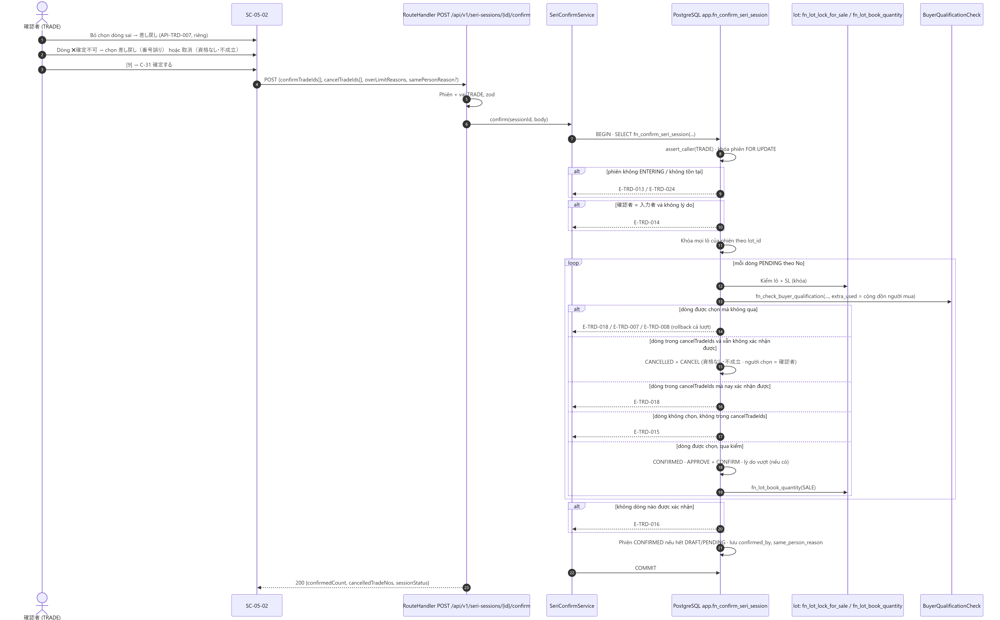
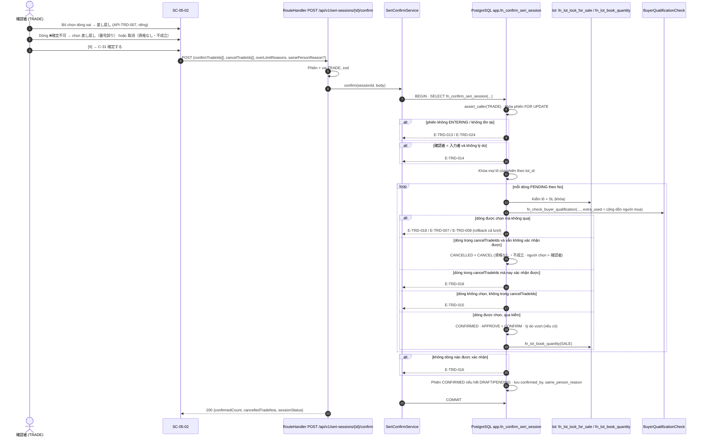

# TRADE_SERI_CONFIRM — Xác nhận kết quả phiên せり (người chốt) + 差し戻し

> Biểu mẫu: **BM-2-901-53 v01** — Detail Design (Chart + Description) · SUN ASTERISK VIETNAM CO., LTD · ISO/IEC 27001:2013 & ISO 9001:2015

---

## 1. History of change

| No | Version | Action | Mục / Bước | Nội dung thay đổi | Ngày | Người sửa | Approve |
|---|---|---|---|---|---|---|---|
| 1 | 0.1.0 | Add new | — | Khởi tạo (LAB-4 P3) | 2026-11-25 | phuongnnm-23344 | |
| 2 | 0.1.1 | Update | — | Gate 2 G2-m03: sửa câu as-is (lý do vượt hạn mức chỉ UI hiện cho mọi dòng; S7 của 0027 là approve_correction); khách Q-TRD-05: 差し戻し / 取消, DoD b–b5 | 2026-11-25 | phuongnnm-23344 |  |
| 3 | 0.1.2 | Update | §2 | FB-EXP-236: nhúng ảnh PNG `./assets/TRADE_SERI_CONFIRM_sequence.png` xuất từ khối Mermaid (`scripts/export-mermaid-png.py`); Mermaid vẫn là nguồn | 2026-11-25 | phuongnnm-23344 |  |

---

## 2. Sequence diagram

Nguồn: khối Mermaid dưới (bản để sửa); ảnh sinh từ chính khối đó bằng `python scripts/export-mermaid-png.py TRADE_SERI_CONFIRM` — sửa Mermaid thì chạy lại để hai bản không lệch.

**File nguồn của sơ đồ:** khối Mermaid trong file này.

---

## 3. Description

- 確認者 xác nhận **kết quả cuối đã được せり人 quyết trên sàn** cho cả phiên — người quyết cuối của CAP-HUMAN-01. Hệ thống chỉ ghi; không có giá đặt, không lượt trả giá (luật 1, FR-SERI-01).
- Tại lúc xác nhận, từng dòng được kiểm lại 許可 / 承認 + SL (BR-PERM-01, BR-LOT-02); 参加上限 chỉ cho 売買参加者, cộng dồn các dòng của cùng người mua trong phiên với 相対 + せり đã 確定 trong kỳ (L4-A04 (1)).
- 確認者 ≠ 入力者 mặc định; trùng → lý do bắt buộc, lưu `seri_sessions.same_person_reason`, hiện ở 要確認 SC-07-01 (S2, PRM-115).
- Dòng không xác nhận được (失効 / 一時停止 / SL thiếu) **không tự hủy** — 確認者 chọn một trong hai cho từng dòng (Q-TRD-05 [Customer giả lập, 2026-11-25]): **差し戻し（番号誤り）** khi 入力者 có thể đã gõ nhầm số người mua → `fn_send_back_seri_results` về 入力者 đối chiếu せり原票 / phiếu giấy rồi sửa đúng số **người thật sự thắng せり**; hoặc **取消（資格なし・不成立）** khi số đúng mà người đó thật sự không có tư cách (BR-PERM-01) → dòng `CANCELLED` có lịch sử, không trừ SL, lô vẫn / trở lại 販売公開中 để せり lại hoặc chuyển 相対 (khách #9). **Không** có đường đổi sang người trả giá cao thứ hai — đó là quyết kết quả せり mới, phải せり lại (luật 3, CAP-HUMAN-01). Dòng 入力者 sửa rồi nộp lại được kiểm lại BR-PERM-01 lúc xác nhận lượt sau.
- Tất cả hoặc không: một dòng được chọn mà không qua kiểm → không dòng nào được ghi, client nạp lại.

---

## 4. Detail function

### 4.1. Kiểm request, phiên, người xác nhận

| Trường | Giá trị |
|---|---|
| Input | `sessionId`, body `SeriConfirmBody` |
| Output | `v_session` đã khóa, `v_caller` → 4.2 |

**Error**

| Điều kiện lỗi | Xử lý | Status code |
|---|---|---|
| Chưa đăng nhập / không có vai TRADE | `E-CMN-001` / `E-CMN-002` | 401 / 403 |
| Phiên không tồn tại | `E-TRD-024` | 404 |
| `seri_sessions.status ≠ ENTERING` | `E-TRD-013: {状態}` | 409 |
| `v_caller = entered_by` và `p_same_person_reason` trống | `E-TRD-014` | 422 |
| Không có 業務日 `OPEN` / phiên thuộc ngày đã khóa | `E-CMN-003` | 423 |
| Trước giờ chốt GD | `E-TRD-012` | 409 |

**Detail**

| No | Nội dung xử lý |
|---|---|
| 1 | `requireRole(["TRADE"])`; zod |
| 2 | `v_caller := assert_caller(['TRADE'], [])`; `SELECT … FROM seri_sessions WHERE id = … FOR UPDATE` (kiểm vai **trước** khi khóa phiên — cùng nguyên tắc với sửa S7 của prototype ở `0027` cho `approve_correction`; hàm `confirm_seri_session` bản cuối ở `0027`) |
| 3 | Kiểm trùng người, ngày mở, giờ chốt |

### 4.2. Khóa lô và duyệt từng dòng

| Trường | Giá trị |
|---|---|
| Input | Dòng `trades` của phiên có `status = PENDING`, `p_confirm_trade_ids`, `p_cancel_trade_ids`, `p_over_limit_reasons` |
| Output | Danh sách dòng xác nhận / hủy → 4.3 |

**Error**

| Điều kiện lỗi | Xử lý | Status code |
|---|---|---|
| Id trong `p_confirm_trade_ids` / `p_cancel_trade_ids` không thuộc phiên / không `PENDING`, hoặc một id nằm ở cả hai danh sách | `E-TRD-018: {trade_no}`, rollback | 409 |
| Dòng trong `p_cancel_trade_ids` mà nay **xác nhận được** (vd tư cách vừa được gia hạn) | `E-TRD-018: {trade_no}` (`detail.rows[].reason = NOW_CONFIRMABLE`), rollback — 確認者 xem lại | 409 |
| Dòng được chọn: lô không bán / SL thiếu / 許可 · 承認 không hợp lệ | `E-TRD-018: {trade_nos}` (kèm `detail.rows[].reason`), rollback cả lượt | 409 |
| Dòng được chọn vượt 参加上限 không lý do / `OTHER` thiếu note | `E-TRD-007` / `E-TRD-008` kèm `detail.tradeNos`, rollback | 422 |
| Dòng `PENDING` **không** ở `p_confirm_trade_ids` cũng không ở `p_cancel_trade_ids` (kể cả dòng ✖確定不可 chưa chọn cách xử lý) | `E-TRD-015: {n}`, rollback | 422 |

**Detail**

| No | Nội dung xử lý |
|---|---|
| 1 | Khóa mọi lô của phiên `ORDER BY lot_id FOR UPDATE` (chống deadlock — prototype 0027 W12) |
| 2 | Duyệt dòng theo `No`; `v_used_in_batch[buyer]` cộng dồn tiền các dòng **được xác nhận** trước đó cùng người mua |
| 3 | Mỗi dòng: kiểm lô + SL (`fn_lot_lock_for_sale`, trừ dần SL các dòng trước cùng lô); gọi `fn_check_buyer_qualification(buyer, now(), trade_date, amount, v_used_in_batch[buyer], NULL, reason, note)` bắt lỗi thành kết quả "không qua" |
| 4 | Dòng trong `p_cancel_trade_ids` + vẫn không qua → đánh dấu hủy, lý do `資格なし・不成立` kèm nguyên nhân hệ thống (`資格失効` / `一時停止` / `残数量不足` / `販売公開外`); người hủy = 確認者 |

### 4.3. Ghi kết quả dòng

| Trường | Giá trị |
|---|---|
| Input | Danh sách 4.2 |
| Output | `confirmed_count`, `cancelled_trade_nos` → 4.4 |

**Error**

| Điều kiện lỗi | Xử lý | Status code |
|---|---|---|
| Không dòng nào được xác nhận | `E-TRD-016`, rollback | 422 |
| Trigger `DAY_LOCKED` / `TRADE_FROZEN` | `E-CMN-003` / `E-CMN-004`, rollback | 423 / 500 |

**Detail**

| No | Nội dung xử lý |
|---|---|
| 1 | Dòng xác nhận: `UPDATE trades SET status = 'CONFIRMED', confirmed_by = v_caller, confirmed_at = now(), over_limit_reason_code / note` (chỉ khi vượt) — UPDATE cuối cùng được phép trước khi đóng băng |
| 2 | `fn_record_trade_event`: `APPROVE` (`PENDING` → `PENDING`), `CONFIRM` (`PENDING` → `CONFIRMED`) |
| 3 | `fn_lot_book_quantity(lot, 'SALE', -qty, trade_id, NULL, v_day)` — lô SL 0 → `CLOSED` |
| 4 | Dòng hủy: `UPDATE trades SET status = 'CANCELLED'` + `CANCEL` (`PENDING` → `CANCELLED`, lý do `資格なし・不成立（{nguyên nhân}）`, `created_by` = 確認者); **không** ghi sổ SL; lô giữ / về `PUBLISHED` (販売公開中) |

### 4.4. Cập nhật phiên, commit

| Trường | Giá trị |
|---|---|
| Input | `v_session`, kết quả 4.3 |
| Output | 200 `{confirmedCount, cancelledTradeNos, sessionStatus}` |

**Error**

| Điều kiện lỗi | Xử lý | Status code |
|---|---|---|
| `40P01` / `40001` | Rollback, `E-CMN-006` | 409 |
| Lỗi khác | Log `ERROR`, `E-CMN-004` | 500 |

**Detail**

| No | Nội dung xử lý |
|---|---|
| 1 | Còn dòng `DRAFT` / `PENDING` (đã 差し戻し, chờ 入力者) → phiên giữ `ENTERING`; hết → `CONFIRMED`, `confirmed_by`, `confirmed_at` |
| 2 | `same_person_reason` lưu khi `v_caller = entered_by` (CHECK bảng 4.29) |
| 3 | `COMMIT`; log `INFO trade.seri.confirmed session={…} confirmed={n} cancelled={m} samePerson={bool}` |

### 4.5. 差し戻し (`fn_send_back_seri_results`, API-TRD-007)

| Trường | Giá trị |
|---|---|
| Input | `sessionId`, `tradeIds[]`, `reason` |
| Output | 200 `{sentBackCount}` |

**Error**

| Điều kiện lỗi | Xử lý | Status code |
|---|---|---|
| `reason` trống / > 200 | `E-TRD-017` | 422 |
| Phiên không `ENTERING` | `E-TRD-013` | 409 |
| Id không thuộc phiên / không `PENDING` | `E-TRD-018` | 409 |

Dòng ✖確定不可 (tư cách / SL) **được** 差し戻し (Q-TRD-05 — gõ nhầm số người mua). `reason` gợi ý sẵn 「買受人番号誤りの可能性（せり原票と照合してください）」, sửa được.

**Detail**

| No | Nội dung xử lý |
|---|---|
| 1 | `assert_caller(TRADE)`; khóa phiên |
| 2 | Mỗi dòng: `UPDATE trades SET status = 'DRAFT'` + `REJECT` (`PENDING` → `DRAFT`, lý do) — không trừ SL |
| 3 | Ghi outbox thông báo in-app cho `entered_by` 「第{n}回 {k}件が差し戻されました：{理由}」 (module notify) |
| 4 | 入力者 sửa ở SC-05-01 (chưa đặc tả — phụ thuộc ở `specs/_index.md`) rồi `SUBMIT` lại `DRAFT` → `PENDING`: số người mua cũ / mới + người sửa giữ ở `trade_status_history` (`SUBMIT`, `reason` có 「買受人 {旧} → {新}」) và `audit_logs` before / after — không ghi đè lịch sử (luật 4) |

---

## 5. Other Notes

- **Bắt buộc online, không MFA** (ADR-008, PREMISE §3.2). Hộp C-31 ở client trước khi gọi.
- **Function này KHÔNG:** nhập / sửa kết quả せり (SC-05-01, `SUBMIT` `DRAFT` → `PENDING` do 入力者); sửa sau xác nhận (→ 当日訂正 / 修正申請).
- **Lệch prototype:** server prototype chỉ bắt lý do vượt hạn mức khi người mua là 売買参加者 (`check_buyer_qualification` trả `false` cho 仲卸 trước bước kiểm hạn mức — `0025`), nhưng hạn mức tính theo 業務日 (M20, D08); **chỉ UI** (`src/app/(app)/seri/[id]/confirm/page.tsx:53-58`) hiện ô lý do cho mọi dòng kể cả 仲卸 — to-be chỉ hiện ô ở dòng 売買参加者 vượt hạn mức (khớp wireframe SC-05-02); không có hủy dòng / 差し戻し; dòng lỗi làm hỏng cả phiên mà không có đường ra.
- **Điều kiện hoàn thành (LAB-5):** (a) 入力者 tự xác nhận không lý do → 422 `E-TRD-014`; có lý do → lưu và hiện ở 要確認; (b) 12 dòng, 1 dòng 承認 失効 được chọn 「取消（資格なし・不成立）」 (`cancelTradeIds`) → 11 `CONFIRMED`, 1 `CANCELLED` (lý do 資格なし・不成立, người hủy = 確認者), SL chỉ trừ 11 dòng, lô của dòng hủy vẫn `PUBLISHED`; (b2) cùng phiên mà dòng 失効 chưa chọn cách xử lý → 422 `E-TRD-015`, không dòng nào ghi; (b3) dòng 失効 → 差し戻し → `DRAFT`, 入力者 sửa số người mua → nộp lại → lượt xác nhận sau kiểm lại BR-PERM-01, lịch sử có số cũ / mới; (b4) dòng trong `cancelTradeIds` mà tư cách vừa được gia hạn → 409 `E-TRD-018` `NOW_CONFIRMABLE`; (b5) không có API / nút nào đổi người mua ngay trên SC-05-02; (c) 2 dòng cùng 売買参加者, dòng 2 vượt nhờ cộng dồn → chỉ dòng 2 cần lý do; (d) 仲卸 không bao giờ cần lý do; (e) bỏ chọn dòng xác nhận được rồi bấm [9] → 422 `E-TRD-015`; 差し戻し trước → dòng `DRAFT`, phiên `ENTERING`; (f) 相対 vừa chốt hết SL lô của một dòng được chọn → 409 `E-TRD-018`, không dòng nào ghi.
