# GitHub Project Guidelines

| Information | Content |
| :--- | :--- |
| **Version** | 1.0 |
| **Issued Date** | 05/05/2026 |

## 1. User Registration
To begin working on GitHub Projects, members must use the GitHub account provided by the company.

## 2. Project Registration
* Provide information in [form IFU Request Repository](***REMOVED***)
* Project GitHub Structure:
    - 01 GitHub Project:
        + Cloned from the GitHub Project template, featuring pre-configured webhooks and custom fields.
        + New issues can be created from any repository and will be automatically displayed within the project's central GitHub Project.
    - 01 Management_template Repo: Cloned from /framgia/management_template, serving as the standardized storage for Issue Templates, Scripts, Labels, etc.
    - Source code Repositories: Based on project requirements (e.g., Backend Repo, Frontend Repo, etc.).
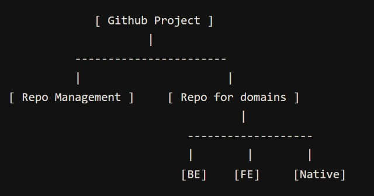
## 3. Trackers (Issue Classification)
### 3.1 Trackers list
Correct classification helps us filter data and report progress accurately. Each Issue on GitHub must be assigned a corresponding `Label`:

| Tracker | Category | Intended Issue Issuer | Description | Label on GitHub |
| :--- | :--- | :--- | :--- | :--- |
| **Epic** | -- | Product Owner | • Outlines business purposes. • Can be written from the end-user's perspective. | type:epic |
| **Story** | -- | Product Owner | • Steps of the business flow. • User stories. • Specific screens: corresponding logic and database. • API: Aggregation of specific business logic. • Usually contains Acceptance Criteria.  *Example: "iPhone users need to access the vertical view of the live stream when using the mobile app."* | type:story |
| **Change Request** | -- | Product Owner | • Technical specification changes arising after development has started. • Concepts similar to a Story. | type:changerequest |
| **UI Design** | Task | PM / Team Lead | • Specific tasks for Designers. | type:uidesign |
| **Dev Task** | Task | PM / Team Lead | • Basic task tickets for programming (Frontend/Backend/Native/AI/Infrastructure). | type:devtask, team:frontend  team:backend  team:native-ios  team:native-android  team:native-multiPF  team:ai  team:infrastructure |
| **Test Design** | Task | QA | • Tasks for designing test cases. | type:testdesign |
| **Test Execution** | Task | QA | • Testing work based on test cases or bugs discovered by QA during internal testing. | type:testexecution |
| **QA Bug** | Bug | QA Team | • Bugs discovered by QA during the Test Execution process. | type:qabug  severity:low  severity:medium  severity:high  severity:critical  testtype:functionaltest  testtype:layouttest  testtype:performancetest  testtype:stresstest  testtype:accesscontrol&securitytest |
| **Feedback** | -- | Product Owner | • Feedback found during the UAT process.  • If the defect appears to be a system bug, this ticket should be changed to a UAT Bug. • This tracker acts as a temporary issue pool when the issuer cannot verify if the behavior is a system bug or not. | type:feedback |
| **UAT Bug** | -- | Product Owner / QA | • Bugs discovered during User Acceptance Testing (UAT) with the client. | type:uatbug  severity:low  severity:medium  severity:high  severity:critical  testtype:functionaltest  testtype:layouttest  testtype:performancetest  testtype:stresstest  testtype:accesscontrol&securitytest |
| **Production Bug** | -- | Any | • Critical bugs discovered directly in the live production environment. | type:productionbug  severity:low  severity:medium  severity:high  severity:critical |
| **Investigation** | -- | Project Manager / Team Lead / Product Owner | • Technical investigation. e.g., Server log investigation, DB performance checks, etc. | type:investigation |
| **Documentation** | Task | PM / Team Lead | • Tasks related to writing documents and manuals. | type:documentation |
| **Operation** | Task | PM / Team Lead | • Technical operations. e.g., Log rotation, Manual batch execution, etc. | type:operation |

### 3.2 Issue Storage Structure across Repositories (Reference)
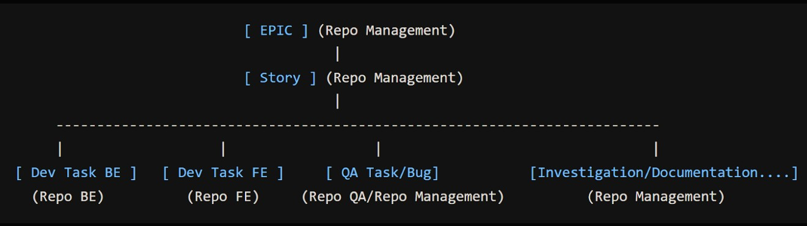
---

## 4. Workflow
### 4.1 Structure
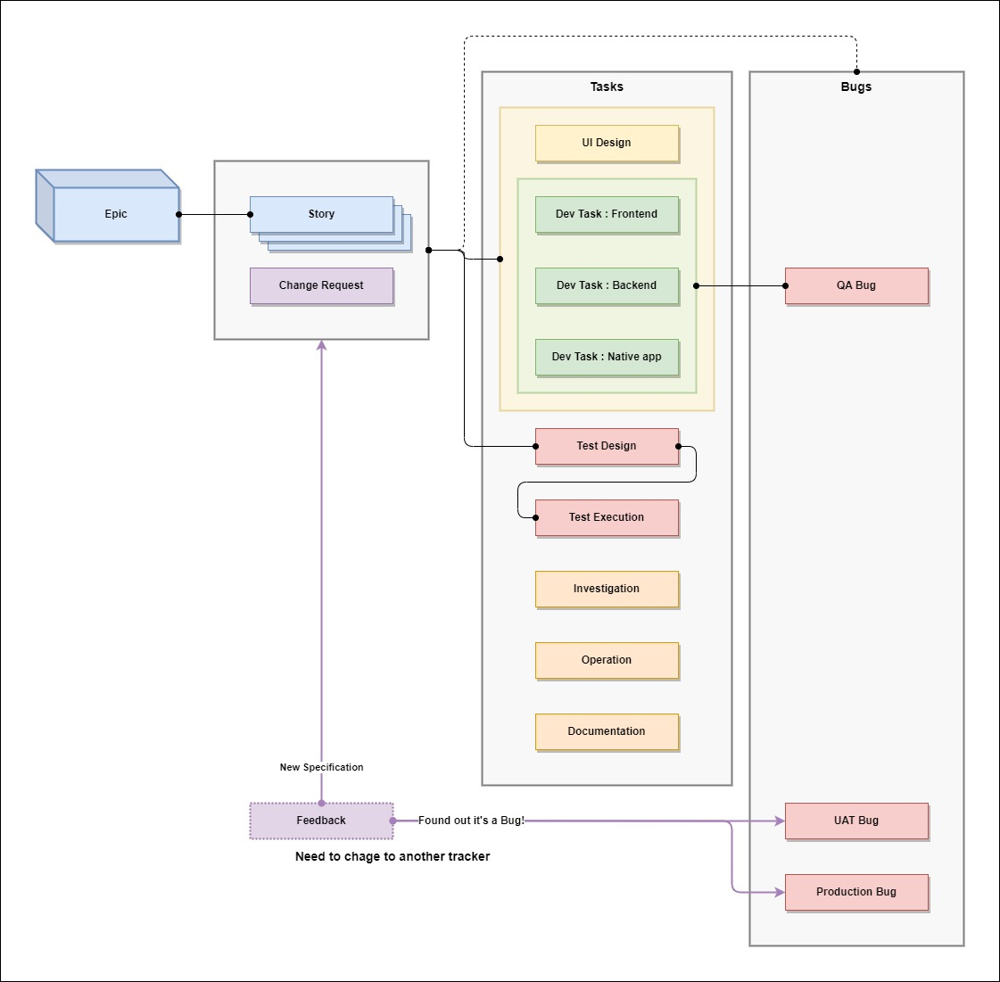

### 4.2 EPIC Workflow
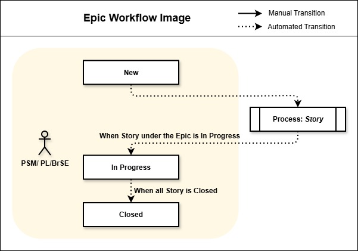

### 4.3 Story Workflow
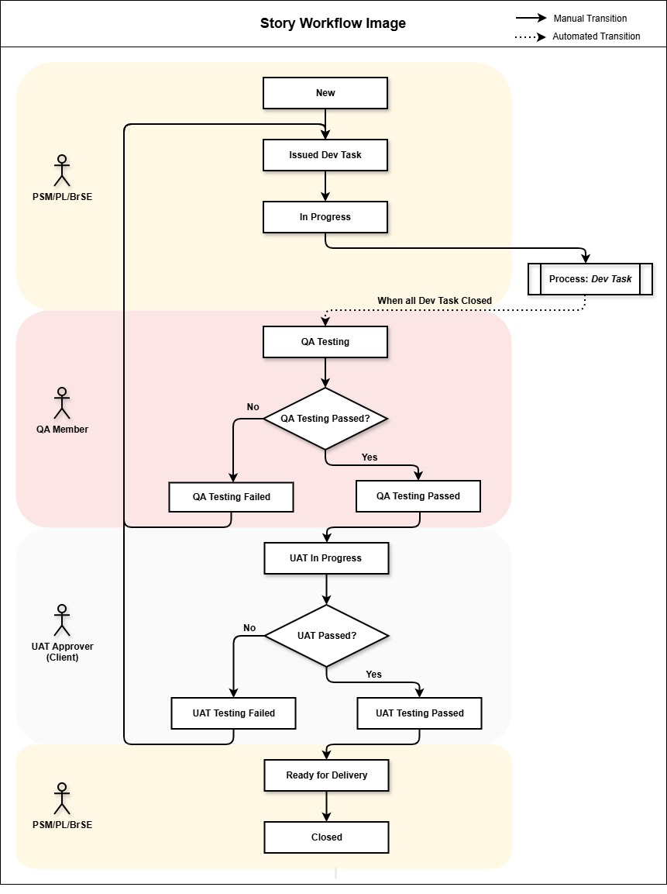

### 4.4 Change Request Workflow
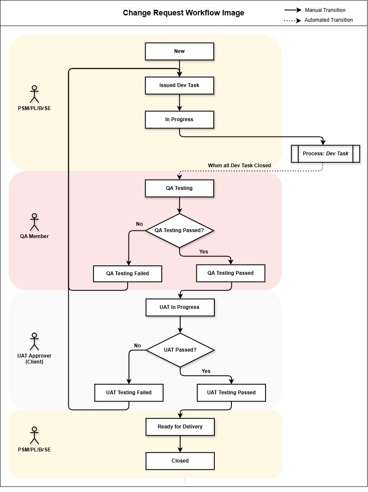

### 4.5 UI Design Workflow
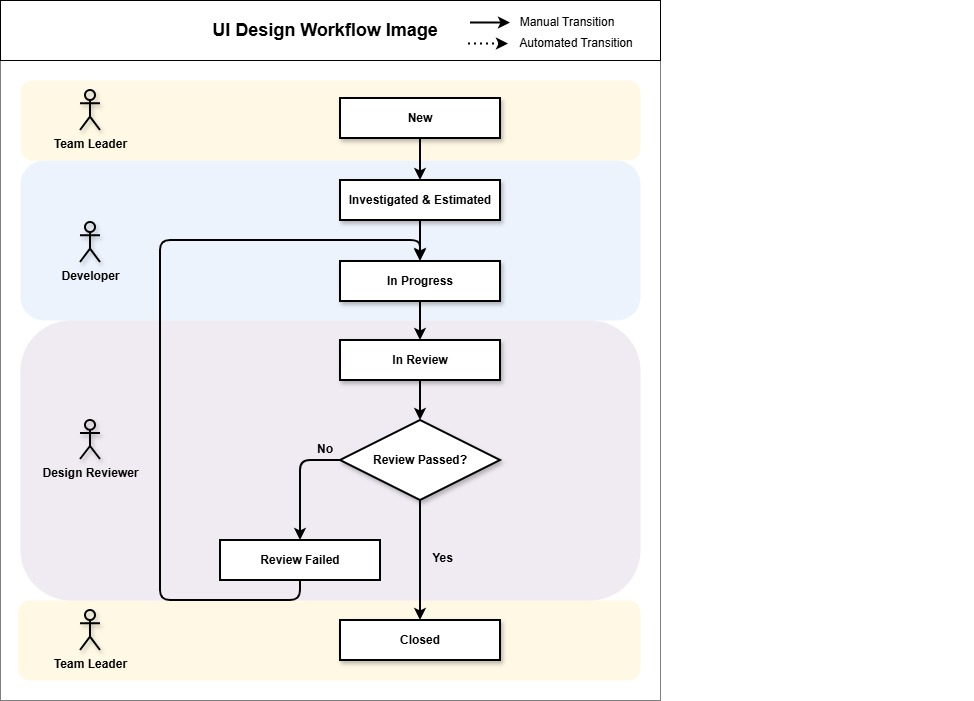

### 4.6 Development Task Workflow
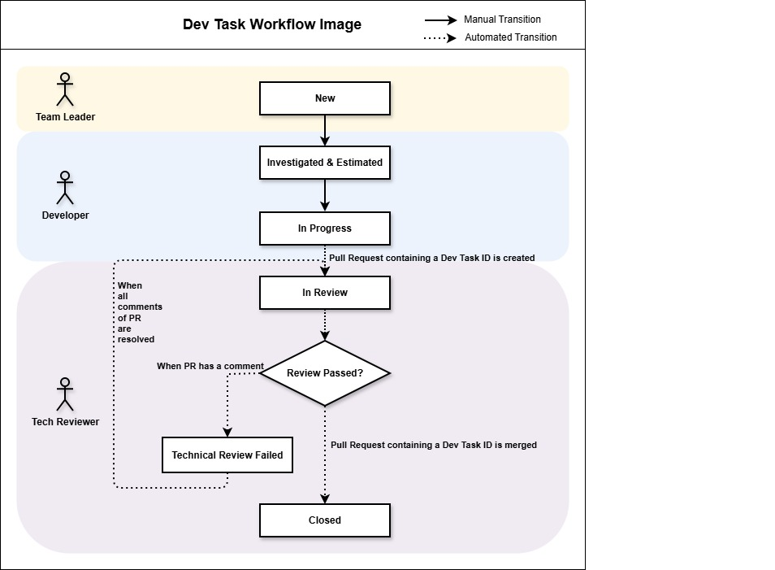

### 4.7 Test Design Workflow
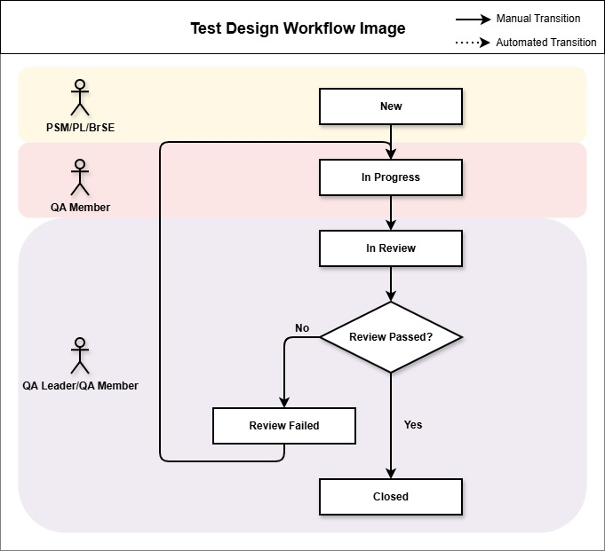

### 4.8 Test Execution Workflow
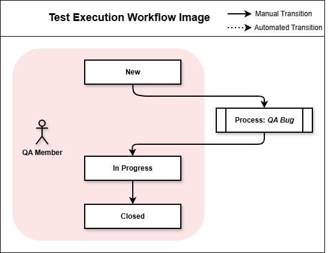

### 4.9 QA Bug Workflow
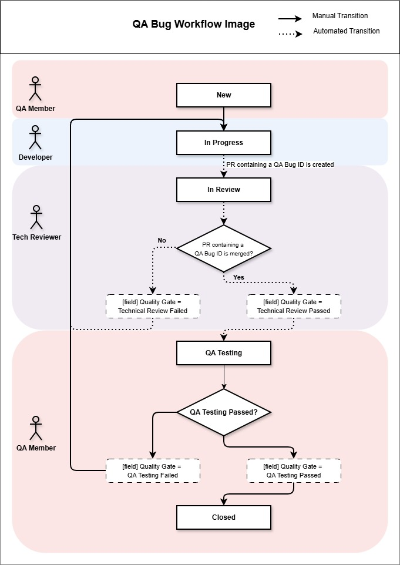

### 4.10 UAT Bug Workflow
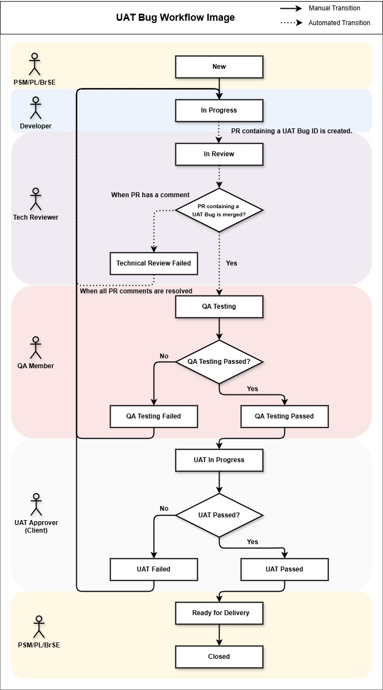

### 4.11 Production Bug Workflow
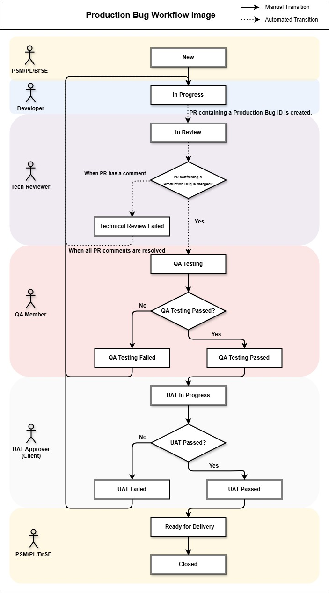

### 4.12 Investigation Workflow
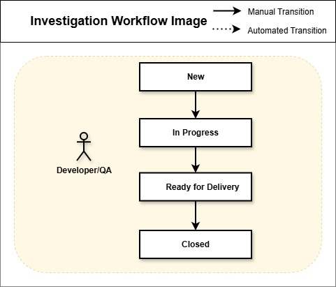

### 4.13 Documentation Workflow
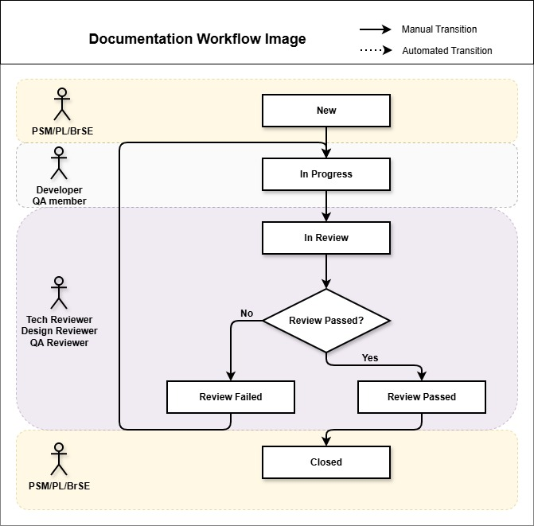

### 4.14 Feedback Workflow
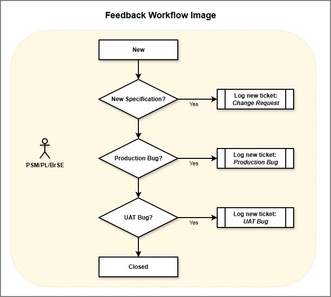

### 4.15 Operation Workflow
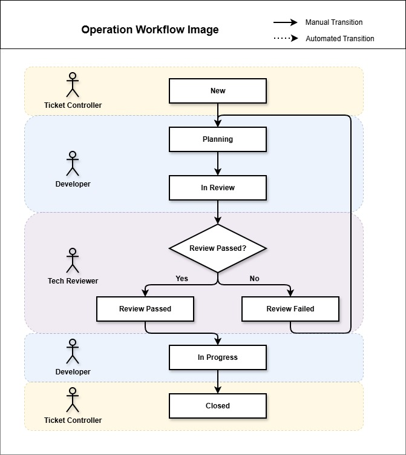

---
## 5. How to use GitHub Project v2

### 5.1 Dashboard Management and Filters

#### 5.1.1 Setting up Views (Tabs)
To optimize the distinct workflows of each Tracker, the system provides pre-configured default Views. However, projects can fully customize these Views to fit their actual operational needs.
Additionally, projects can create new Views by:
1. **Creating a new View:** Click the `+` sign next to the existing Tabs on the Dashboard.
2. **Renaming a View:** Click the arrow next to the Tab name -> `Rename`.
3. **Choosing a Layout:**
    
| Layout | Display Format | Purpose of Use |
| :--- | :--- | :--- |
| **Table** | Grid format (similar to Excel/Spreadsheet) | **Data Management & Control:** Suitable for bulk editing, advanced filtering, and managing attribute categories (Tracker, Version, Priority). |
| **Board** | Column format (Kanban Board) | **Daily Operations:** Ideal for Daily Scrum meetings. Helps the team visually track work progress by dragging and dropping tickets between statuses. |
| **Roadmap** | Bar format (Gantt Chart/Timeline) | **Planning:** Displays tasks on a timeline. Best for managing long-term **Epics** or **Milestones**, helping to monitor overlaps and deadlines. |

4. **Group by:** Click `Group` on the toolbar to group tasks by **Status**, **Target Version**, or **Assignee**.

#### 5.1.2 Using Filter Queries
In the Filter bar, you can type commands to filter the desired content:

| Filtering Need | Filter Syntax |
| :--- | :--- |
| **View your own tasks** | `assignee:@me` |
| **Filter by specific Tracker** | `label:type:devtask` or `label:type:qabug` |
| **Filter unassigned tasks** | `no:assignee` |
| **View tasks for Version v1.0** | `"Target Version":v1.0` |
| **Combine multiple conditions** | `assignee:@me status:"In Progress" label:type:story` |
| **Exclude content** | `-label:type:epic` (Shows everything except Epics) |
| **Filter by Milestone** | `milestone:"Sprint 15"` |

> **Tip:** After typing the filter, click **Save changes** to save this filter to the current Tab so you don't have to re-type it next time.

---
### 5.2 Managing Custom Fields (Default Data Fields)
The following fields are pre-configured; members only need to provide the information to ensure accurate reporting data:

| Field Name | Data Type | Meaning |
| :--- | :--- | :--- |
| **Status** | Single select | The status of the ticket within the workflow. |
| **Target Version** | Single select | The expected release version (v1.0, v1.1...). |
| **Priority** | Single select | Priority level: *Critical, High, Medium, Low*. |
| **Estimated time** | Number | Estimated time to complete (unit: hours). |
| **Spent time** | Number | Actual time spent (unit: hours). |
| **Start Date** | Date | Start date of the task (Required for Roadmap view). |
| **Due Date** | Date | Deadline of the task (Required for Roadmap view). |
| **Story Point** | Number | Estimated effort in story points for planning and sprint management. |

### 5.3 How to Create a New Ticket / Issue
* **Location:** Go to the **Issues** tab in the corresponding Repository or click the `+ Add Item` button directly in the "Todo" column on the Project interface.
* **Title Structure:** `[Tracker] Brief task name`.
    * *Example:* `[Dev Task] Design Login API`.
* **Assignee:** Must assign at least one primary responsible person.

### 5.4 How to Create a Target Version
Use the **Custom Fields** feature in Project v2:
1. Go to Project `Settings` -> `Fields` -> `New field`.
2. Select data type `Single select` and name it **Target Version**.
3. Add options such as: `v1.0`, `v1.1`, `Hotfix_Mar_2026`.

### 5.5 How to Create Milestones
Milestones are used to manage important deadlines such as Sprints or Release dates.
* **Location:** Go to the Repository -> `Issues` tab -> `Milestones` -> `New milestone`.
* Each Issue, once created, must be assigned to a specific Milestone to track progress on the Burndown chart.

### 5.6 Linking Tickets to Pull Requests (PR)
To activate the automatic issue status transition feature via Pull Requests, include the Issue identifier in the PR title or description using the structure `#[ID Task]`.
