# GitHub プロジェクト ガイドライン

| 項目 | 内容 |
| :--- | :--- |
| **バージョン** | 1.0 |
| **発行日** | 2026/05/05 |

## 1. ユーザー登録
GitHub Projects での作業を開始するには、メンバーは会社から提供された GitHub アカウントを使用する必要があります。

## 2. プロジェクト登録
* [IFU リポジトリ申請フォーム](***REMOVED***) から情報を提供してください。
* プロジェクトの GitHub 構成:
    - 01 GitHub Project:
        + GitHub Project テンプレートから複製され、Webhook とカスタムフィールドが事前に設定されています。
        + 新しい Issue はどのリポジトリからでも作成でき、プロジェクトの中心となる GitHub Project 内に自動的に表示されます。
    - 01 Management_template リポジトリ: /framgia/management_template から複製され、Issue テンプレート、スクリプト、ラベルなどの標準化された保管場所として機能します。
    - ソースコード リポジトリ: プロジェクトの要件に基づきます（例: Backend リポジトリ、Frontend リポジトリなど）。
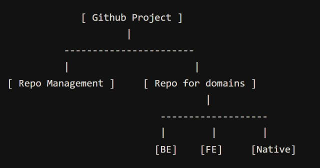
## 3. トラッカー（Issue の分類）
### 3.1 トラッカー一覧
正しく分類することで、データのフィルタリングと進捗報告を正確に行えます。GitHub 上の各 Issue には、対応する `Label` を割り当てる必要があります。

| トラッカー | カテゴリ | 想定する Issue 起票者 | 説明 | GitHub 上のラベル |
| :--- | :--- | :--- | :--- | :--- |
| **Epic** | -- | Product Owner | • ビジネス上の目的を概説する。 • エンドユーザーの視点から記述できる。 | type:epic |
| **Story** | -- | Product Owner | • 業務フローのステップ。 • ユーザーストーリー。 • 具体的な画面: 対応するロジックとデータベース。 • API: 特定の業務ロジックの集約。 • 通常、受け入れ基準（Acceptance Criteria）を含む。  *例: 「iPhone ユーザーがモバイルアプリ使用時にライブ配信の縦向き表示にアクセスできる必要がある。」* | type:story |
| **Change Request** | -- | Product Owner | • 開発開始後に発生した技術仕様の変更。 • Story と類似した概念。 | type:changerequest |
| **UI Design** | Task | PM / Team Lead | • デザイナー向けの具体的なタスク。 | type:uidesign |
| **Dev Task** | Task | PM / Team Lead | • プログラミングの基本的なタスクチケット（Frontend/Backend/Native/AI/Infrastructure）。 | type:devtask, team:frontend  team:backend  team:native-ios  team:native-android  team:native-multiPF  team:ai  team:infrastructure |
| **Test Design** | Task | QA | • テストケースを設計するタスク。 | type:testdesign |
| **Test Execution** | Task | QA | • テストケースに基づくテスト作業、または QA が内部テスト中に発見したバグ。 | type:testexecution |
| **QA Bug** | Bug | QA Team | • Test Execution の過程で QA が発見したバグ。 | type:qabug  severity:low  severity:medium  severity:high  severity:critical  testtype:functionaltest  testtype:layouttest  testtype:performancetest  testtype:stresstest  testtype:accesscontrol&securitytest |
| **Feedback** | -- | Product Owner | • UAT の過程で見つかったフィードバック。  • 不具合がシステムバグと思われる場合、このチケットは UAT Bug に変更する。 • 起票者が挙動がシステムバグかどうか判断できない場合に、一時的な Issue プールとして機能する。 | type:feedback |
| **UAT Bug** | -- | Product Owner / QA | • クライアントとのユーザー受け入れテスト（UAT）の過程で発見されたバグ。 | type:uatbug  severity:low  severity:medium  severity:high  severity:critical  testtype:functionaltest  testtype:layouttest  testtype:performancetest  testtype:stresstest  testtype:accesscontrol&securitytest |
| **Production Bug** | -- | Any | • 本番環境で直接発見された重大なバグ。 | type:productionbug  severity:low  severity:medium  severity:high  severity:critical |
| **Investigation** | -- | Project Manager / Team Lead / Product Owner | • 技術調査。 例: サーバーログ調査、DB パフォーマンスチェックなど。 | type:investigation |
| **Documentation** | Task | PM / Team Lead | • ドキュメントやマニュアルの作成に関するタスク。 | type:documentation |
| **Operation** | Task | PM / Team Lead | • 技術的な運用作業。 例: ログローテーション、手動バッチ実行など。 | type:operation |

### 3.2 リポジトリをまたいだ Issue の保管構造（参考）
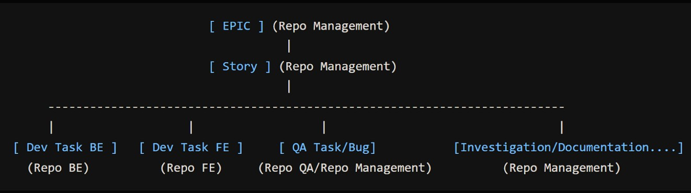
---

## 4. ワークフロー
### 4.1 構成
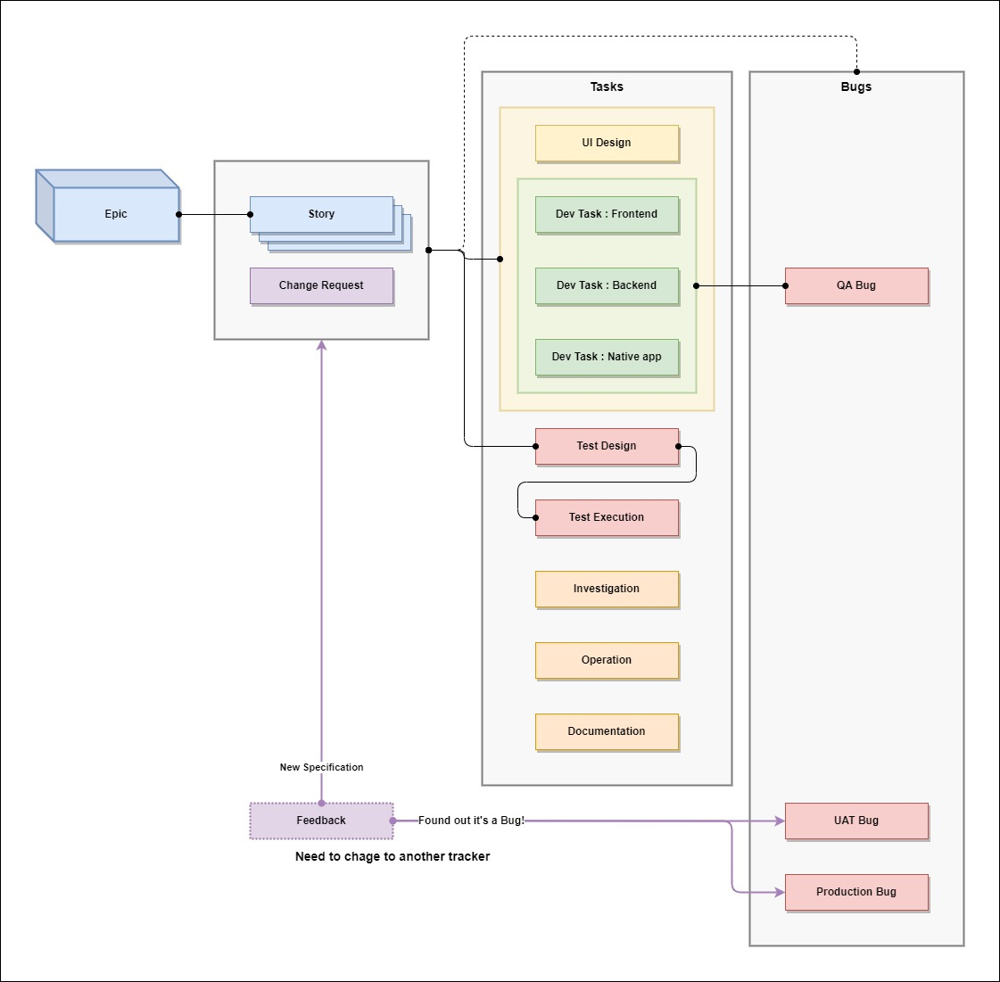

### 4.2 EPIC ワークフロー
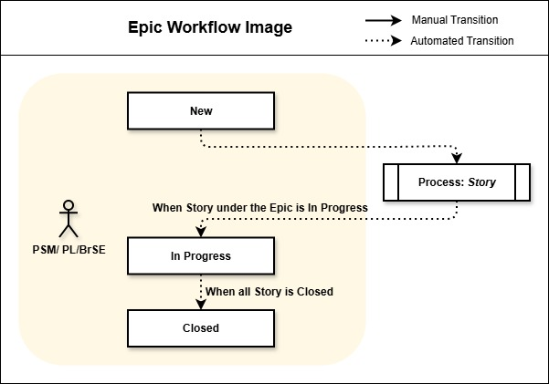

### 4.3 Story ワークフロー
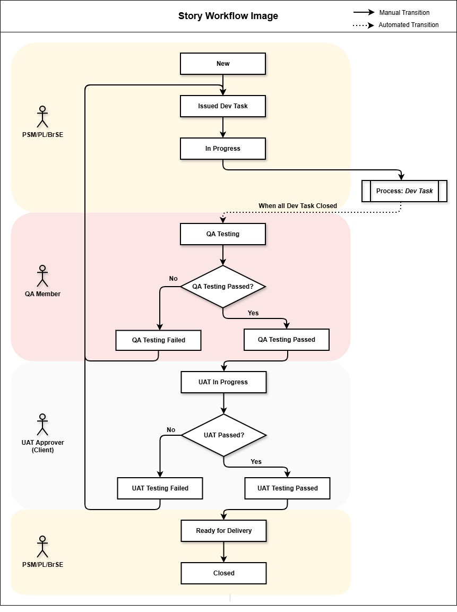

### 4.4 Change Request ワークフロー
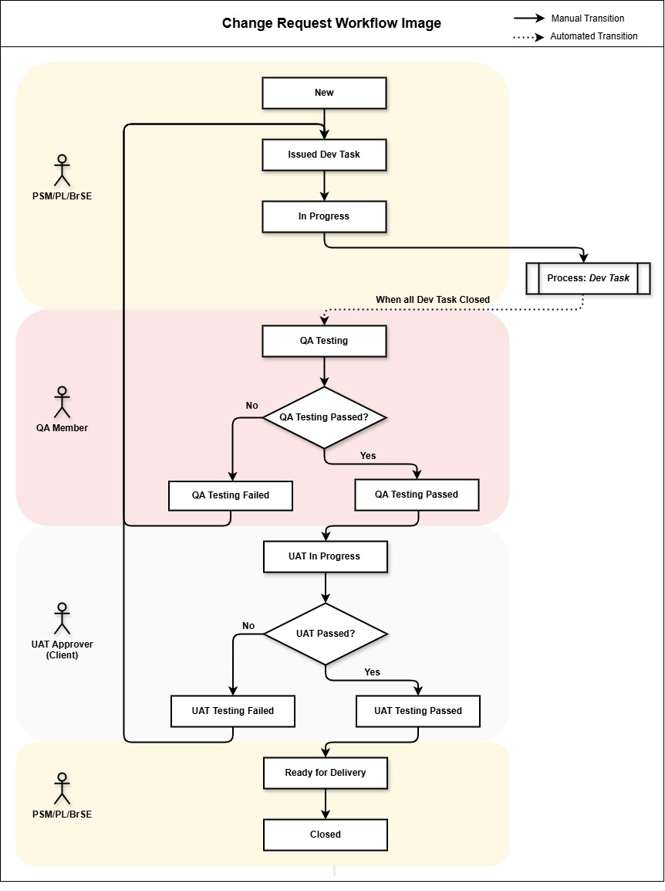

### 4.5 UI Design ワークフロー
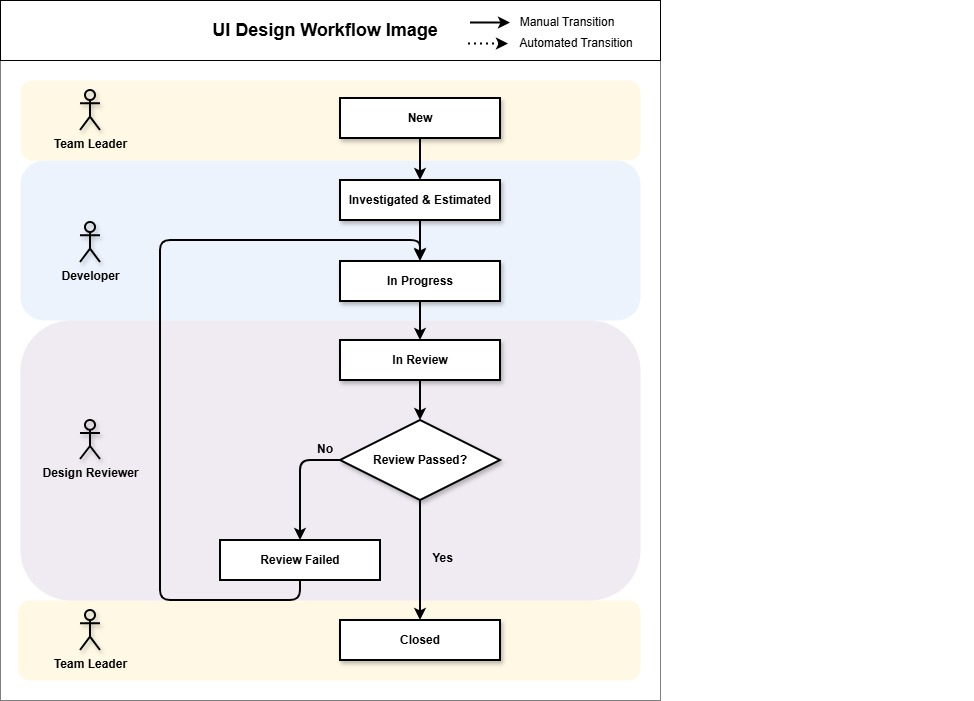

### 4.6 Development Task ワークフロー
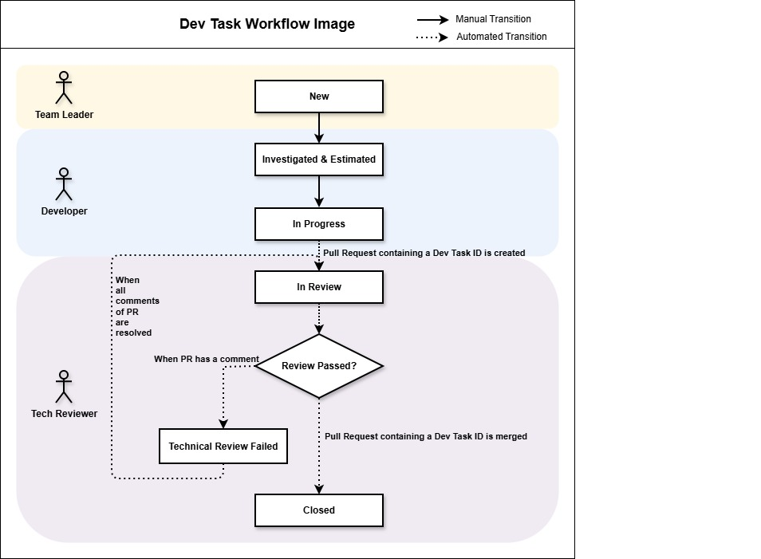

### 4.7 Test Design ワークフロー
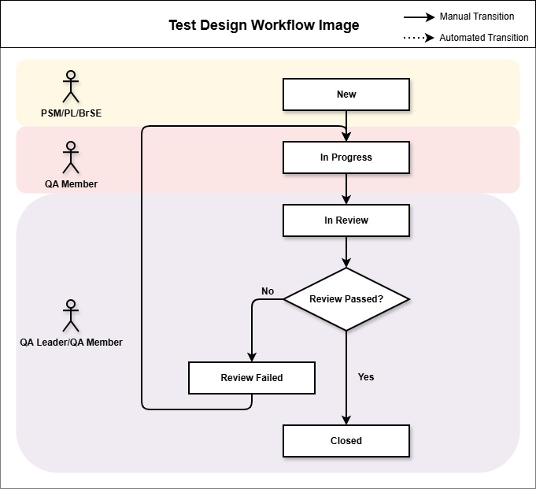

### 4.8 Test Execution ワークフロー
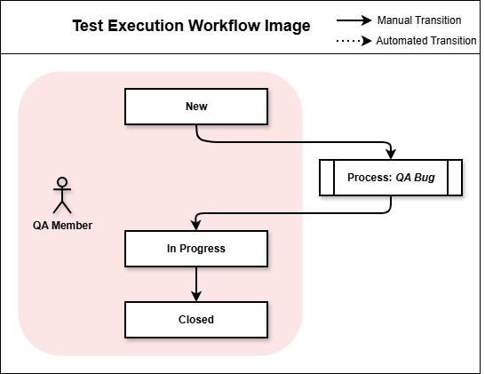

### 4.9 QA Bug ワークフロー
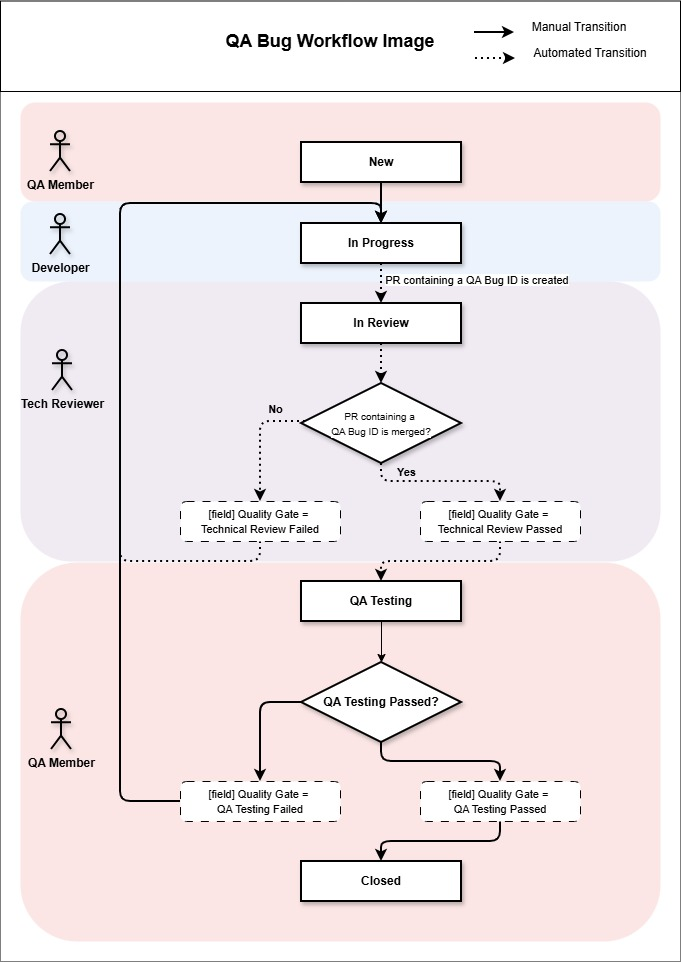

### 4.10 UAT Bug ワークフロー
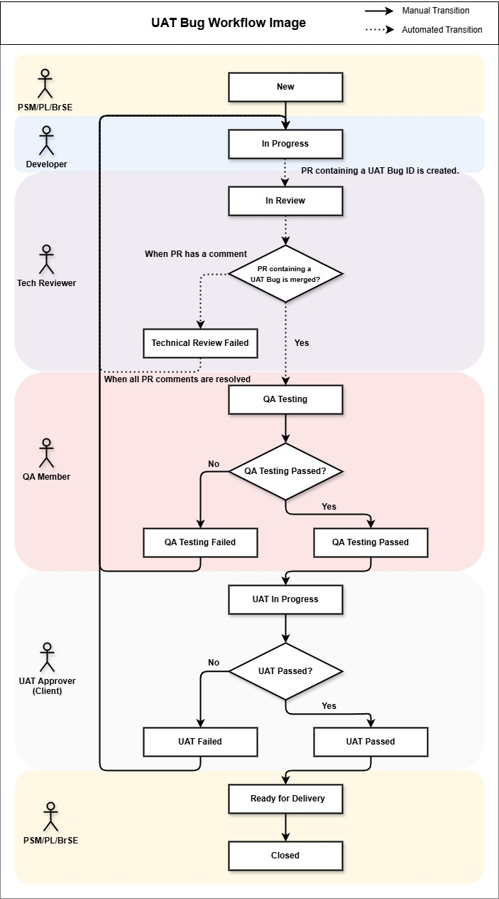

### 4.11 Production Bug ワークフロー
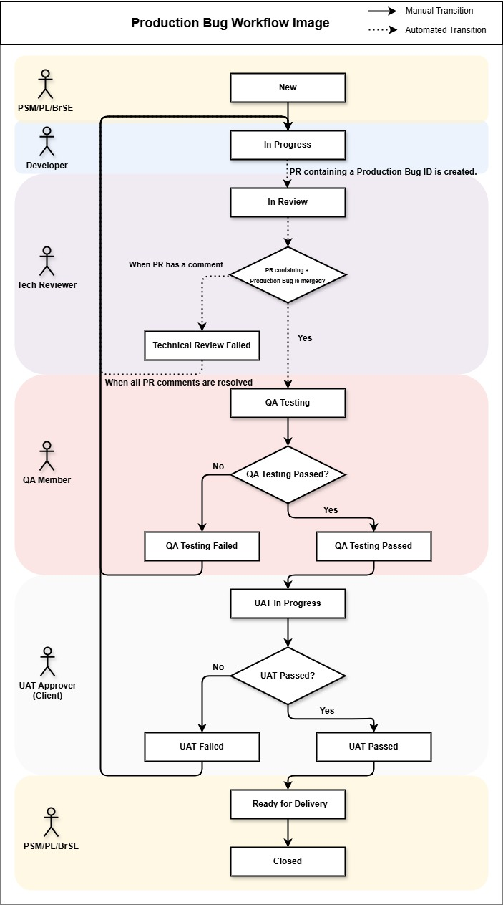

### 4.12 Investigation ワークフロー
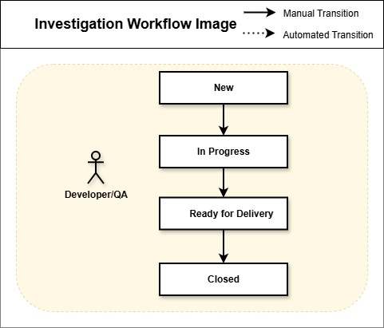

### 4.13 Documentation ワークフロー
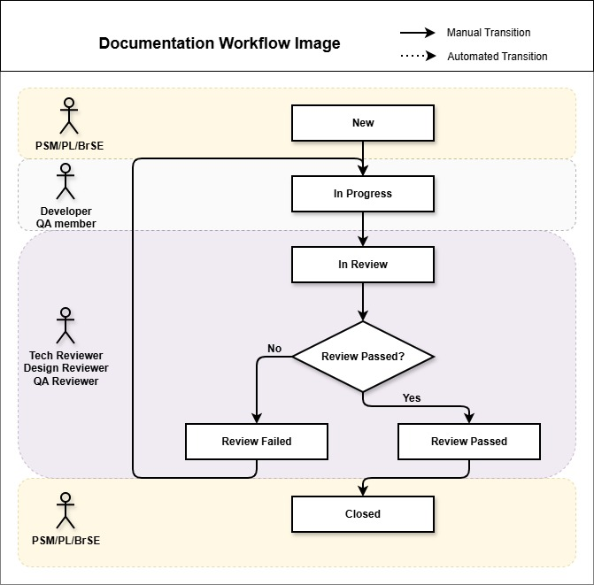

### 4.14 Feedback ワークフロー
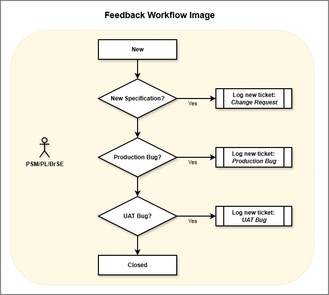

### 4.15 Operation ワークフロー
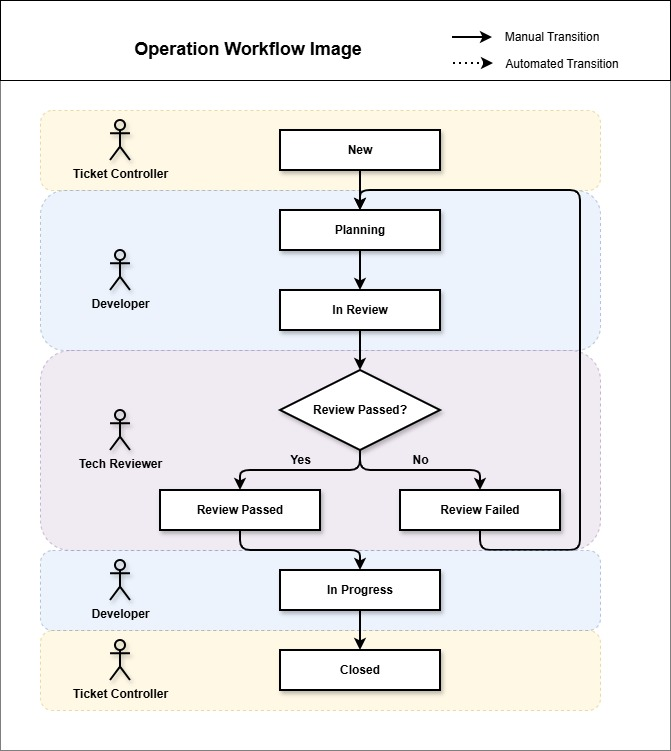

---
## 5. GitHub Project v2 の使い方

### 5.1 ダッシュボードの管理とフィルター

#### 5.1.1 ビュー（タブ）の設定
各トラッカー固有のワークフローを最適化するため、システムには事前設定されたデフォルトのビューが用意されています。ただし、プロジェクトは実際の運用ニーズに合わせてこれらのビューを自由にカスタマイズできます。
さらに、プロジェクトは次の方法で新しいビューを作成できます。
1. **新しいビューの作成:** ダッシュボード上の既存タブの横にある `+` をクリックします。
2. **ビューの名前変更:** タブ名の横にある矢印をクリック -> `Rename`。
3. **レイアウトの選択:**

| レイアウト | 表示形式 | 利用目的 |
| :--- | :--- | :--- |
| **Table** | グリッド形式（Excel/スプレッドシートに類似） | **データ管理・コントロール:** 一括編集、高度なフィルタリング、属性カテゴリ（Tracker、Version、Priority）の管理に適しています。 |
| **Board** | カラム形式（カンバンボード） | **日々の運用:** デイリースクラムに最適。チケットをステータス間でドラッグ＆ドロップして、作業の進捗を視覚的に追跡できます。 |
| **Roadmap** | バー形式（ガントチャート/タイムライン） | **計画立案:** タスクをタイムライン上に表示。長期的な **Epic** や **Milestone** の管理に最適で、重複や期限の監視に役立ちます。 |

4. **Group by:** ツールバーの `Group` をクリックして、**Status**、**Target Version**、**Assignee** ごとにタスクをグループ化します。

#### 5.1.2 フィルタークエリの使用
フィルターバーにコマンドを入力して、目的の内容をフィルタリングできます。

| フィルタリングのニーズ | フィルター構文 |
| :--- | :--- |
| **自分のタスクを表示** | `assignee:@me` |
| **特定のトラッカーでフィルタ** | `label:type:devtask` または `label:type:qabug` |
| **未アサインのタスクをフィルタ** | `no:assignee` |
| **バージョン v1.0 のタスクを表示** | `"Target Version":v1.0` |
| **複数条件の組み合わせ** | `assignee:@me status:"In Progress" label:type:story` |
| **内容を除外** | `-label:type:epic`（Epic 以外をすべて表示） |
| **マイルストーンでフィルタ** | `milestone:"Sprint 15"` |

> **ヒント:** フィルターを入力した後、**Save changes** をクリックして現在のタブにこのフィルターを保存すると、次回から再入力する必要がなくなります。

---
### 5.2 カスタムフィールドの管理（デフォルトのデータフィールド）
以下のフィールドは事前に設定されています。メンバーは、正確なレポートデータを確保するために情報を入力するだけで済みます。

| フィールド名 | データ型 | 意味 |
| :--- | :--- | :--- |
| **Status** | Single select | ワークフロー内でのチケットのステータス。 |
| **Target Version** | Single select | 想定されるリリースバージョン（v1.0、v1.1...）。 |
| **Priority** | Single select | 優先度: *Critical, High, Medium, Low*。 |
| **Estimated time** | Number | 完了までの見積もり時間（単位: 時間）。 |
| **Spent time** | Number | 実際にかかった時間（単位: 時間）。 |
| **Start Date** | Date | タスクの開始日（Roadmap ビューに必須）。 |
| **Due Date** | Date | タスクの期限（Roadmap ビューに必須）。 |
| **Story Point** | Number | 計画やスプリント管理のための、ストーリーポイントによる見積もり工数。 |

### 5.3 新しいチケット / Issue の作成方法
* **場所:** 対応するリポジトリの **Issues** タブに移動するか、Project 画面の「Todo」カラムにある `+ Add Item` ボタンを直接クリックします。
* **タイトルの構成:** `[Tracker] タスクの簡単な名前`。
    * *例:* `[Dev Task] ログイン API の設計`。
* **担当者（Assignee）:** 少なくとも 1 名の主担当者を割り当てる必要があります。

### 5.4 Target Version の作成方法
Project v2 の **Custom Fields** 機能を使用します。
1. Project の `Settings` -> `Fields` -> `New field` に移動します。
2. データ型 `Single select` を選択し、**Target Version** と名付けます。
3. `v1.0`、`v1.1`、`Hotfix_Mar_2026` などのオプションを追加します。

### 5.5 マイルストーンの作成方法
マイルストーンは、スプリントやリリース日などの重要な期限を管理するために使用します。
* **場所:** リポジトリ -> `Issues` タブ -> `Milestones` -> `New milestone` に移動します。
* 作成された各 Issue は、バーンダウンチャートで進捗を追跡するために、特定のマイルストーンに割り当てる必要があります。

### 5.6 チケットとプルリクエスト（PR）の紐付け
プルリクエストによる Issue ステータスの自動遷移機能を有効にするには、PR のタイトルまたは説明に `#[ID Task]` の形式で Issue 識別子を含めてください。
