# GitHub Project Guidelines

| Thông tin | Nội dung |
| :--- | :--- |
| **Version** | 1.0 |
| **Issued Date** | 05/05/2026 |

## 1. User Registration
Để bắt đầu làm việc trên Github Project, các thành viên bắt buộc sử dụng account Github do công ty cung cấp.

## 2. Project Registration
* Cung cấp thông tin vào [form IFU Request Repository](***REMOVED***) để request IFU khởi tạo các Github Repository và Github Project v2.
* Cấu trúc Github của dự án:
   - 01 Github Project:
     + Được copy từ Github Project template, đã được tạo sẵn các config về webhook và các custom fields.
     + Có thể tạo new issue từ bất kì repo nào, nhưng đều được hiển thị trong Github Project của dự án.
   - 01 Repo Management_template: Được copy từ /framgia/management_template, nơi lưu trữ các Issue Template và các Scripts, label,.. đã được chuẩn hóa.
   - Các Repo chứa source code theo yêu cầu của dự án: Repo Backend, Repo Frontend,...
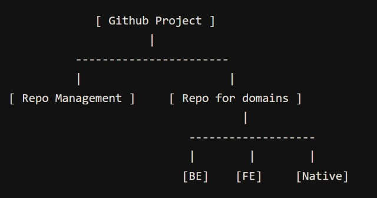
## 3. Trackers (Phân loại Issue)
### 3.1 Danh sách Tracker
Việc phân loại đúng giúp chúng ta lọc dữ liệu và báo cáo tiến độ chính xác. Mỗi Issue trên GitHub cần được gán nhãn `Label` tương ứng:

| Tracker | Category | Intended Issue Issuer | Description | Label on Github |
| :--- | :--- | :--- | :--- | :--- |
| **Epic** | -- | Product Owner | • Phác thảo mục đích kinh doanh. • Có thể viết dưới góc nhìn của người dùng cuối (end-user). | type:epic |
| **Story** | -- | Product Owner | • Các bước của luồng nghiệp vụ (Business flow). • User story. • Từng màn hình (Screen): logic và database tương ứng. • API: Tổng hợp một logic kinh doanh cụ thể. • Thường chứa tiêu chí nghiệm thu (Acceptance criteria).  *Ví dụ: "Người dùng iPhone cần truy cập vào chế độ xem dọc của luồng trực tiếp khi dùng ứng dụng di động."* | type:story |
| **Change Request** | -- | Product Owner | • Thay đổi đặc tả kỹ thuật phát sinh sau khi đã phát triển. • Có khái niệm tương tự như Story. | type:changerequest |
| **UI Design** | Task | PM / Team Lead | • Các đầu việc dành riêng cho Designer. | type:uidesign |
| **Dev Task** | Task | PM / Team Lead | • Các ticket đầu việc cơ bản cho việc lập trình (Frontend/Backend/Native/AI/Infrastructure). | type:devtask, team:frontend  team:backend  team:native-ios  team:native-android  team:native-multiPF  team:ai  team:infrastructure |
| **Test Design** | Task | QA | • Công việc thiết kế các testcase. | type:testdesign |
| **Test Execution** | Task | QA | • Công việc kiểm thử theo testcase hoặc lỗi phát hiện bởi QA trong quá trình test nội bộ. | type:testexecution |
| **QA Bug** | Bug | QA Team | • Lỗi phát hiện bởi QA trong quá trình thực hiện Test Execution. | type:qabug  severity:low  severity:medium  severity:high  severity:critical  testtype:functionaltest  testtype:layouttest  testtype:performancetest  testtype:stresstest  testtype:accesscontrol&securitytest |
| **Feedback** | -- | Product Owner | • Feedback which is found in UAT process.  • If the defect looks a system bug, this ticket should be change to UAT Bug. • Actually, this tracker is a temporary issue pool; In the case, an issuer can't verify whether the unexpected system behavior is a system bug or not. | type:feedback |
| **UAT Bug** | -- | Product Owner / QA | • Lỗi phát hiện trong quá trình nghiệm thu với khách hàng (User Acceptance Testing). | type:uatbug  severity:low  severity:medium  severity:high  severity:critical  testtype:functionaltest  testtype:layouttest  testtype:performancetest  testtype:stresstest  testtype:accesscontrol&securitytest |
| **Production Bug** | -- | Any | • Lỗi nghiêm trọng phát hiện trực tiếp trên môi trường vận hành thực tế (Production). | type:productionbug  severity:low  severity:medium  severity:high  severity:critical |
| **Investigation** | -- | Project Manager / Team Lead / Product Owner | • Technical investigation. e.g. Server log investigation, DB performance check, etc. | type:investigation |
| **Documentation** | Task | PM / Team Lead |• Công việc liên quan đến viết tài liệu, hướng dẫn. | type:documentation |
| **Operation** | Task | PM / Team Lead |• Technical operation. eg.Log rotation, Manual batch execution, etc. | type:operation |

### 3.2 Cấu trúc lưu trữ Issue trên các repo (Tham khảo)
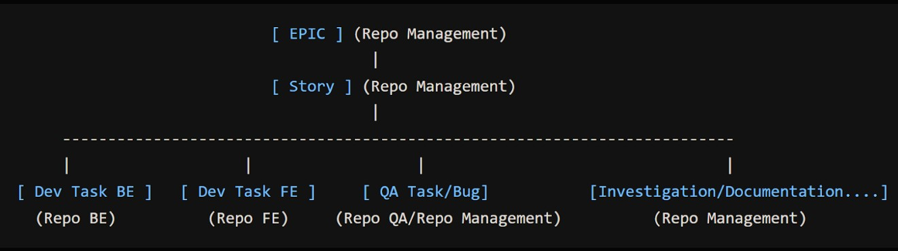
---

## 4. Workflow
### 4.1 Structure
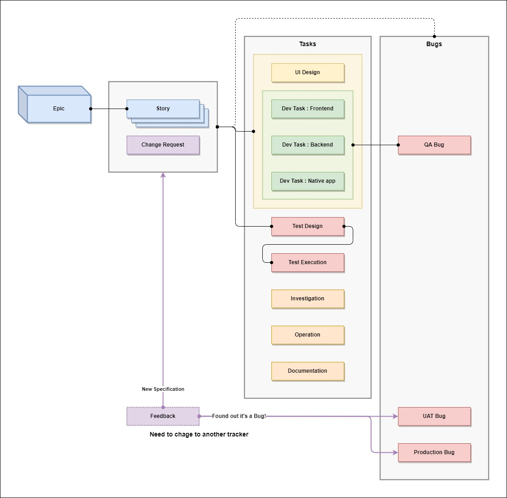

### 4.2 EPIC Workflow
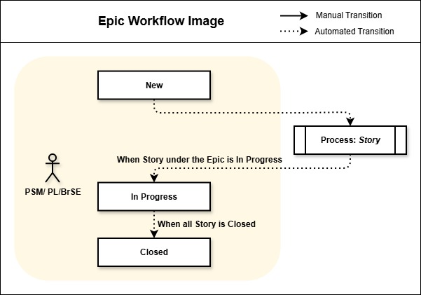

### 4.3 Story Workflow
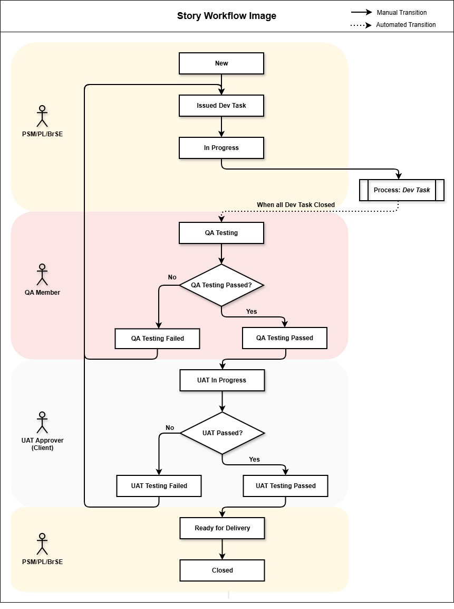

### 4.4 Change Request Workflow
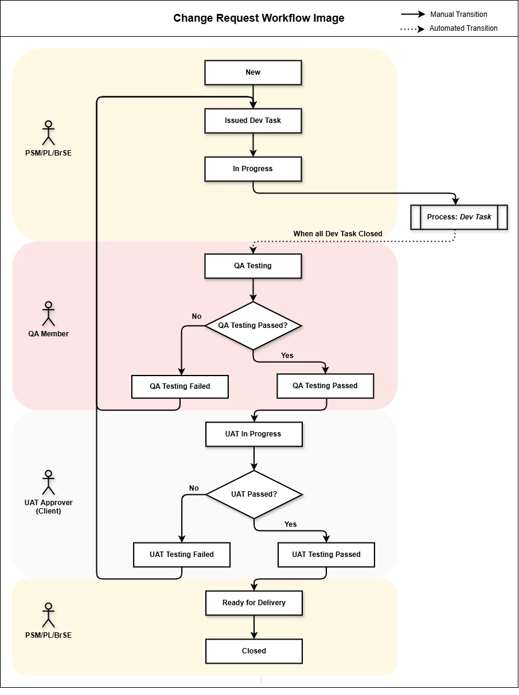

### 4.5 UI Design Workflow
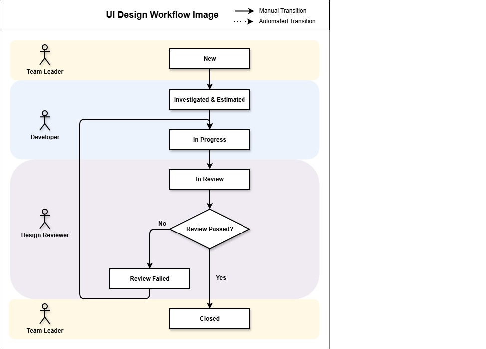

### 4.6 Development Task Workflow
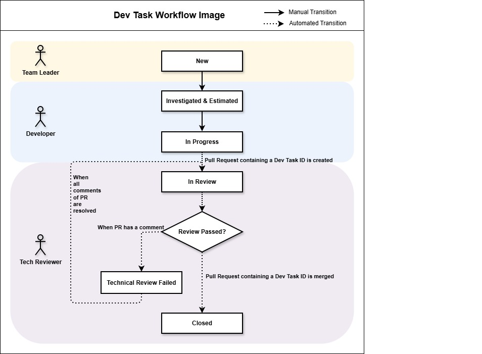

### 4.7 Test Design Workflow
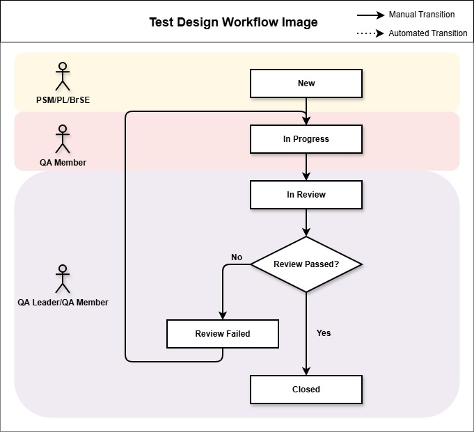

### 4.8 Test Execution Workflow
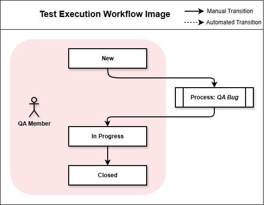

### 4.9 QA Bug Workflow
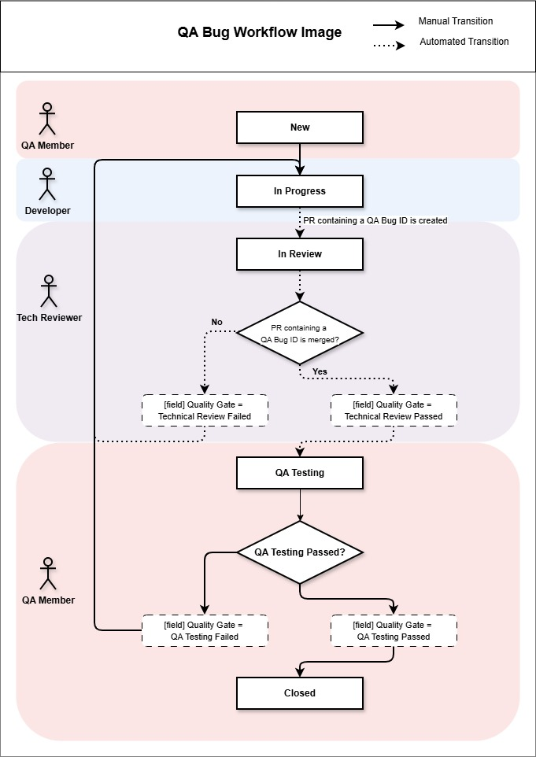

### 4.10 UAT Bug Workflow
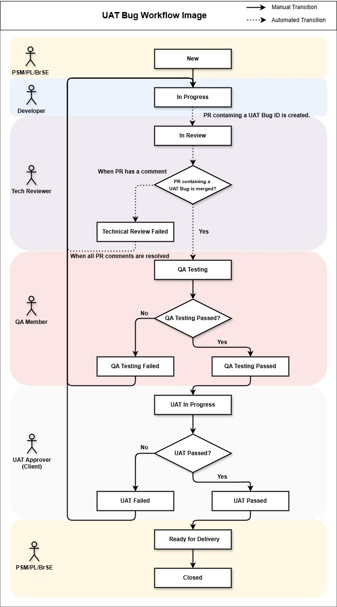

### 4.11 Production Bug Workflow
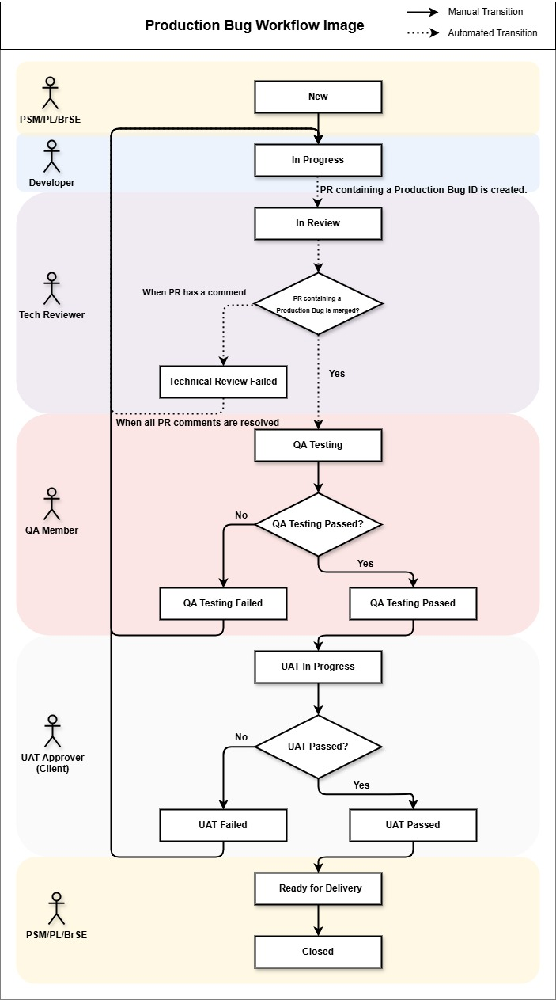

### 4.12 Investigation Workflow
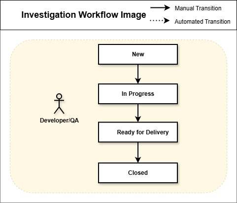

### 4.13 Documentation Workflow
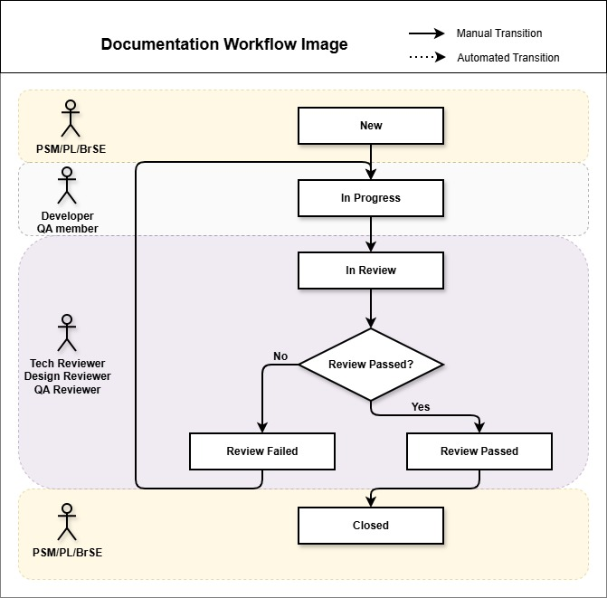

### 4.14 Feedback Workflow
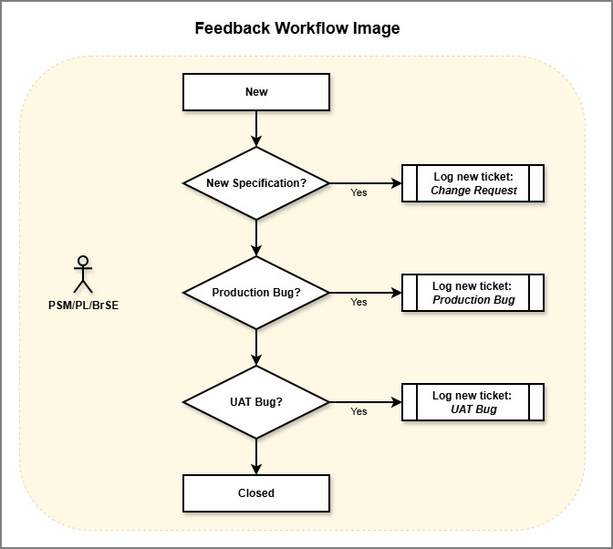

### 4.15 Operation Workflow
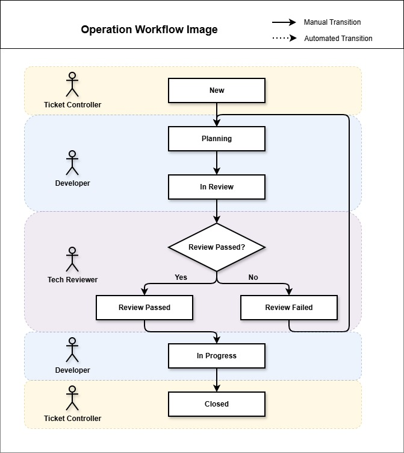

---
## 5. Cách sử dụng GitHub Project V2

### 5.1 Quản lý Dashboard và Filters (Bộ lọc)

#### 5.1.1 Cách thiết lập các View (Tabs)
Nhằm tối ưu hóa luồng công việc (Workflow) riêng biệt của từng Tracker, hệ thống đã thiết lập sẵn các View mặc định. Tuy nhiên, dự án hoàn toàn có thể tùy chỉnh các View này để phù hợp với nhu cầu vận hành thực tế.
Ngoài ra, dự án có thể tạo các View mới bằng cách:
1. **Tạo View mới:** Nhấn dấu `+` bên cạnh các Tab hiện có trên thanh Dashboard.
2. **Đổi tên View:** Nhấn vào mũi tên cạnh tên Tab -> `Rename`.
3. **Chọn Layout:**
   
| Layout | Hình thức hiển thị | Mục đích sử dụng |
| :--- | :--- | :--- |
| **Table** | Dạng bảng (giống Excel/Spreadsheet) | **Quản lý & Kiểm soát dữ liệu:** Phù hợp để chỉnh sửa hàng loạt (Bulk edit), lọc dữ liệu chuyên sâu và quản lý danh mục thuộc tính (Tracker, Version, Priority). |
| **Board** | Dạng cột (Kanban Board) | **Vận hành hằng ngày:** Phù hợp cho các buổi Daily Scrum. Giúp Team theo dõi trực quan luồng công việc thông qua việc kéo thả ticket giữa các trạng thái (Status). |
| **Roadmap** | Dạng thanh (Gantt Chart/Timeline) | **Lập kế hoạch:** Hiển thị task trên trục thời gian. Thích hợp để quản lý các **Epic** hoặc **Milestone** dài hạn, giúp theo dõi sự chồng chéo và thời hạn hoàn thành. |

4. **Group by:** Nhấn `Group` trên thanh công cụ để nhóm task theo **Status**, **Target Version** hoặc **Assignee**.

#### 5.1.2 Cách sử dụng Filter Query (Lọc nội dung)
Tại ô tìm kiếm (Filter bar), bạn có thể gõ các câu lệnh sau để lọc nội dung mong muốn:

| Nhu cầu lọc | Cú pháp Filter |
| :--- | :--- |
| **Xem task của riêng mình** | `assignee:@me` |
| **Lọc theo Tracker cụ thể** | `label:type:devtask` hoặc `label:type:qabug` |
| **Lọc task chưa có người làm** | `no:assignee` |
| **Xem task thuộc Version v1.0** | `"Target Version":v1.0` |
| **Kết hợp nhiều điều kiện** | `assignee:@me status:"In Progress" label:type:story` |
| **Loại trừ nội dung** | `-label:type:epic` (Hiển thị mọi thứ trừ Epic) |
| **Lọc theo Milestone** | `milestone:"Sprint 15"` |

> **Mẹo:** Sau khi gõ Filter xong, hãy nhấn **Save changes** để lưu bộ lọc này vào Tab hiện tại, giúp lần sau truy cập không cần gõ lại.

---
### 5.2 Quản lý Custom Fields (Các trường dữ liệu mặc định)
Các trường sau đã được setting sẵn, thành viên chỉ cần điền thông tin để đảm bảo dữ liệu báo cáo chính xác:

| Field Name | Loại dữ liệu | Ý nghĩa |
| :--- | :--- | :--- |
| **Status** | Single select | Trạng thái ticket trong quy trình (Workflow). |
| **Target Version** | Single select | Phiên bản dự kiến Release (v1.0, v1.1...). |
| **Priority** | Single select | Mức độ ưu tiên: *Critical, High, Medium, Low*. |
| **Estimated time** | Number | Thời gian dự kiến hoàn thành (đơn vị: h). |
| **Spent time** | Number | Thời gian thực tế đã bỏ ra (đơn vị: h). |
| **Start Date** | Date | Ngày bắt đầu thực hiện (Yêu cầu cho view Roadmap). |
| **Due Date** | Date | Ngày hạn chót (Yêu cầu cho view Roadmap). |
| **Story Point** | Number | Điểm ước lượng công sức cho việc lập kế hoạch và quản lý Sprint. |

### 5.3 Cách tạo mới ticket / issue
* **Vị trí:** Vào tab **Issues** trong Repository tương ứng hoặc nhấn nút `+ Add Item` trực tiếp tại cột "Todo" trên giao diện Project.
* **Cấu trúc tiêu đề:** `[Tracker] Tên công việc ngắn gọn`.
    * *Ví dụ:* `[Dev Task] Thiết kế API Login`.
* **Assignee:** Bắt buộc gán ít nhất một người chịu trách nhiệm chính.

### 5.4 Cách tạo Target Version
Sử dụng tính năng **Custom Fields** trong Project V2:
1. Truy cập vào `Settings` của Project -> `Fields` -> `New field`.
2. Chọn kiểu dữ liệu là `Single select` và đặt tên là **Target Version**.
3. Thêm các option như: `v1.0`, `v1.1`, `Hotfix_Mar_2026`.

### 5.5 Cách tạo Milestones
Milestone dùng để quản lý các mốc thời gian (Deadline) quan trọng như Sprint hoặc ngày Release.
* **Vị trí:** Truy cập Repository -> Tab `Issues` -> `Milestones` -> `New milestone`.
* Mỗi Issue khi tạo xong phải được gán vào một Milestone cụ thể để theo dõi tiến độ trên biểu đồ Burn-down.

### 5.6 Liên kết ticket với Pull Request (PR)
Để kích hoạt tính năng tự động chuyển đổi trạng thái Issue thông qua Pull Request, hãy điền mã định danh Issue vào tiêu đề hoặc nội dung mô tả của PR bằng cấu trúc #[ID Task].

