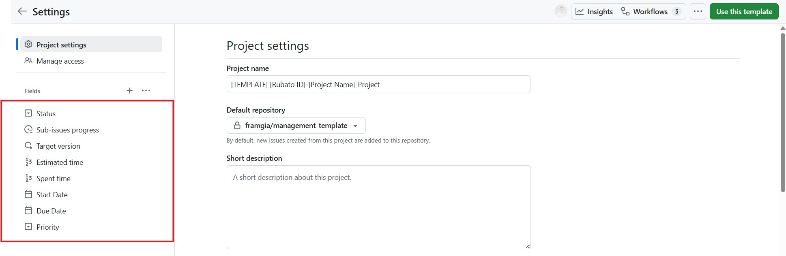
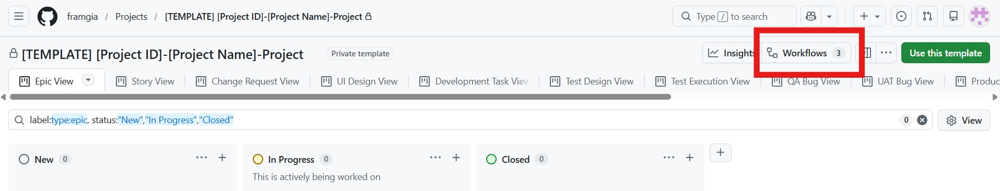
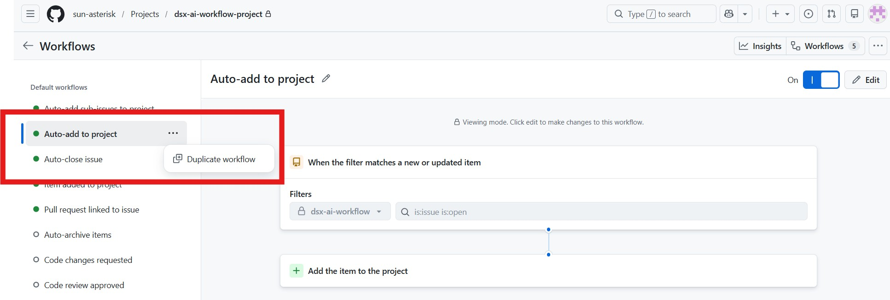
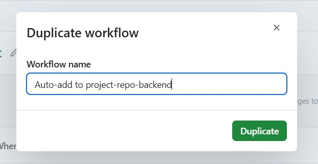

# Github Project Guidelines

| Information | Details |
| :--- | :--- |
| **Version** | 1.0 |
| **Issued Date** | 01/06/2026 |

# Github Project Guideline (External - Customer Side)

This document provides instructions for setting up a GitHub Project and configuring Repositories when the project uses the Customer's GitHub infrastructure.

---

## 1. For the Customer

*The Customer performs the steps that require Organization Admin privileges.*

### 1.1 Github Authorization (PL OAuth)
* [Guideline](https://kpi-insight.sun-asterisk.vn/docs/screens/settings/github-authorization)

### 1.2 Initialize a Github Project from Template
When creating a new Project from scratch:
1. Navigate to the **Projects** section of the Customer's Organization.
2. Select **New Project** -> **Link a template**.
3. Use Sun*'s public Template link: [https://github.com/orgs/framgia/projects/148](https://github.com/orgs/framgia/projects/148) to pull the standard configuration.

---

## 2. For the Project Leader (PL)

*If the Customer has already created a Project, the PL needs to be granted **Admin** permission on the Project to perform the following steps. Otherwise, the PL should guide the Customer to do so.*

### 2.1 Configure Custom Fields
Set up custom data fields aligned with the standard template at: [Sun* Project Template #148](https://github.com/orgs/framgia/projects/148).



List of Custom Fields to configure:

| No. | Fields Name | Fields Type |
| :--- | :--- | :--- |
| 1 | Status | Single select |
| 2 | Sub-issues progress *(default field of Github Project)* | Sub-issues progress |
| 3 | Target version | Iteration |
| 4 | Estimated time | Number |
| 5 | Spent time | Number |
| 6 | Start Date | Date |
| 7 | Due Date | Date |
| 8 | Priority | Single select |

> **NOTE:** These fields must be configured manually.

### 2.2 Configure Workflows
* Navigate to: `https://github.com/orgs/[CUSTOMER_ORG]/projects/[PROJECT_ID]/workflows`.
  - Click Workflow at the top right of the screen.

  

  - Select the workflow named exactly "Auto-add to project", click the ... button, then select Duplicate Workflow.

 

  - Duplicate this workflow to match the number of platform repos in the project. E.g., if the project has 1 Backend repo and 1 Frontend repo => Duplicate 2 additional workflows for Backend and Frontend, and update the name to match each repo accordingly.

 

### 2.3 Set Up Views
* Proactively create and configure Views (Tabs) in **Kanban** (Board) or **Table** format based on management needs, following the Project Template as a reference.

---

## 3. Project Repository Configuration

*Applies to all Repos in the project (Frontend, Backend, Mobile, etc.).*

### 3.1 Update Standard Files from Template
The project should pull/copy the management resources from [management_template](https://github.com/framgia/management_template) into the current Repos:
* **Required:**
    * Directory `.github/ISSUE_TEMPLATE`: Contains standard ticket templates (Epic, Story, Bug...).
    * Directory `.github/workflows`: Automation scripts at the Repo level.
* **Optional:**
    * Directory `scripts/`.
    * File `.github/pull_request_template.md`: PR description template.

### 3.2 Synchronize Labels
To ensure Filters and Dashboards work correctly, the PL or Dev needs to sync the standard label set:
1. Navigate to the directory containing the script in the repo.
2. Run the following command for each Repo in the project:
   ```bash
   ./scripts/setup-labels.sh --repo [CUSTOMER_ORG]/[REPO_NAME]
