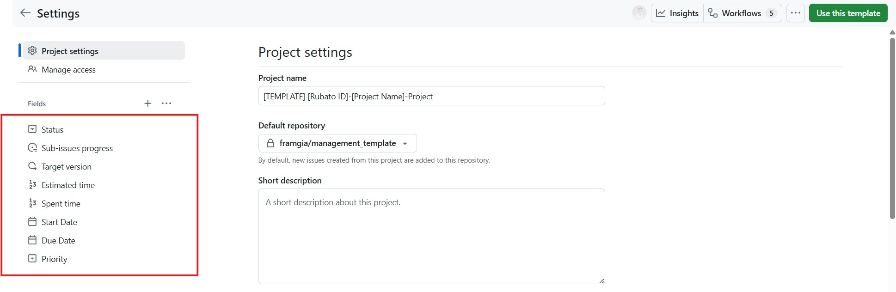
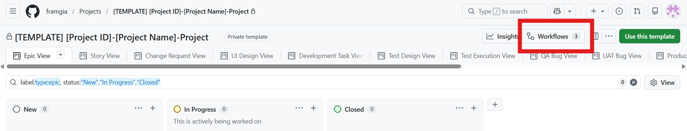
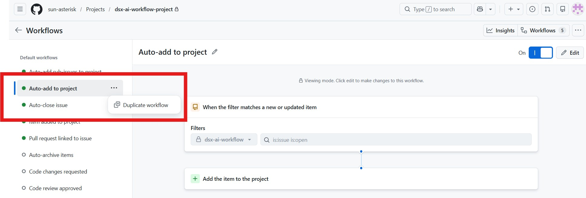
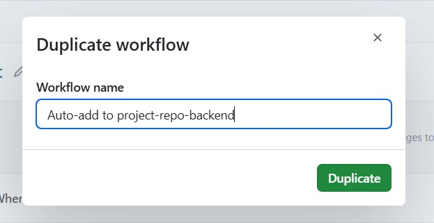

# Github プロジェクト ガイドライン

| 項目 | 詳細 |
| :--- | :--- |
| **バージョン** | 1.0 |
| **発行日** | 2026/06/01 |

# Github プロジェクト ガイドライン（外部 - 顧客側）

本ドキュメントは、プロジェクトが顧客の GitHub インフラを使用する場合に、GitHub Project をセットアップしリポジトリを構成するための手順を説明します。

---

## 1. 顧客向け

*顧客は、Organization の Admin 権限を必要とする手順を実施します。*

### 1.1 Github 認可（PL OAuth）
* [ガイドライン](https://kpi-insight.sun-asterisk.vn/docs/screens/settings/github-authorization)

### 1.2 テンプレートから Github Project を初期化する
新規に Project をゼロから作成する場合:
1. 顧客の Organization の **Projects** セクションに移動します。
2. **New Project** -> **Link a template** を選択します。
3. Sun* の公開テンプレートリンク [https://github.com/orgs/framgia/projects/148](https://github.com/orgs/framgia/projects/148) を使用して、標準構成を取り込みます。

---

## 2. プロジェクトリーダー（PL）向け

*顧客がすでに Project を作成している場合、PL は以下の手順を実施するために Project の **Admin** 権限を付与される必要があります。そうでない場合は、PL が顧客に手順を案内してください。*

### 2.1 カスタムフィールドの設定
次の標準テンプレートに合わせてカスタムデータフィールドを設定します: [Sun* Project Template #148](https://github.com/orgs/framgia/projects/148)。



設定するカスタムフィールドの一覧:

| No. | フィールド名 | フィールド型 |
| :--- | :--- | :--- |
| 1 | Status | Single select |
| 2 | Sub-issues progress *(Github Project のデフォルトフィールド)* | Sub-issues progress |
| 3 | Target version | Iteration |
| 4 | Estimated time | Number |
| 5 | Spent time | Number |
| 6 | Start Date | Date |
| 7 | Due Date | Date |
| 8 | Priority | Single select |

> **注意:** これらのフィールドは手動で設定する必要があります。

### 2.2 ワークフローの設定
* 次に移動します: `https://github.com/orgs/[CUSTOMER_ORG]/projects/[PROJECT_ID]/workflows`。
  - 画面右上の Workflow をクリックします。

  

  - 名前が正確に "Auto-add to project" であるワークフローを選択し、... ボタンをクリックして Duplicate Workflow を選択します。

 

  - プロジェクト内のプラットフォームリポジトリの数に合わせて、このワークフローを複製します。例: プロジェクトに Backend リポジトリ 1 つと Frontend リポジトリ 1 つがある場合 => Backend 用と Frontend 用に 2 つのワークフローを追加で複製し、名前を各リポジトリに合わせて更新します。

 

### 2.3 ビューの設定
* 管理ニーズに基づき、Project Template を参考にしながら、**Kanban**（Board）または **Table** 形式のビュー（タブ）を主体的に作成・設定します。

---

## 3. プロジェクトリポジトリの構成

*プロジェクト内のすべてのリポジトリ（Frontend、Backend、Mobile など）に適用されます。*

### 3.1 テンプレートから標準ファイルを更新する
プロジェクトは、[management_template](https://github.com/framgia/management_template) から管理リソースを現在のリポジトリに取り込む（pull/copy する）必要があります。
* **必須:**
    * `.github/ISSUE_TEMPLATE` ディレクトリ: 標準のチケットテンプレート（Epic、Story、Bug...）を含みます。
    * `.github/workflows` ディレクトリ: リポジトリレベルの自動化スクリプト。
* **任意（オプション）:**
    * `scripts/` ディレクトリ。
    * `.github/pull_request_template.md` ファイル: PR の説明テンプレート。

### 3.2 ラベルの同期
フィルターとダッシュボードが正しく機能するように、PL または Dev は標準のラベルセットを同期する必要があります。
1. リポジトリ内のスクリプトを含むディレクトリに移動します。
2. プロジェクトの各リポジトリに対して、次のコマンドを実行します。
   ```bash
   ./scripts/setup-labels.sh --repo [CUSTOMER_ORG]/[REPO_NAME]
