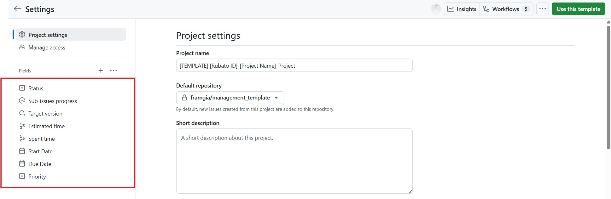
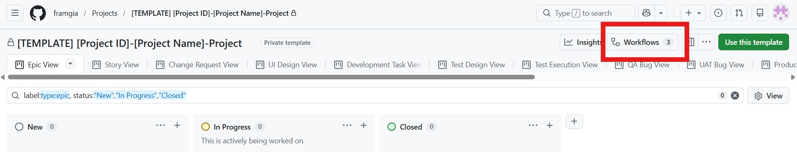
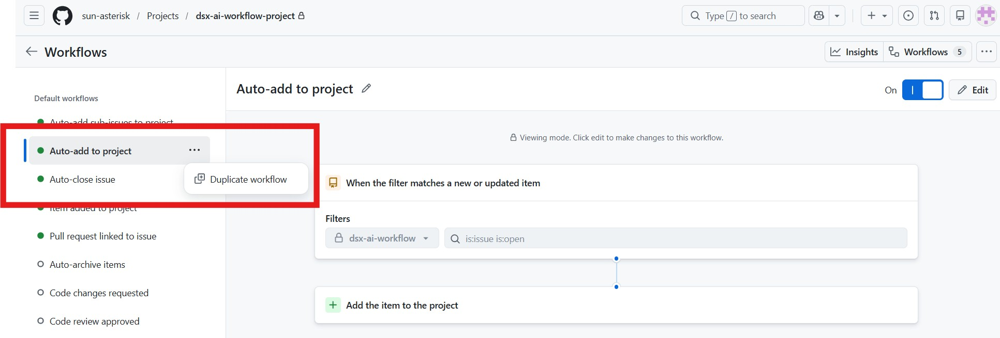
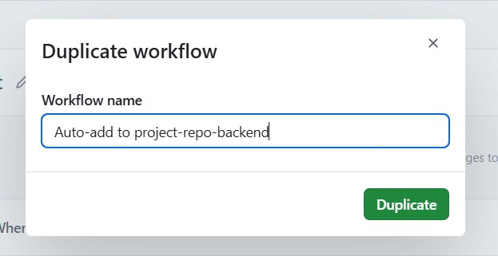

# Github Project Guidelines

| Thông tin | Nội dung |
| :--- | :--- |
| **Version** | 1.0 |
| **Issued Date** | 01/06/2026 |

# Github Project Guideline (External - Customer Side)

Tài liệu này hướng dẫn quy trình thiết lập GitHub Project và cấu hình Repository khi dự án sử dụng hạ tầng GitHub của Khách hàng.

---

## 1. Dành cho Khách hàng (Customer)
*Khách hàng thực hiện các bước yêu cầu quyền Admin Organization.*

### 1.1 Github Authorization (PL OAuth)
* [Guideline](https://kpi-insight.sun-asterisk.vn/docs/screens/settings/github-authorization)

### 1.2 Khởi tạo Github Project từ Template
Trong trường hợp tạo Project mới từ đầu:
1. Truy cập vào mục **Projects** của Organization phía Khách hàng.
2. Chọn **New Project** -> **Link a template**.
3. Sử dụng đường dẫn Template công khai của Sun*: [https://github.com/orgs/framgia/projects/148](https://github.com/orgs/framgia/projects/148) để kéo cấu hình chuẩn về.

---

## 2. Dành cho Project Leader (PL)
*Nếu Khách hàng đã tạo Project trước đó, PL cần được cấp quyền **Admin** trên Project để thực hiện các bước sau. Nếu không, PL hướng dẫn Khách hàng thực hiện.*

### 2.1 Cấu hình Custom Fields
Thiết lập các trường dữ liệu tùy chỉnh đồng nhất với mẫu chuẩn tại: [Sun* Project Template #148](https://github.com/orgs/framgia/projects/148).



Danh sách các Custom Fields cần thiết lập:

| No. | Fields Name | Fields Type |
| :--- | :--- | :--- |
| 1 | Status | Single select |
| 2 | Sub-issues progress *(trường mặc định của Github Project)* | Sub-issues progress |
| 3 | Target version | Iteration |
| 4 | Estimated time | Number |
| 5 | Spent time | Number |
| 6 | Start Date | Date |
| 7 | Due Date | Date |
| 8 | Priority | Single select |

> **NOTE:** Trường này cần làm thủ công.

### 2.2 Cấu hình Workflows
* Truy cập: `https://github.com/orgs/[CUSTOMER_ORG]/projects/[PROJECT_ID]/workflows`.
  - Click Workflow ở phía trên bên phải màn hình.

  

  - Chọn chính xác workflow có tên là "Auto-add to project", click vào nút ..., chọn Duplicate Workflow

 

  - Duplicate workflow này tương ứng với số lượng repo platform của dự án. Eg: Dự án có 1 repo Backend, 1 repo Frontent => Duplicate thêm 2 workflow cho Backend và Frontend, và update tên tương ứng với repo đó.

 

### 2.3 Thiết lập giao diện (Views)
* Chủ động tạo và cấu hình các View (Tab) theo dạng **Kanban** (Board) hoặc **Table** tùy theo nhu cầu quản trị, dựa trên mẫu Project Template.

---

## 3. Cấu hình Repository dự án
*Áp dụng cho tất cả các Repo thuộc dự án (Frontend, Backend, Mobile...).*

### 3.1 Cập nhật Standard Files từ Template
Dự án thực hiện kéo (pull/copy) các tài nguyên quản lý từ [management_template](https://github.com/framgia/management_template) về các Repo hiện tại:
* **Bắt buộc:**
    * Thư mục `.github/ISSUE_TEMPLATE`: Chứa các mẫu ticket chuẩn (Epic, Story, Bug...).
    * Thư mục `.github/workflows`: Các script tự động hóa mức Repo.
* **Tùy chọn (Optional):**
    * Thư mục `scripts/`.
    * File `.github/pull_request_template.md`: Mẫu mô tả khi tạo PR.

### 3.2 Thiết lập Labels đồng bộ
Để đảm bảo các bộ lọc (Filter) và Dashboard hoạt động chính xác, PL hoặc Dev cần đồng bộ bộ nhãn chuẩn:
1. Truy cập vào thư mục chứa script trong repo.
2. Chạy lệnh sau cho từng Repo của dự án:
   ```bash
   ./scripts/setup-labels.sh --repo [CUSTOMER_ORG]/[REPO_NAME]


