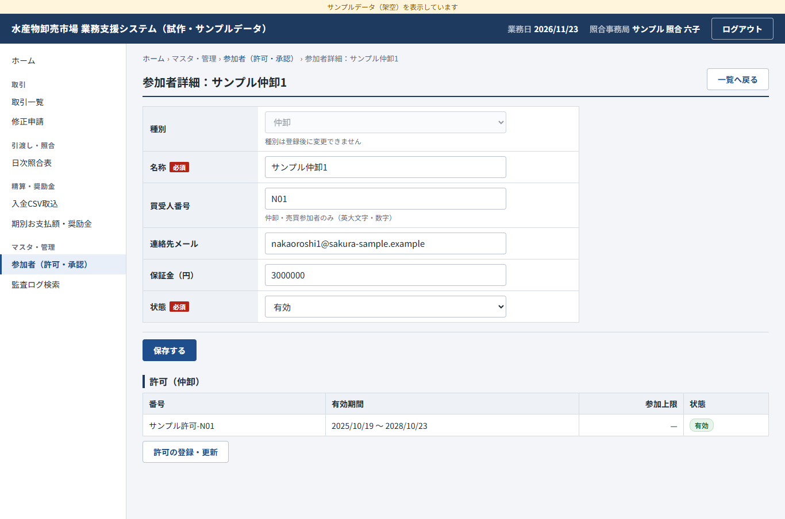
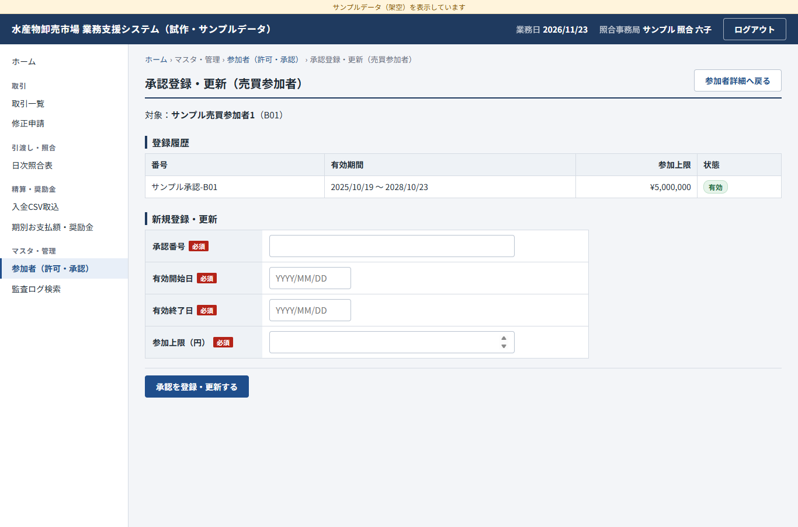

# SC-01-02 参加者詳細・編集 — wireframe

| Mục | Nội dung |
|---|---|
| Vai trò màn | **Quản lý** (manage) hồ sơ một người tham gia + nhìn tư cách pháp lý |
| Vai ghi | SETTLE, STL-HEAD (P01–P03). Đọc: OPS-HEAD (閲). Vai khác: C-25 |
| Thiết bị | PC |
| Điểm cốt lõi | **許可 (仲卸 — giấy phép có xét duyệt) và 承認 (売買参加者 — chấp thuận, thủ tục nhẹ) là hai khối riêng**: trường, trạng thái, thao tác, căn cứ khác nhau (L4-D02, luật 2, S5). Không có khối chung "取引資格" |

## 1. Prototype (as-is)

| 仲卸 | 売買参加者 — màn 承認 |
|---|---|
|  |  |

Ảnh phụ: `assets/SC-01-02_prototype-baibai.png`, `assets/SC-01-03_prototype-nakaoroshi-permits.png`. Prototype: form hồ sơ + một bảng tư cách theo loại, bảng 許可 vẫn có cột 「参加上限」 để trống (—); 保証金 sửa đè; 状態 là ô chọn sửa trực tiếp.

## 2. Wireframe to-be

```
[C-9] 参加者詳細：サンプル仲卸1                                     [C-10] 一覧へ戻る
┌─ [1] 基本情報 ─────────────────────────────────────────────────────────────────┐
│ [2] 種別      仲卸（登録後変更不可）           [3] 参加者状態  有効  ※変更は [17]      │
│ [4] 名称      [ サンプル仲卸1          ]        [5] 買受人番号  [ N01 ]                 │
│ [6] 通知メール1 [ …@sakura-sample.example ]   [7] 通知メール2 [            ]（最大2件） │
│ [8] 保証金額   ¥3,000,000   [9] 保証金の変更（履歴に追加）  [10] 履歴を見る ▼           │
│ [11] [ 保存する ]                                                                │
└─────────────────────────────────────────────────────────────────────────────┘

── 種別 = 仲卸 のときだけ表示 ───────────────────────────────────────────────
┌─ [12] 許可（仲卸）─ 根拠: 市場業務規程（許可・審査あり） ──────────────────────────┐
│ [13] 許可番号  有効期間                 状態        失効まで                          │
│      サンプル許可-N01 2025/10/19〜2028/10/23  有効     698日                         │
│      （履歴: 更新前の許可は「更新済」で残る）                                       │
│ [14] [ 許可の登録・更新 → SC-01-03 ]                                               │
└──────────────────────────────────────────────────────────────────────────────┘

── 種別 = 売買参加者 のときだけ表示 ─────────────────────────────────────────
┌─ [15] 承認（売買参加者）─ 根拠: 市場業務規程（承認・届出） ────────────────────────┐
│ [16] 承認番号  有効期間                 参加上限      今期使用額 / 残     状態          │
│      サンプル承認-B01 2025/10/19〜2028/10/23 ¥5,000,000  ¥1,200,000 / ¥3,800,000 有効 │
│      （参加上限の既定値 = 保証金額。変更は理由必須）                                    │
│ [18] [ 承認の登録・更新・参加上限 → SC-01-04 ]                                      │
└──────────────────────────────────────────────────────────────────────────────┘

┌─ [17] 資格状態（一時停止・再審査・期限前更新）──────────────────────────────────────┐
│ 現在: 有効   [ 一時停止を起案 ] [ 期限前更新を入力 ]  → SC-01-05（決裁は運用部門長, MFA） │
│ [19] 進行中: 「一時停止 起案中（決裁待ち）」(C-27)                                   │
└──────────────────────────────────────────────────────────────────────────────┘
[20] 変更履歴（監査）→ SC-13-01 で絞込み表示
```

## 3. Item

| No | Item | Loại | Bắt buộc | Quy tắc | Vai thấy / sửa | Nguồn |
|---|---|---|---|---|---|---|
| 1 | Khối 基本情報 | Vùng | — | | Đọc: SETTLE, STL-HEAD, OPS-HEAD | FT-01-01 |
| 2 | 種別 | Nhãn | — | 4 loại (卸売業者 / 仲卸 / 売買参加者 / 買出人); khóa sau đăng ký | — | TBL-ACTOR-01 |
| 3 | 参加者状態 | Nhãn | — | 有効 / 一時停止 / 失効 / 再審査中; **không sửa ở đây** — chỉ qua [17] | — | FT-01-04, PRM-121 |
| 4 | 名称 | Văn bản | ✓ | 1–100 ký tự | Sửa: SETTLE, STL-HEAD | — |
| 5 | 買受人番号 | Văn bản | ✓ với 仲卸 / 売買参加者 | `^[A-Z0-9]{1,10}$`, duy nhất | như trên | TBL-ACTOR-01 |
| 6–7 | 通知メール 1, 2 | Email | — | Tối đa 2; đổi theo giấy yêu cầu, có lịch sử | như trên | L4-A08 |
| 8 | 保証金額 | Nhãn | — | Giá trị hiện hành | — | PRM-046 |
| 9 | Đổi 保証金 | Nút → hộp thoại | — | Số mới + ngày hiệu lực + lý do; **thêm dòng lịch sử, không sửa đè** | Sửa: SETTLE, STL-HEAD | luật 4, D14 |
| 10 | Lịch sử 保証金 | Bảng gập | — | | Đọc | D14 |
| 11 | 保存する | Nút | — | Ghi audit before/after | SETTLE, STL-HEAD | FR-AUDIT-01 |
| 12 | **Khối 許可** | Vùng | — | **Chỉ hiện khi 種別 = 仲卸.** Không có cột 参加上限 | Đọc: SETTLE, STL-HEAD, OPS-HEAD | 02-08, S5 |
| 13 | Bảng 許可 | Bảng | — | Số, hiệu lực, trạng thái, số ngày tới 失効; bản cũ giữ nhãn 「更新済」 | — | FT-01-02 |
| 14 | 許可の登録・更新 | Nút | — | → SC-01-03 | SETTLE, STL-HEAD | P02 |
| 15 | **Khối 承認** | Vùng | — | **Chỉ hiện khi 種別 = 売買参加者** | Đọc như [12] | 02-08, S5 |
| 16 | Bảng 承認 + 参加上限 | Bảng | — | 参加上限 mặc định = 保証金額; **今期使用額 / 残** tính theo kỳ, chung 相対 + せり | — | PRM-046, L4-A04 |
| 17 | Khối trạng thái tư cách | Vùng + nút | — | 一時停止 / 再審査 = 起案 (STL-HEAD) → 決裁 (OPS-HEAD, MFA); 期限前更新 = SETTLE nhập + STL-HEAD 確認, **không qua 再審査**; chữ dùng 「決裁」「確認」, không 「承認」 | Nút theo vai | FT-01-04, PRM-121, S6 |
| 18 | 承認の登録・更新 | Nút | — | → SC-01-04 | SETTLE, STL-HEAD | P03 |
| 19 | Yêu cầu đang chờ | Nhãn | — | C-27 | Đọc | — |
| 20 | Lịch sử audit | Liên kết | — | → SC-13-01 lọc theo người tham gia | SETTLE, STL-HEAD | FR-AUDIT-01 |

## 4. Trạng thái

| Trạng thái | Hiển thị |
|---|---|
| 仲卸 chưa có 許可 | [13] C-21: 「許可が登録されていません。取引の確定はできません」 + [14] |
| 売買参加者 chưa có 承認 | [16] C-21 tương tự + [18] |
| 卸売業者 / 買出人 | Không có [12], [15]; câu 「この種別は許可・承認の対象外です」 |
| 失効まで ≤ 30 ngày | Nhãn vàng ở [13] / [16] (cùng ngưỡng với SC-04-01) |
| 一時停止 / 失効 | [3] đỏ + chữ; [14] / [18] vẫn dùng được để gia hạn theo đúng thủ tục |
| Đang chờ 決裁 | [19] C-27; nút [17] ẩn tới khi xong |
| Lỗi 買受人番号 trùng | C-22 dưới [5] |

## 5. Khác biệt theo vai

| Vai | [4]–[11] | [12]–[16] | [17] |
|---|---|---|---|
| SETTLE | Sửa | Đọc + nút [14] / [18] | 「期限前更新を入力」 |
| STL-HEAD | Sửa | Đọc + nút | 「一時停止を起案」, 「期限前更新を確認」 (MFA) |
| OPS-HEAD | Đọc | Đọc | 「決裁」 (MFA) khi có yêu cầu chờ |
| Khác | C-25 | | |

## 6. To-be khác prototype

| # | Prototype | To-be | Nguồn |
|---|---|---|---|
| 1 | Bảng 許可 có cột 参加上限 (trống) | Bỏ cột ở khối 許可; 参加上限 chỉ ở khối 承認 | luật 2, S5 |
| 2 | 状態 là ô chọn sửa thẳng | Chỉ đổi qua [17] với 起案 → 決裁 + MFA | FT-01-04, D13 |
| 3 | 保証金 sửa đè | Lịch sử thêm dòng | D14 |
| 4 | Một email | Tối đa 2 email | L4-A08 |
| 5 | Không có 今期使用額 / 残 | Có, theo kỳ | M19 |

## History of change

| No | Version | Action | Nội dung thay đổi | Ngày | Người sửa | Approve |
|---|---|---|---|---|---|---|
| 1 | 0.1.0 | Add new | Bản đầu | 2026-11-25 | phuongnnm-23344 | |
