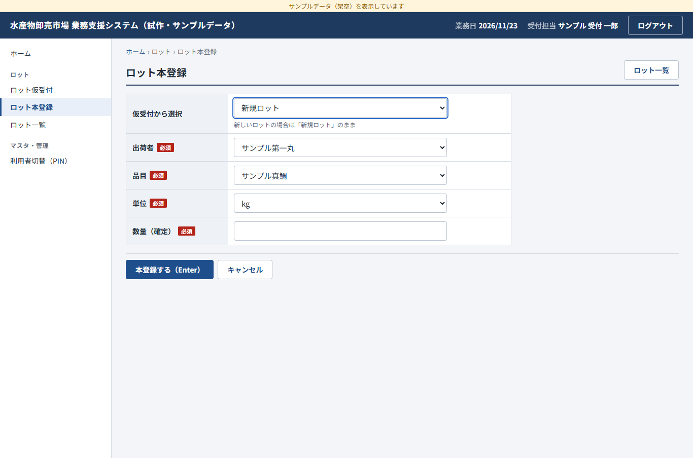

# SC-03-01 ロット本登録（受付台・PC）— wireframe

| Mục | Nội dung |
|---|---|
| Vai trò màn | **Nhập** — bước 2 của tiếp nhận lô (~04:00): bổ sung lô 仮受付 thành lô chính thức |
| Vai ghi | INTAKE. Đọc: SETTLE, STL-HEAD, OPS-HEAD qua SC-03-03 / SC-03-04 (P13) |
| Thiết bị | PC + テンキー; nhập liên tiếp, ở lại form sau khi lưu (DEC-033) |

## 1. Prototype (as-is)



`/lots/new`, intake@. Có: chọn từ 仮受付 hoặc 新規, 出荷者 / 品目 / 単位 bằng ô chọn, 数量, 本登録する（Enter）.

## 2. Wireframe to-be

```
┌─ [1] 仮受付待ち（3件）────────────────────────────────┐  ┌─ [11] 本日登録済（直近10件）──────┐
│ 仮番号  受付時刻 品目    数量(初回)  受付者              │  │ ロット番号    品目  数量  出荷者  │
│ ▶ K-012  01:42  真鯛    120kg    桜 一郎   [選択]      │  │ L20270802-14 鰹  80kg  S0021   │
│   K-013  01:55  鰹      80kg     桜 一郎              │  │ …                              │
│   (未同期の仮受付があります 2件 → [12]) (C-28/C-29)      │  └───────────────────────────────┘
└──────────────────────────────────────────────────┘
┌─ [2] 本登録 ─────────────────────────────────────────┐
│ [3] 業務日      2027/08/02(月)（01:00以降の受付は当日扱い）│
│ [4] 出荷者コード [ 0021 ] → サンプル第一丸（候補表示）     │
│ [5] 品目        [ 真鯛 ▼ ]（仮受付の値、変更可）         │
│ [6] 単位        [ kg ▼ ]  kg / 箱 / 尾                │
│ [7] 数量（確定）  [ 118.50 ]  仮受付 120kg との差 −1.5kg │
│ [8] 証憑        紙伝票番号 [        ]（スキャン添付はPC）│
│ [9] [ 本登録する（Enter） ] [10] クリア（Esc）           │
└──────────────────────────────────────────────────┘
 確定後: C-12 「本登録：L20270802-15 真鯛 118.5kg（サンプル第一丸）」、カーソルは [1] の次の行
 [13] 重複疑い: 同じ出荷者・品目・数量が10分以内 →「重複の可能性があります。登録しますか？」
```

## 3. Item

| No | Item | Loại | Bắt buộc | Quy tắc | Nguồn |
|---|---|---|---|---|---|
| 1 | Danh sách 仮受付待ち | Bảng chọn | — | Lô PROVISIONAL của 業務日; ↑↓ + Enter để chọn; 「新規ロット」 ở dòng đầu | FT-03-01 |
| 2 | Khối 本登録 | Vùng | — | | — |
| 3 | 業務日 | Nhãn | — | Lô nhận từ 01:00 gắn vào 業務日 sáng đó (giờ là **tham số quy chế có version**) | PRM-116, E-16, PREMISE §3.1 |
| 4 | 出荷者コード | Mã + gợi ý | ✓ | Mã trong master SC-10-07 (không text tự do) | FT-10-06, D15 |
| 5 | 品目 | Chọn | ✓ | Master 品目 | FT-10-06 |
| 6 | 単位 | Chọn | ✓ | kg / 箱 / 尾 | FB LAB-2 #5 |
| 7 | 数量（確定） | Số | ✓ | > 0, 2 số lẻ; hiện chênh lệch so với 仮受付 | BR-LOT-02 |
| 8 | 紙伝票番号 | Văn bản | — | ≤ 20 ký tự; ảnh chứng từ chỉ scan ở PC (第1期 không chụp ở bến) | E-21, M11 |
| 9 | 本登録する | Nút | — | Sinh mã lô chính thức + dòng sổ SL 「受入」 | FR-LOT-01 |
| 10 | クリア | Nút | — | | — |
| 11 | Bảng đã đăng ký | Bảng | — | 10 lô gần nhất, liên kết SC-03-04 | — |
| 12 | Báo 仮受付 chưa đồng bộ | Liên kết | — | → SC-03-07 | ADR-008 |
| 13 | Hỏi lại khi nghi trùng | Hộp thoại | — | Không chặn | PRM-116 |

## 4. Trạng thái

| Trạng thái | Hiển thị |
|---|---|
| Không có 仮受付 | [1] C-21 「仮受付待ちはありません」; vẫn nhập 新規 được |
| Mã 出荷者 không có | C-22 dưới [4] + liên kết 「マスタに無い場合は管理者へ」 |
| Ngày đã khóa | C-24; form chỉ đọc |
| Mất mạng | C-28: màn PC này **không lưu offline** (offline chỉ cho 仮受付 / giao / 紙伝票後入力, L4-A05) |

## 5. Khác biệt theo vai

INTAKE: toàn màn. SETTLE / STL-HEAD / OPS-HEAD: không có menu nhập, xem ở SC-03-03 / 03-04. Vai khác: C-25.

## 6. To-be khác prototype

| # | Prototype | To-be | Nguồn |
|---|---|---|---|
| 1 | 出荷者 là tên (text) chọn từ danh sách | Mã 出荷者 từ master | D15 |
| 2 | 仮受付 chọn bằng ô thả xuống | Bảng chờ, chọn bằng phím | NFR-USE-01 |
| 3 | Không có [3] giải thích 業務日, không job 02:00 | Có, theo quy chế | M10, D22 |
| 4 | Không có [8], [11], [13] | Có | M11, PRM-116 |

## History of change

| No | Version | Action | Nội dung thay đổi | Ngày | Người sửa | Approve |
|---|---|---|---|---|---|---|
| 1 | 0.1.0 | Add new | Bản đầu | 2026-11-25 | phuongnnm-23344 | |
