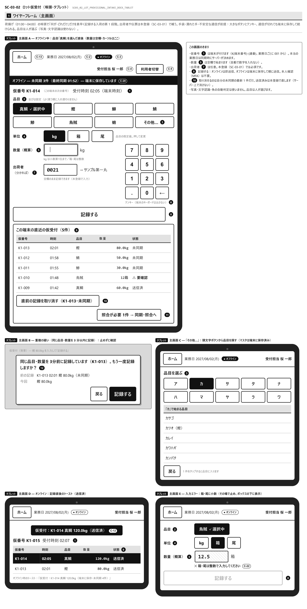

# SC-03-02 ロット仮受付（埠頭・タブレット）— wireframe

> **Chỉ wireframe, không có Screen Specification đầy đủ** (L4-D05 — người dùng chốt 2026-11-25 theo khách #22). Logic ghi (`仮受付` → lô `PROVISIONAL`, hàng đợi offline) thuộc feature `lot` / `sync`; spec đầy đủ khi màn vào phạm vi chi tiết.

| Mục | Nội dung |
|---|---|
| Vai trò màn | **Nhập** — bước 1 của tiếp nhận lô ở bến (01:00–04:00): ghi nhanh "lô gì, bao nhiêu" khi hàng lên bến; bổ sung mã 出荷者, chứng từ ở 本登録 SC-03-01 sau |
| Vai ghi | INTAKE. Không vai nào đọc ở màn này (xem lô ở SC-03-01 [1], SC-03-03) |
| Thiết bị | Tablet dọc 1024 × 1366, **đeo găng, ướt, mạng chập chờn** (PERSONA-DOCK-01); nút ≥ 64 px, chữ ≥ 20 px; máy dùng chung — đổi người bằng PIN (C-5) |
| Offline | **Có** — một trong 3 màn offline (ADR-008 §2.1, L4-A05): lưu cục bộ + hàng đợi, `client_record_id` idempotent |
| Khung / trạng thái chung | `_common-layout.md` khung tablet (C-2..C-5, C-11..C-14, C-20..C-29) |

## 1. Prototype (as-is)

Không có ảnh trong `assets/`: prototype có `/lots/provisional` (INTAKE, **chỉ online**, 3 ô text tự do 出荷者 / 魚種 / 数量概算 — mock M04 cho offline) — xem `prototype/src/app/(app)/lots/provisional/page.tsx`, hàm `provisional_receive_lot` (0014). Không chụp thêm vì ghi 仮受付 là **ghi dữ liệu** vào bản demo.

## 2. Wireframe to-be

> **Hình chuẩn (LAB-4):** nguồn hình là [`html/SC-03-02.html`](html/SC-03-02.html) — một file HTML cho mọi biến thể, render bằng `scripts/render-wireframes.py` ra [`png/SC-03-02.png`](png/SC-03-02.png) và [`pdf/wireframes-all.pdf`](pdf/wireframes-all.pdf); ảnh spec BM-51 lấy biến thể A. Khối ASCII dưới đây giữ làm mô tả bố cục; khi lệch, HTML + SPEC là bản đúng.




```
[C-13]ホーム  業務日 2027/08/02  ●オフライン  受付担当 桜 一郎  [C-5]利用者切替
[C-28] ███ オフライン — 未同期 3件（最終同期 01:52）— 端末に保存しています ███
┌─ [1] 仮番号 K1-014（この端末の次の番号） ── 受付時刻 02:05（端末時刻） ───────┐
├─ [2] 品目（よく使う順ではなく、固定の並び） ────────────────────────────┤
│  ( 真鯛 ) ( 鰹 ) ( 鰤 ) ( 鯖 )                                            │
│  ( 鯵 )  ( 烏賊 ) ( 蛸 ) ( その他… → [3] )                                  │
│  選択中: 真鯛（塗りつぶし＋「選択中」）                                       │
├─ [4] 単位 ── [ kg ] [ 箱 ] [ 尾 ]  ← 品目の既定値、押して変更                  │
├─ [5] 数量（概算） [ _ ] kg  ← 空欄・カーソルはここ    ┌─ [6] テンキー ─────┐ │
│                                                     │  7   8   9        │ │
├─ [7] 出荷者（分かれば） [ 0021 ] → サンプル第一丸       │  4   5   6        │ │
│      （空欄のまま記録可。本登録で入力）                  │  1   2   3        │ │
│                                                     │  .   0   ←        │ │
│                                                     └───────────────────┘ │
│ [8] [          記録する          ]   ← 最大のボタン                         │
└───────────────────────────────────────────────────────────────────────┘
 記録後: C-12 「仮受付：K1-014 真鯛 120kg（端末に保存・未同期 4件）」 オンライン時は「送信済」
┌─ [9] この端末の直近の仮受付（5件） ──────────────────────────────────────┐
│ K1-014 02:05 真鯛 120kg   未同期                                         │
│ K1-013 01:58 鰹    80kg   送信済                                         │
│ K1-012 01:42 鯖    50kg   ⚠要確認 → [11]                                   │
│ [10] [ 直前の記録を取り消す ]（未同期の最新1件のみ）                          │
└─────────────────────────────────────────────────────────────────────┘
 [11] 「照合が必要 1件 → 同期・照合へ」（SC-03-07）
 [12] 重複確認: 「同じ品目・数量を 3分前に記録しています（K1-013）。もう一度記録しますか？」 [記録する] [戻る]
 [3] 品目検索: 大きな一覧（50音の頭文字ボタン ア カ サ タ ナ …）→ 1件をタップ
```

## 3. Item

| No | Item | Loại | Bắt buộc | Quy tắc | Nguồn |
|---|---|---|---|---|---|
| 1 | 仮番号 + 受付時刻 | Nhãn | — | Sinh **trên máy**, không cần mạng: `K{端末番号}-{連番}` (vd. `K1-014`), đánh lại từ 001 mỗi 業務日 của máy; giờ = giờ thiết bị (`captured_at`). 業務日 thật do **server** xác định khi đồng bộ (ADR-005) | ADR-008 §2.2-4, Q-SC0302-01 |
| 2 | 品目 nút to | Nhóm nút chọn một | ✓ | 6–8 品目 hay gặp, **thứ tự cố định** do quản trị đặt trong file cấu hình (không tự đổi chỗ theo tần suất — cùng nguyên tắc C-14); nút đang chọn tô đặc + chữ 「選択中」. Không ô thả xuống (khó khi đeo găng — khách #13) | FB LAB-2 #13, PRM-086, Q-SC0302-03 |
| 3 | 品目検索 (その他) | Danh sách to | — | Mở khi bấm 「その他…」: hàng nút đầu chữ (ア カ サ …) → danh sách 品目 chữ to; danh mục master tải sẵn để dùng offline | FT-10-06 |
| 4 | 単位 | 3 nút to | ✓ | Mặc định theo 品目; bấm để đổi | FB LAB-2 #5 |
| 5 | 数量（概算） | Số | ✓ | **Để trống**, con trỏ ở đây (bài học khách #8); > 0; kg 1 chữ số lẻ, 箱 / 尾 số nguyên — chặn ngay khi gõ; sai → chữ đỏ dưới ô (C-22) | BR-LOT-02, m-11 |
| 6 | テンキー | Bàn số to | — | Phím ≥ 64 px như SC-06-02; không bật bàn phím ảo của máy | PRM-086, khách #23, #24 |
| 7 | 出荷者（分かれば） | Mã + gợi ý | Không | Mã master (tải sẵn); không có mạng vẫn gõ được mã, tên hiện nếu có trong bản tải. **Không bắt buộc** ở bến (Q-SC0302-02 đã trả lời [Customer giả lập, 2026-11-25]: mỗi lúc chỉ dỡ một tàu ở một bến, chỗ dễ lẫn là bàn 本登録 lúc 04:00); để trống vẫn lưu — 本登録 bắt buộc (DB `lots.shipper_id` NULL khi `PROVISIONAL`, truy vết A.1) | D15, LOT_DB 4.25, Q-SC0302-02 |
| 8 | 記録する | Nút lớn nhất | — | Online: gửi ngay. Offline: lưu IndexedDB + hàng đợi, toast ghi rõ 「端末に保存」. Không MFA (PREMISE §3.2 "tiếp nhận lô") | ADR-008, L4-A05 |
| 9 | Danh sách 直近（この端末） | Bảng | — | 5 bản ghi gần nhất của **máy này**, trạng thái 「未同期」/「送信済」/「⚠要確認」 (chữ + màu) | ADR-008 §2.1-3 |
| 10 | 直前の記録を取り消す | Nút | — | Chỉ bản ghi **chưa đồng bộ** mới nhất của chính người đang dùng; hỏi lại một lần. Bản đã gửi → sửa ở 本登録 SC-03-01 (không xóa trên server — luật 4) | luật 4 |
| 11 | 照合が必要 N件 | Liên kết | — | Khi có bản ghi `HELD` (vd. nghi trùng, ngày đã khóa) → SC-03-07 | ADR-008 §2.2-6, C-14 |
| 12 | Hỏi lại khi nghi trùng | Hộp thoại | — | Cùng 品目 + 数量 trên máy này trong 3 phút; không chặn | PRM-116 |

## 4. Trạng thái

| Trạng thái | Hiển thị |
|---|---|
| Online | C-3 ●オンライン; [9] bản mới 「送信済」 sau vài giây |
| Mất mạng | C-28 thanh đỏ cố định + số 未同期; **vẫn ghi được** — lưu cục bộ, toast 「端末に保存」 |
| Có mạng lại | C-29; hàng đợi gửi theo thứ tự tạo qua **cùng hàm** như online; bản bị giữ → [11] |
| Bản ghi về sau khi 業務日 đã khóa | Không ghi vào ngày đã khóa; vào SC-03-07 → 修正申請 `LATE_ENTRY` hoặc 「反映しない」 (ADR-008 §2.2-6) |
| Đổi người khi mất mạng | PIN offline (người đã đăng nhập máy này trong 12 giờ — ADR-008 §2.3); bản ghi gắn cờ 「オフライン切替」 |
| Máy hỏng / mất | 照合部門長 đánh dấu 「端末回収不能」 ở SC-07-02; bản ghi chưa gửi coi như mất, nhập bù từ giấy |
| Vai khác INTAKE | C-25 |

## 5. Khác biệt theo vai

INTAKE: toàn màn. Vai khác: không vào (C-25). SETTLE / STL-HEAD xem máy còn bản ghi chưa đồng bộ ở SC-03-07 / checklist SC-07-02.

## 6. To-be khác prototype

| # | Prototype | To-be | Nguồn |
|---|---|---|---|
| 1 | Chỉ online (offline là mock M04) | Lưu cục bộ + hàng đợi + đối chiếu SC-03-07 | ADR-008, M04 |
| 2 | 出荷者 / 魚種 là text tự do | 品目 nút to từ master; 出荷者 mã master, không bắt buộc ở bước này | D15, khách #13 |
| 3 | Không có 仮番号 ở bến | 仮番号 sinh trên máy, dùng để đối chiếu khi 本登録 | PRM-116 |
| 4 | Ô số dùng bàn phím máy | Bàn số to, ô SL để trống | khách #8, #23 |
| 5 | Không có danh sách gần nhất / trạng thái gửi | [9] + [11] | ADR-008 §2.1-3 |

## 7. Ràng buộc và câu hỏi

- **Không** chụp ảnh ở bến ở 第1期 (E-21 — ảnh chứng từ chỉ scan ở PC); **không** OCR ký hiệu tay / 符丁, **không** AI nhận dạng cá (luật 3, ADR-010) — người bấm 品目.
- Q-SC0302-01 (mới): định dạng 仮番号 `K{端末番号}-{連番}` có dễ đọc với 受付担当 không, hay dùng số thẻ treo trên thùng có sẵn? Giả định PL: định dạng máy sinh; ảnh hưởng nếu sai: thêm ô 「札番号」 (~0,2 ngày).
- Q-SC0302-02 — **đã trả lời** [Customer giả lập, 2026-11-25]: 出荷者 không bắt buộc ở bến (khớp góp ý #15 261118, tablet 3–4 ô); bắt buộc ở 本登録 giữ nguyên.
- **Để sau (Muốn có, ~0,3 ngày — chỉ làm khi còn buffer):** ô 「いま荷揚げ中の船」 ở đầu màn — chạm **một lần mỗi tàu** (không phải mỗi lô), các lô nhập sau tự mang theo tàu đó tới khi đổi tàu; bỏ trống vẫn lưu được. Chưa vẽ vào wireframe / chưa có cột DB; khi làm cần nơi lưu trên bản ghi 仮受付 (vd `lots.shipper_id` gợi ý hoặc cột riêng) — quyết lúc làm. Tạm thời 受付 ghi dải 仮番号 của từng tàu lên 荷受伝票 giấy (đang làm).
- Q-SC0302-03 (mới): danh sách 6–8 品目 nút to cố định cả năm hay đổi theo mùa (ai đổi)? Giả định PL: file cấu hình có nhật ký (PRM-126), quản trị đổi theo mùa.
- Liên quan: Q-LOT-01 — đã trả lời [Customer giả lập, 2026-11-25]: mã chính thức cấp khi bản ghi lên server, 仮番号 tra được ở mọi màn tới hết 業務日, số không dùng lại, phiếu in dùng mã chính thức — ở `specs/lot/function-specifications/LOT_FUNC.md` §3.

## History of change

| No | Version | Action | Nội dung thay đổi | Ngày | Người sửa | Approve |
|---|---|---|---|---|---|---|
| 1 | 0.1.0 | Add new | Bản đầu theo khách #22 (FB-CUS-281), L4-D05 — chỉ wireframe (LAB-4 P3) | 2026-11-25 | phuongnnm-23344 | |
| 2 | 0.1.1 | Update | Khách Q-SC0302-02: 出荷者 không bắt buộc; 「いま荷揚げ中の船」 là mục Muốn có (để sau); Q-LOT-01 | 2026-11-25 | phuongnnm-23344 |  |
| 3 | 0.1.2 | Update | LAB-4 wireframe HTML: nguồn hình `html/SC-03-02.html`, nhúng `png/SC-03-02.png` | 2026-11-25 | phuongnnm-23344 | |
