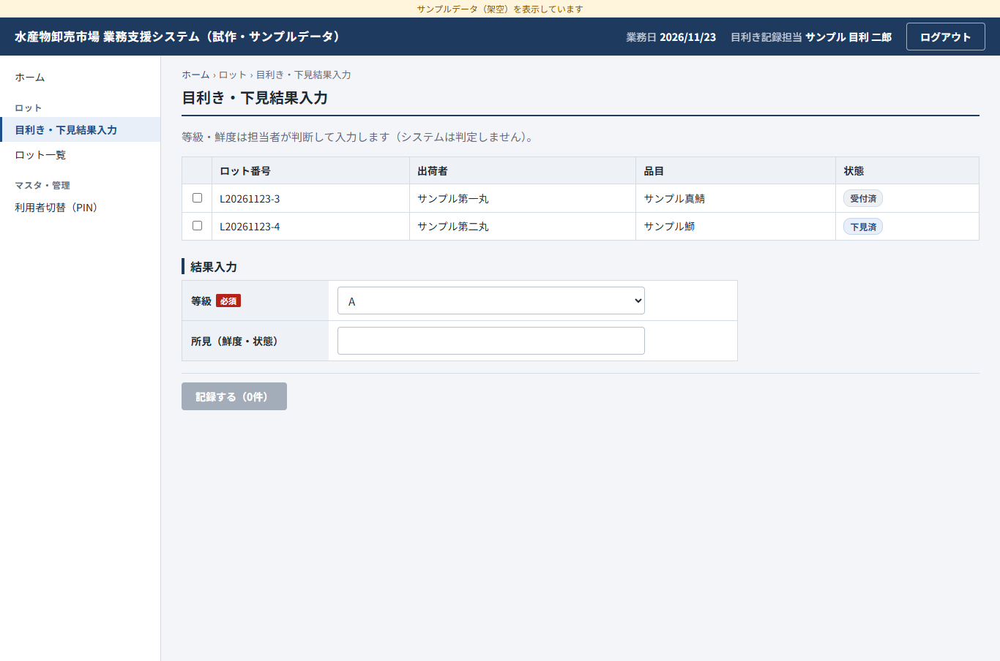
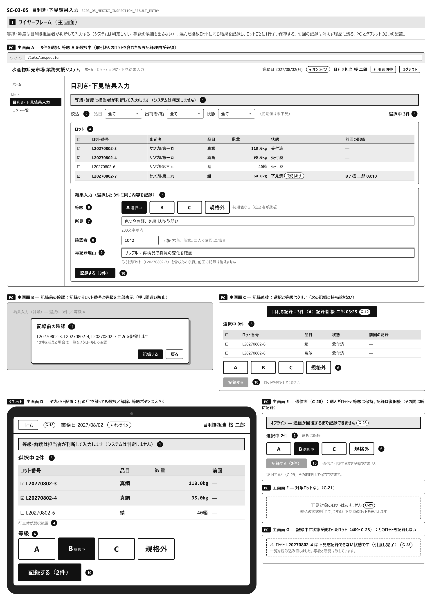

# SC-03-05 目利き・下見結果入力 — wireframe

| Mục | Nội dung |
|---|---|
| Vai trò màn | **Nhập kết quả do người đánh giá quyết** (CAP-HUMAN-01). Hệ thống **không** chấm, không gợi ý hạng, không OCR / AI (SCOPE-OUT-01/02, ADR-010) |
| Vai ghi | JUDGE (◎). Đọc: SETTLE, STL-HEAD, OPS-HEAD (P14) |
| Thiết bị | PC/TAB (hai bố cục; tablet: nút hạng to) |

## 1. Prototype (as-is)



`/lots/inspection`, judge@. Có: chọn nhiều lô, 等級 + 所見, câu 「システムは判定しません」.

## 2. Wireframe to-be

> **Hình chuẩn (LAB-4):** nguồn hình là [`html/SC-03-05.html`](html/SC-03-05.html) — một file HTML cho mọi biến thể, render bằng `scripts/render-wireframes.py` ra [`png/SC-03-05.png`](png/SC-03-05.png) và [`pdf/wireframes-all.pdf`](pdf/wireframes-all.pdf); ảnh spec BM-51 lấy biến thể A. Khối ASCII dưới đây giữ làm mô tả bố cục; khi lệch, HTML + SPEC là bản đúng.




```
[1] 等級・鮮度は担当者が判断して入力します（システムは判定しません）
[2] 絞込: 品目 [全て▼] 出荷者/船 [全て▼] 状態 [未下見▼]           [3] 選択中 3件
┌─ [4] ─────────────────────────────────────────────────────────────────┐
│ ☑ ロット番号      出荷者      品目   数量    状態     前回の記録            │
│ （タブレットでは行のどこを触っても選択／解除）                              │
│ ☑ L20270802-3   第一丸      真鯛   118kg  受付済   —                     │
│ ☑ L20270802-4   第一丸      真鯛    95kg  受付済   —                     │
│ ☐ L20270802-6   第三丸      鯖     40箱  受付済   —                     │
│ ☑ L20270802-7   第二丸      鰤     60kg  下見済(取引あり) B / 桜 二郎 03:10 │
└──────────────────────────────────────────────────────────────────────┘
┌─ [5] 結果入力（選択した 3件に同じ内容を記録）──────────────────────────────┐
│ [6] 等級   ( A ) ( B ) ( C ) ( 規格外 )   ← 大きなボタン                  │
│ [7] 所見   [ 色つや良好、身締まりやや弱い                 ]               │
│ [8] 確認者  [ 社員番号 ____ ]（任意。二人で確認した場合）                    │
│ [9] 取引済ロットの再記録理由 [                ]（取引後のみ必須）            │
│ [10] [ 記録する（3件） ]                                              │
└──────────────────────────────────────────────────────────────────────┘
 [11] 記録前の確認: 「L20270802-3, L20270802-4, L20270802-7 に A を記録します」 [記録する] [戻る]
 記録後: C-12 「目利き記録：3件（A）記録者 桜 二郎 03:25」。前回の記録は消えず履歴に残る
```

## 3. Item

| No | Item | Loại | Bắt buộc | Quy tắc | Nguồn |
|---|---|---|---|---|---|
| 1 | Câu nguyên tắc | Nhãn | — | Luôn hiện | CAP-HUMAN-01 |
| 2 | Bộ lọc | Chọn | — | 品目, 出荷者 / tàu, trạng thái | FT-03-02 |
| 3 | Số đã chọn | Nhãn | — | | — |
| 4 | Bảng lô | Bảng chọn nhiều | — | Lô của 業務日 đang mở; cột 前回の記録 = bản ghi gần nhất. Trên tablet chạm cả dòng là chọn / bỏ chọn (ô ☑ nhỏ khó bấm — khách #14) | FR-LOT-02, PRM-086 |
| 5 | Khối nhập | Vùng | — | Áp một kết quả cho các lô đã chọn, **lưu từng lô một dòng** | FT-03-02 |
| 6 | 等級 | Nút chọn | ✓ | Danh mục hạng theo quy chế của chợ (chờ fixture, L4-A02); **không có giá trị mặc định** | CAP-HUMAN-01 |
| 7 | 所見 | Văn bản | — | ≤ 200 ký tự | — |
| 8 | 確認者 | Mã nhân viên | — | Người thứ hai (nếu có) | FT-03-02 |
| 9 | Lý do ghi lại | Văn bản | Khi lô đã có GD | Ghi lại không xóa bản cũ (append-only) | luật 4 |
| 10 | 記録する | Nút | — | Mở [11] trước khi ghi; ghi người ghi + thời điểm; lô → 下見済 | — |
| 11 | Xác nhận danh sách lô | Hộp thoại | — | Liệt kê đúng mã các lô sẽ ghi + hạng, để không ghi hạng cho lô chưa xem vì bấm nhầm ô (khách #15) | CAP-HUMAN-01 |

## 4. Trạng thái

| Trạng thái | Hiển thị |
|---|---|
| Không có lô | C-21 「下見対象のロットはありません」 |
| Chưa chọn lô / chưa chọn hạng | [10] mờ + lý do ngay cạnh nút |
| Lô đã có GD | Dòng có nhãn 「取引あり」; [9] bắt buộc |
| Ngày đã khóa | C-24 |
| Mất mạng | C-28: **giữ nguyên lô đã chọn và hạng đã bấm**; không lưu được (màn này không thuộc danh sách offline L4-A05); có mạng lại bấm [10] lưu ngay. Trong lúc mất mạng 目利き ghi giấy như hiện nay (Q-SC0305-01 đã trả lời) |

## 5. Khác biệt theo vai

JUDGE: toàn màn. SETTLE / STL-HEAD / OPS-HEAD: xem kết quả ở SC-03-04 (lịch sử 目利き). INTAKE, TRADE: thấy [前回の記録] qua SC-03-03 / SC-04-01 [2], không vào màn này.

## 6. To-be khác prototype

| # | Prototype | To-be | Nguồn |
|---|---|---|---|
| 1 | 等級 mặc định 「A」 trong ô chọn | **Không mặc định** — tránh ghi nhầm hạng thay người đánh giá | CAP-HUMAN-01 |
| 2 | Không có [2], [8], [9] | Có | FT-03-02, luật 4 |
| 3 | Ô chọn nhỏ | Nút to cho tablet | PRM-086 |

## 7. Câu hỏi

- Q-SC0305-01: 目利き có cần ghi offline ở bến không? **Đã trả lời [Customer giả lập, 2026-11-25]:** không cần ở 第1期 — mất mạng thì 相対 cũng không chốt được, cả chợ chuyển sang giấy. Điều kiện: màn giữ lô / hạng đã chọn, có mạng lại lưu được ngay (đã áp ở §4). Muốn có ô 「下見時刻」 khi nhập bù từ giấy — để sau (không làm ở bản này).
- Q-SC0305-02 (mới, nối E-13 / OPEN-L4-03): khi mất mạng, lô chưa ghi 目利き trên hệ thống có được bán bằng giấy không? Hỏi 運用部門 cùng lúc với E-13.

## History of change

| No | Version | Action | Nội dung thay đổi | Ngày | Người sửa | Approve |
|---|---|---|---|---|---|---|
| 1 | 0.1.0 | Add new | Bản đầu | 2026-11-25 | phuongnnm-23344 | |
| 2 | 0.2.0 | Update | Khách: chạm cả dòng để chọn trên tablet (#14); hộp xác nhận danh sách lô trước khi ghi (#15); Q-SC0305-01 đã trả lời — giữ lô / hạng khi mất mạng; thêm Q-SC0305-02. Ảnh prototype giữ nguyên | 2026-11-25 | phuongnnm-23344 | |
| 3 | 0.2.1 | Update | LAB-4 wireframe HTML: nguồn hình `html/SC-03-05.html`, nhúng `png/SC-03-05.png`; lô đang chọn thống nhất -3, -4, -7 (-7 取引あり → [9] bắt buộc), [11] liệt kê đúng 3 lô | 2026-11-25 | phuongnnm-23344 | |
