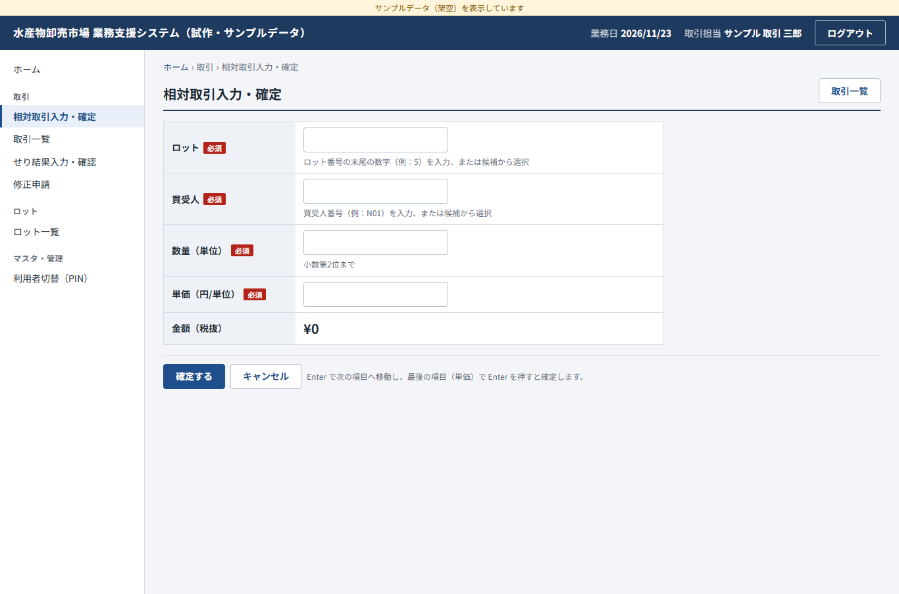

# SC-04-01 相対取引入力・確定 — wireframe

| Mục | Nội dung |
|---|---|
| Vai trò màn | **Nhập** (input) — màn dùng nhiều nhất, luồng chính ~90% giá trị (C.5) |
| Vai ghi | TRADE. Đọc: SETTLE, STL-HEAD, OPS-HEAD (role-list P16) — họ xem GD ở SC-04-03 / SC-04-04, **không mở màn nhập** |
| Thiết bị | PC + テンキー; đi hết bằng bàn phím |
| Mục tiêu | Một GD ~10 giây khi đã thạo **[Giả lập]**: ロット → 買受人 → 数量 → 単価 → Enter |
| Khung / trạng thái chung | `_common-layout.md` (C-1..C-31) |

## 1. Prototype (as-is)



`/trades/new`, tài khoản trade@ (dữ liệu 「サンプル」). Đã có: 4 ô, gõ số ngắn hoặc chọn gợi ý, Enter sang ô kế, Enter ở 単価 chốt, ở lại form sau khi chốt (DEC-033).

## 2. Wireframe to-be

```
[C-11] ┌ オフライン時: 「通信が回復するまで確定できません。紙伝票で継続してください」(C-28) ┐
┌─ 入力 ──────────────────────────────────────────┐ ┌─ [10] 直前の確定（5件） ─────────┐
│[1] ロット   [ 5      ] → L20270802-5 サンプル鰹       │ │ 時刻  ロット 買受人  数量  金額   │
│             [2] 単位 kg・残 66kg・下見済 A            │ │ 04:31  5   N01  2kg  ¥2,400 │
│[3] 買受人   [ N01    ] → サンプル仲卸1                 │ │ 04:30  5   B03  5kg  ¥6,000 │
│     [4] ┌ 仲卸 許可 有効（〜2028/10/23）        ┐     │ │ …                           │
│         │ 売買参加者なら: 承認 有効 / 参加上限残 ¥… │     │ │ [11] 取引一覧へ →             │
│         └ 赤: 失効・一時停止 / 黄: 失効まで30日以内  ┘     │ └────────────────────────────┘
│[5] 数量（kg）[   2.00 ]                            │
│[6] 単価（円/kg）[  1,200 ]                         │
│[7] 金額（税抜） ¥2,400                              │
│                                                    │
│[8] [ 確定する（Enter） ]  [9] クリア（Esc）            │
│    Enter: 次の項目へ ／ 単価で Enter: 確定             │
└────────────────────────────────────────────────────┘
 ── 確定後: [C-12] 「確定：N01 サンプル仲卸1／鰹 2kg × ¥1,200 = ¥2,400（相対-0005）」
    取引確認票を印刷中…（[12] 印刷失敗時: 「再印刷 →」SC-04-02）
    ロット・残 を保持、買受人以降を空欄、カーソルは [3]

 ── [13] 参加上限超過ダイアログ（売買参加者のみ）
   ┌ 今期の参加上限を超えます：上限 ¥5,000,000 / 今期確定済 ¥4,990,000 / 今回 ¥24,000 ┐
   │ 理由を選択: 1 事前に了承済  2 保証金追加予定  3 その他（備考必須）  [14] 備考 [   ] │
   └ [ 理由を付けて確定 ]  [ 戻る ]                                              ┘
 ── [15] 同一内容の再確定確認: 「直前と同じ内容です。もう一度確定しますか？」 [はい] [いいえ]
```

## 3. Item

| No | Item | Loại | Bắt buộc | Quy tắc / validation | Nguồn |
|---|---|---|---|---|---|
| 1 | ロット | Ô nhập số + gợi ý | ✓ | Gõ số đuôi (「5」) → lô của 業務日 hiện tại; chỉ lô 販売公開中 và còn SL; gợi ý ≤ 10 dòng | FB LAB-2 #1, FIG-011 |
| 2 | Đơn vị · 残 · 目利き | Nhãn | — | `単位 kg・残 66kg`; kết quả 目利き hiện để tham khảo, **không tự quyết giá** | FR-LOT-03, CAP-HUMAN-01 |
| 3 | 買受人 | Ô nhập mã + gợi ý | ✓ | 買受人番号 `^[A-Z0-9]{1,10}$`; chỉ 仲卸 / 売買参加者 | TBL-ACTOR-01 |
| 4 | Tư cách người mua | Nhãn trạng thái | — | **仲卸 → chữ 「許可」; 売買参加者 → chữ 「承認」 + 参加上限残 (theo kỳ)**; không gộp thành "資格OK". Màu + chữ | BR-PERM-01, ADR-003, luật 2 |
| 5 | 数量 | Số | ✓ | > 0, 2 số lẻ, ≤ 残 (kiểm lại ở server lúc chốt) | BR-LOT-02 |
| 6 | 単価 | Số | ✓ | > 0, nguyên; nhãn theo đơn vị lô | FB LAB-2 #5 |
| 7 | 金額 | Nhãn tính | — | floor(数量 × 単価), 税抜; thuế tính ở 精算 | PRM-053 |
| 8 | 確定する | Nút chính | — | Online bắt buộc; một phím; ghi người chốt + thời điểm | PRM-114, L4-A05 |
| 9 | クリア | Nút phụ | — | Xóa form, giữ lô | — |
| 10 | 直前の確定 | Bảng | — | 5 GD gần nhất của chính người dùng, mới nhất trên | FB LAB-2 #7 |
| 11 | 取引一覧へ | Liên kết | — | → SC-04-03 | — |
| 12 | Lỗi in | Banner | — | In thẳng phiếu, không xem trước; lỗi → SC-04-02 「再発行」 | M05, FT-04-04 |
| 13 | Hộp 参加上限 | Hộp thoại | — | Chỉ 売買参加者; hạn mức **theo kỳ**, chung 相対 + せり, mặc định = 保証金額; **không chặn cứng**; chọn lý do bằng phím số | PRM-046, L4-A04 (1), M19 |
| 14 | 備考 | Văn bản | Khi 「その他」 | ≤ 200 ký tự | FT-01-09 |
| 15 | Hỏi lại khi trùng | Hộp thoại | — | Cùng lô, người mua, SL, giá trong 3 phút; không chặn | FB LAB-2 #6 |

## 4. Trạng thái

| Trạng thái | Hiển thị |
|---|---|
| Rỗng — chưa có lô 公開 | C-21: 「販売公開中のロットがありません」 + liên kết SC-03-03 (cho vai có quyền) |
| Người mua 失効 / 一時停止 / sai loại | [4] đỏ; nút [8] vẫn bấm được nhưng server từ chối với lỗi dưới ô [3] (C-22) — kiểm lúc chốt là cuối cùng |
| SL không đủ / người khác vừa chốt cùng lô | C-23: 「残数量が 1kg に変わりました」, [2] cập nhật |
| Ngày đã khóa | C-24 (hiếm: màn chỉ ghi vào 業務日 đang mở) |
| Mất mạng | C-28: form khóa, banner giấy; có mạng lại → C-29 hiện 確定済 / 未確定 của lần bấm cuối |
| Chờ duyệt | Không áp dụng (相対 chốt bởi người chốt sau 読み合わせ, không duyệt) |

## 5. Khác biệt theo vai

| Vai | Thấy |
|---|---|
| TRADE | Toàn màn |
| SETTLE / STL-HEAD / OPS-HEAD | Không có menu này; xem GD ở SC-04-03, SC-04-04 (閲) |
| Vai khác | C-25 |

## 6. To-be khác prototype

| # | Prototype | To-be | Nguồn |
|---|---|---|---|
| 1 | Bản 1.2 đã hiện 許可 / 承認 + hạn khi chọn người mua | Giữ, thêm 参加上限残 theo kỳ (売買参加者) và cảnh báo vàng khi còn ≤ 30 ngày tới 失効日 | FB LAB-2 #3, luật 2, FR-AITAI-02 |
| 2 | 参加上限 tính theo 業務日 | Theo kỳ, chung 相対 + せり | M19, D08 |
| 3 | Không in | In thẳng qua máy in hiện trường; [12] khi lỗi | M05 |
| 4 | Không có [10] | Bảng 5 GD gần nhất | FB LAB-2 #7 |
| 5 | Lý do vượt hạn mức gõ tự do | Chọn bằng phím số + 備考 | L4-A04 (1) |
| 6 | Không có banner mất mạng | C-28 | M04, ADR-008 |
| 7 | Mã GD `T20261123-5-1` | Mã ngắn đọc được (vd. 相対-0005) — chờ chốt định dạng ở Database Design | FB LAB-2 #7 |

## History of change

| No | Version | Action | Nội dung thay đổi | Ngày | Người sửa | Approve |
|---|---|---|---|---|---|---|
| 1 | 0.1.0 | Add new | Bản đầu | 2026-11-25 | phuongnnm-23344 | |
