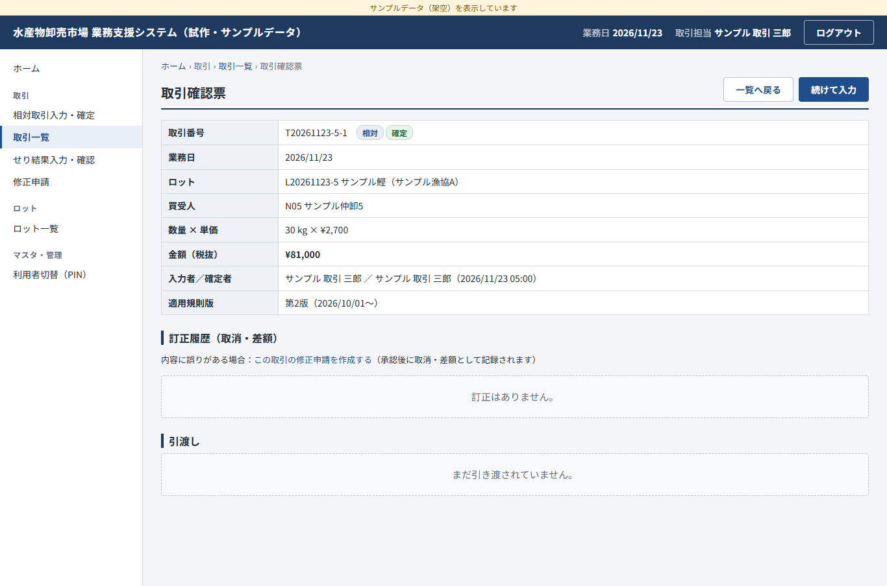

# SC-04-05 当日訂正（＋取消）— wireframe (màn mới, mức wireframe)

| Mục | Nội dung |
|---|---|
| Vai trò màn | **Nhập** — sửa / hủy GD **của 業務日 chưa khóa**, có lý do, không cần duyệt 2 cấp. Gồm nút 取消 riêng (gộp SC-04-06 — PRM-127) |
| Vai ghi | TRADE (P17). Đọc: SETTLE, STL-HEAD, OPS-HEAD (đối soát ở tab 要確認 SC-07-01) |
| Thiết bị | PC |
| Không ghi đè | GD gốc giữ nguyên; 訂正 / 取消 sinh bản ghi REVERSE + DELTA cùng 業務日, sổ SL có dòng hoàn / trừ (luật 4, ADR-004) |

## 1. Prototype (as-is)



Prototype **không có** màn này (M17): mọi điều chỉnh đi 修正申請 duyệt 1–2 cấp, kể cả GD trong ngày. Ảnh là 取引確認票 (SC-04-04) — nơi to-be đặt nút vào SC-04-05.

## 2. Wireframe to-be

```
[1] 対象取引 相対-0005（2027/08/02 04:31・未締め）  ロット L…-5 鰹  入力者 桜 三郎
┌─ [2] 現在の内容 ───────────┐   ┌─ [3] 訂正後 ─────────────────────────────┐
│ 買受人  N05 サンプル仲卸5    │   │ [4] 買受人  [ N05 ]  → 許可 有効            │
│ 数量    30kg                │   │ [5] 数量    [ 28 ] kg   ロット残 18 → 20kg   │
│ 単価    ¥2,700              │   │ [6] 単価    [ 2,700 ]                     │
│ 金額    ¥81,000             │   │ [7] 金額    ¥75,600（差 −¥5,400）           │
└────────────────────────────┘   └────────────────────────────────────────┘
[8] 理由 [ 計量の誤り ▼ ] [9] 備考 [            ]（必須: その他のとき）
[10] 引渡し状況: 引渡済 12kg（訂正後の数量は引渡済以上であること）
[11] [ 訂正する ]   [12] [ 取引を取り消す ]（別ボタン・赤枠）  [13] キャンセル
 取消の確認（C-31）: 「相対-0005 を取り消します。元の取引は残り、取消の記録が追加されます。ロットに30kg戻ります」
 完了: C-12 「訂正：相対-0005 数量 30→28kg（取消・差額を記録）」、取引確認票を再印刷（「訂正」表示）
```

## 3. Item

| No | Item | Loại | Bắt buộc | Quy tắc | Nguồn |
|---|---|---|---|---|---|
| 1 | GD đích | Nhãn | — | Chỉ vào được khi 業務日 của GD **chưa khóa** | FR-AITAI-03 |
| 2 | Nội dung hiện tại | Nhãn | — | Giá trị hiệu lực (đã gồm lần 訂正 trước) | ADR-004 |
| 3 | Khối 訂正後 | Vùng | — | | — |
| 4 | 買受人 | Mã | ✓ | Kiểm lại 許可 / 承認 + 参加上限 như SC-04-01 | BR-PERM-01 |
| 5 | 数量 | Số | ✓ | > 0; ≤ SL gốc + 残 lô; ≥ SL đã giao | BR-LOT-02, FR-DEL-01 |
| 6 | 単価 | Số | ✓ | > 0 | — |
| 7 | 金額 + chênh lệch | Nhãn | — | | — |
| 8 | 理由 | Chọn | ✓ | Danh sách: 計量の誤り / 買受人の取り違え / 単価の誤り / その他 | FT-04-05 |
| 9 | 備考 | Văn bản | Khi その他 | ≤ 200 | — |
| 10 | Tình trạng giao | Nhãn | — | | FR-DEL-05 |
| 11 | 訂正する | Nút | — | Online bắt buộc; không duyệt 2 cấp; hiện ở tab 要確認 SC-07-01 | PRM-127 |
| 12 | 取り消す | Nút | — | Nút riêng, viền đỏ; **chặn nếu đã giao một phần** → dẫn SC-06-04 | FT-04-06, PRM-127 |
| 13 | キャンセル | Nút | — | | — |

## 4. Trạng thái

| Trạng thái | Hiển thị |
|---|---|
| Ngày đã khóa | Không mở được; C-24 → SC-08-01 (修正申請) |
| GD đang có 修正申請 chờ | C-27, form chỉ đọc |
| Đã giao một phần + bấm 取消 | Hộp lỗi 「引渡済のため取り消せません。差異は例外登録で処理してください →」 SC-06-04 |
| Người mua mới không đủ tư cách | C-22 dưới [4] |
| Mất mạng | C-28 |

## 5. Khác biệt theo vai

TRADE: toàn màn. SETTLE / STL-HEAD / OPS-HEAD: xem lịch sử ở SC-04-04 và tab 要確認 SC-07-01, không có nút. Vai khác: C-25.

## 6. To-be khác prototype

Toàn bộ màn là mới (M17, D11). Prototype dùng 修正申請 cho mọi điều chỉnh → to-be tách: **chưa khóa = SC-04-05 (không duyệt 2 cấp), đã khóa = SC-08-01 → SC-08-03**. SC-04-04 hiện đúng một nút theo trạng thái ngày.

## 7. Câu hỏi

- Q-SC0405-01: 当日訂正 có cần người thứ hai xác nhận khi chênh tiền lớn không? Giả định: không (PRM-127), chỉ hiện ở 要確認 để 照合 soát. Sai → thêm bước xác nhận, ~+0,2 MM.

## History of change

| No | Version | Action | Nội dung thay đổi | Ngày | Người sửa | Approve |
|---|---|---|---|---|---|---|
| 1 | 0.1.0 | Add new | Bản đầu | 2026-11-25 | phuongnnm-23344 | |
