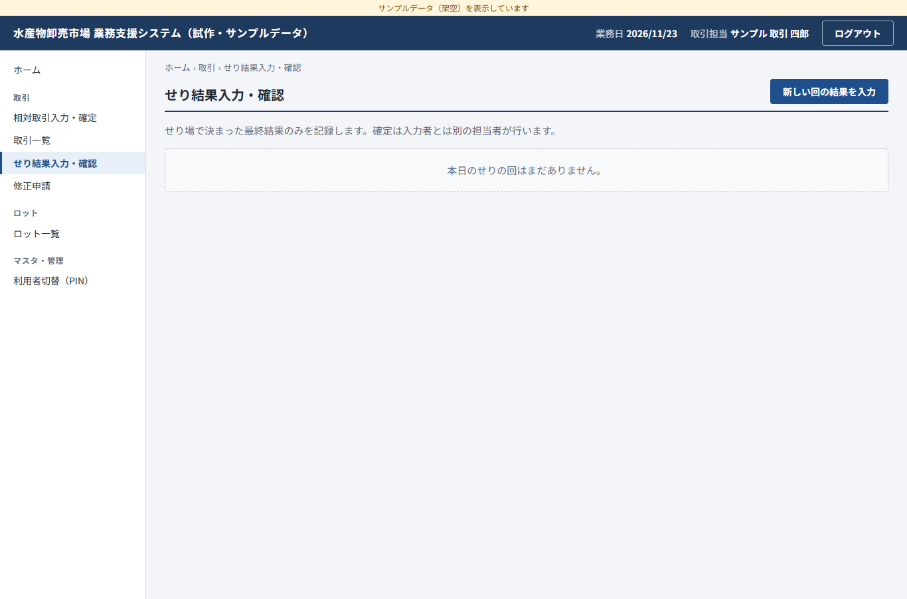
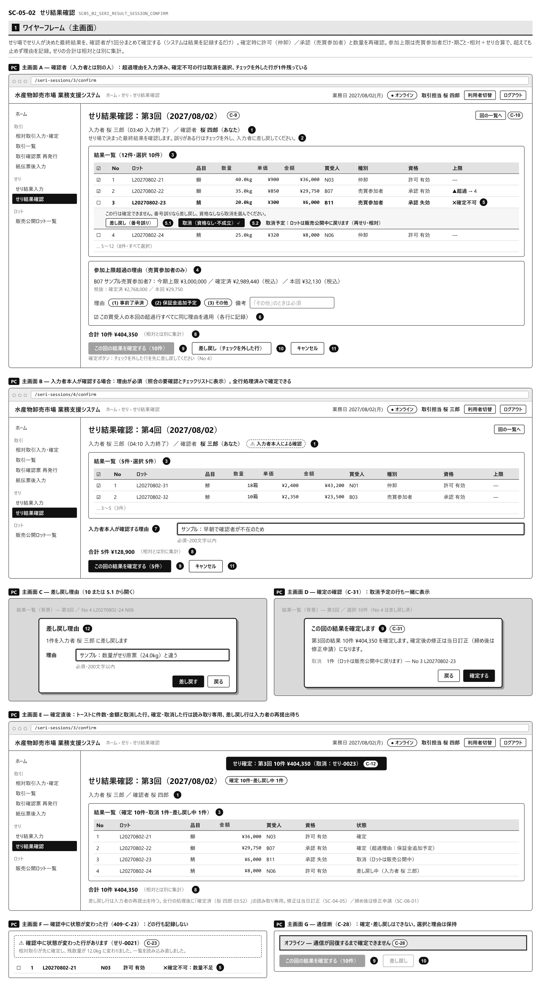

# SC-05-02 せり結果確認 — wireframe

| Mục | Nội dung |
|---|---|
| Vai trò màn | **Quyết định** — 確認者 xác nhận cả phiên せり một lần. Kết quả せり do せり人 quyết trên sàn; hệ thống chỉ **ghi kết quả**, không có màn đấu giá trực tiếp (FR-SERI-01, luật 1) |
| Vai ghi | TRADE (確認者 ◎, ≠ 入力者 — S2). Đọc: SETTLE, STL-HEAD, OPS-HEAD (P20) |
| Thiết bị | PC |

## 1. Prototype (as-is)



Không chụp được màn xác nhận: 業務日 demo chưa có phiên せり nào, và tạo phiên sẽ **ghi dữ liệu** (ngoài phạm vi chỉ xem). Mô tả as-is theo mã `src/app/(app)/seri/[id]/confirm/page.tsx`: bảng kết quả; một ô lý do vượt hạn mức **cho mọi dòng** (gõ tự do); ô 「入力者本人が確定する理由」 khi trùng người; nút 「この回の結果を確定する」 + hộp xác nhận. Ảnh trên là trạng thái rỗng của danh sách phiên (C-21).

## 2. Wireframe to-be

> **Hình chuẩn (LAB-4):** nguồn hình là [`html/SC-05-02.html`](html/SC-05-02.html) — một file HTML cho mọi biến thể, render bằng `scripts/render-wireframes.py` ra [`png/SC-05-02.png`](png/SC-05-02.png) và [`pdf/wireframes-all.pdf`](pdf/wireframes-all.pdf); ảnh spec BM-51 lấy biến thể A. Khối ASCII dưới đây giữ làm mô tả bố cục; khi lệch, HTML + SPEC là bản đúng.




```
[C-9] せり結果確認：第3回（2027/08/02）                       [C-10] 回の一覧へ
[1] 入力者 桜 三郎（03:40 入力終了） ／ 確認者 桜 四郎（あなた）
[2] せり場で決まった最終結果を確認します。誤りがある行はチェックを外し、入力者に差し戻してください。
┌─ [3] 結果一覧（12件・選択 10件）─────────────────────────────────────────────────┐
│ ☑ No ロット   品目 数量  単価    金額     買受人  種別      資格             上限      │
│ ☑ 1  L…-21  鰤  40kg ¥900  ¥36,000  N03  仲卸      許可 有効          —         │
│ ☑ 2  L…-22  鰤  35kg ¥850  ¥29,750  B07  売買参加者 承認 有効          ▲超過 [4]  │
│ ☐ 3  L…-23  鯖  20kg ¥300  ¥6,000   B11  売買参加者 承認 失効 ✖確定不可 [5]       │
│      └ 確定できません [差し戻し（番号誤り）] [取消（資格なし・不成立）]              │
│ ☐ 4  L…-24  鯖  25kg ¥320  ¥8,000   N06  仲卸      許可 有効          —（差し戻し）│
│ ☑ 5〜12 …（8件・すべて選択）                                                   │
└────────────────────────────────────────────────────────────────────────────┘
┌─ [4] 参加上限超過の理由（売買参加者のみ）───────────────────────────────────────┐
│ B07 サンプル売買参加者7: 今期上限 ¥3,000,000 / 確定済 ¥2,989,440（税込） / 本回 ¥32,130（税込）│
│ 理由 (1)事前了承済 (2)保証金追加予定 (3)その他 [備考        ]                         │
│ [6] ☐ この買受人の本回の超過行すべてに同じ理由を適用（各行に記録）                       │
└────────────────────────────────────────────────────────────────────────────┘
[7] 入力者本人が確認する理由 [            ]  ← 入力者=確認者 のときだけ表示・必須、要確認に表示
[8] 合計 10件 ¥404,350（相対とは別に集計）
[9] [ この回の結果を確定する（10件） ]  [10] 差し戻し（チェックを外した行）  [11] キャンセル

── [10] を押したときのダイアログ
┌─ [12] 差し戻し理由 ───────────────────────────────────────────────┐
│ 1件を入力者 桜 三郎 に差し戻します                                     │
│ 理由（必須・200文字以内） [                                        ]   │
│                                          [ 差し戻す ]  [ 戻る ]      │
└──────────────────────────────────────────────────────────────┘
```

## 3. Item

| No | Item | Loại | Bắt buộc | Quy tắc | Nguồn |
|---|---|---|---|---|---|
| 1 | 入力者 / 確認者 | Nhãn | — | Hiện hai tên; trùng người → nhãn vàng | S2, PRM-115 |
| 2 | Hướng dẫn | Nhãn | — | | FR-SERI-02 |
| 3 | Bảng kết quả | Bảng chọn | — | Bố cục FORM-SERI-01; cột 資格 ghi đúng **許可 (仲卸) / 承認 (売買参加者)**; kiểm lại tư cách + SL **tại lúc xác nhận** | BR-PERM-01, FT-01-05 |
| 4 | Khối lý do vượt 参加上限 | Vùng | Khi có dòng vượt | **Chỉ 売買参加者** (仲卸 không có hạn mức); hạn mức theo kỳ, chung 相対 + せり; chọn lý do nhanh + 備考; không chặn cứng | L4-A04 (1), ACT-03, M20 |
| 5 | Dòng không chốt được | Nhãn đỏ + 2 nút | — | Tư cách 失効 / 一時停止 / SL không đủ → bỏ chọn tự động, lý do cạnh dòng; **確認者 chọn** 「差し戻し（番号誤り）」 (入力者 sửa đúng số người thắng) hoặc 「取消（資格なし・不成立）」 (SL không bị trừ, lô vẫn / trở lại 販売公開中 — khách #9); không tự hủy, không nút đổi người mua (Q-TRD-05, luật 3) | BR-PERM-01, BR-LOT-02, FR-SERI-02 |
| 6 | Áp cùng lý do | Checkbox | — | Một người mua trong phiên; vẫn lưu từng dòng (Muốn có) | L4-A04 (1) |
| 7 | Lý do tự xác nhận | Văn bản | Khi 入力者 = 確認者 | Hiện ở tab 要確認 của SC-07-01 và checklist SC-07-02 | S2, PRM-115 |
| 8 | Tổng | Nhãn | — | | — |
| 9 | 確定する | Nút | — | C-31 → ghi 確認者 + thời điểm, trừ sổ SL; **không MFA** (không ở danh sách PREMISE §3.2); **bắt buộc online** | CAP-HUMAN-01, L4-A05 |
| 10 | 差し戻し | Nút | — | Dòng bỏ chọn quay về 入力者 sửa ở SC-05-01 | FR-SERI-02 |
| 11 | キャンセル | Nút | — | | — |
| 12 | 差し戻し理由 (hộp thoại) | Văn bản + nút | ✓ (≤ 200) | Mở từ [10]: 「{n}件を入力者 {tên} に差し戻します」 + ô 理由 + [差し戻す] [戻る]. Trống → `E-TRD-017` 「差し戻しの理由を入力してください」. Lý do ghi vào lịch sử trạng thái GD (`trade_status_history.reason`), 入力者 nhận thông báo in-app. Thêm ở P3 (số kế tiếp, không chèn) | FR-SERI-02, luật 4 |

## 4. Trạng thái

| Trạng thái | Hiển thị |
|---|---|
| Phiên đã xác nhận | Chỉ đọc + 「確定済（桜 四郎 03:52）」; sửa sau đó → SC-04-05 (chưa khóa) / SC-08-01 (đã khóa) |
| Không có dòng | C-21 + liên kết về SC-05-01 |
| Thiếu lý do vượt hạn mức | [9] mờ, dòng thiếu tô viền đỏ (C-22) |
| SL đổi do 相対 chốt trước | C-23, dòng chuyển [5] |
| Ngày đã khóa | C-24 |
| Mất mạng | C-28: không xác nhận được |

## 5. Khác biệt theo vai

| Vai | Thấy |
|---|---|
| TRADE ≠ 入力者 | Toàn màn |
| TRADE = 入力者 | Toàn màn + [7] bắt buộc |
| SETTLE / STL-HEAD / OPS-HEAD | Chỉ đọc (không [4], [6], [7], [9], [10], [12]) |

## 6. To-be khác prototype

| # | Prototype | To-be | Nguồn |
|---|---|---|---|
| 1 | Ô lý do cho mọi dòng, kể cả 仲卸, gõ tự do | Chỉ dòng 売買参加者 vượt hạn mức; chọn nhanh + áp cùng lý do | M20, L4-A04 (1) |
| 2 | Hạn mức theo 業務日 | Theo kỳ, chung 相対 + せり | M19, D08 |
| 3 | Xác nhận tất cả dòng | Bỏ chọn dòng sai + 差し戻し | FT-05-02 |
| 4 | Cột 資格 chưa có | Có, ghi đúng 許可 / 承認 | luật 2 |

## History of change

| No | Version | Action | Nội dung thay đổi | Ngày | Người sửa | Approve |
|---|---|---|---|---|---|---|
| 1 | 0.1.0 | Add new | Bản đầu | 2026-11-25 | phuongnnm-23344 | |
| 2 | 0.2.0 | Update | Khách #9: dòng せり 確定不可 có câu hướng dẫn, lô quay lại 販売公開中 | 2026-11-25 | phuongnnm-23344 | |
| 3 | 0.2.1 | Update | P3 gộp: thêm item [12] hộp thoại lý do 差し戻し (bắt buộc, E-TRD-017) — khớp SC-05-02_SPEC | 2026-11-25 | phuongnnm-23344 | |
| 4 | 0.2.2 | Update | Khách Q-TRD-05: hai nút 差し戻し（番号誤り） / 取消（資格なし・不成立）; Q-TRD-02 | 2026-11-25 | phuongnnm-23344 |  |
| 5 | 0.2.3 | Update | LAB-4 wireframe HTML: nguồn hình `html/SC-05-02.html`, nhúng `png/SC-05-02.png`; cột 上限 「▲超過」 (khớp SPEC), ví dụ 選択 10件 ¥404,350 | 2026-11-25 | phuongnnm-23344 | |
