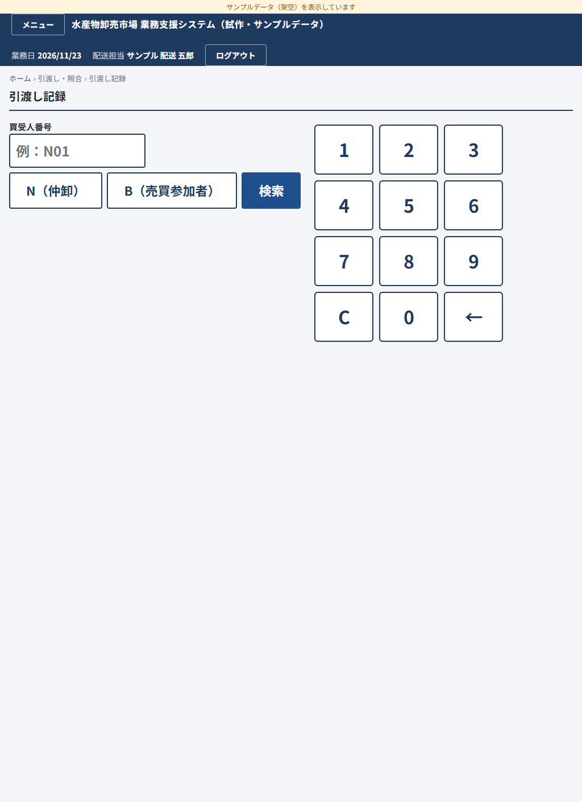

# SC-06-02 引渡し記録（タブレット）— wireframe

| Mục | Nội dung |
|---|---|
| Vai trò màn | **Nhập** — ghi từng lần giao ở bến (06:30–10:00), đeo găng, trời nắng |
| Vai ghi | DELIVERY, DEL-HEAD. Đọc: SETTLE, STL-HEAD, OPS-HEAD (P21) |
| Thiết bị | Tablet dọc; nút ≥ 64px; **được dùng offline** (lưu cục bộ + hàng đợi — ADR-008) |

## 1. Prototype (as-is)



`/deliveries`, delivery@, khung 1024 × 1366. Có: ô 買受人番号, nút N / B, bàn số, 検索; sau khi tìm: danh sách GD chờ giao, 「残り全部」 (không chụp — cần chọn người mua, vẫn là xem nhưng danh sách phụ thuộc dữ liệu ngày).

## 2. Wireframe to-be

```
[C-13]ホーム  業務日 2027/08/02  ●オフライン  配送担当 桜 次郎  [C-5]利用者切替
[C-28] ███ オフライン — 未同期 3件（最終同期 07:12）— 端末に保存しています ███
┌─ [1] 買受人番号 ────────────┐  ┌─ [2] テンキー ──────┐
│ [ N 01 ]  例：N01            │  │  7   8   9          │
│ [3] (N 仲卸) (B 売買参加者) ←選択中は塗りつぶし │  4   5   6          │
│ [4] [   検索   ]             │  │  1   2   3          │
│ [16] 取引データ 06:58 時点      │  │                     │
│   この時刻以降の取引は表示されません│  │                     │
└────────────────────────────┘  │  C   0   ←          │
                                 └─────────────────────┘
[5] N01 サンプル仲卸1 — 引渡し待ち 3件（前日残 1件を含む）
┌─ [6] ─────────────────────────────────────────────────────────┐
│ 取引       品目  単位 確定数量 引渡済  残     状態                  │
│ ▶相対-0005 鰹   kg   30     12    18    引渡し中                │
│  相対-0011 真鯛 箱    4      0     4    待機中                  │
│  せり-0302 鰤   kg   40      0    40    待機中  [前日残]          │
│ （行のどこを触っても選択）                                          │
└──────────────────────────────────────────────────────────────┘
[17] [ この買受人の残りをすべて引渡し（3件） ]
┌─ [7] 相対-0005 鰹 ── 残 18kg ─────────────────────────────────────┐
│ [8] 今回の数量 [ _ ] kg（空欄・カーソルはここ） [9]  (−)  (+)        │
│ [10] [   残り全部（18kg）   ]   ← 最大のボタン                     │
│ [11] 受取人 [ 本人 ] [ 代理 ] ← 大きな2ボタン。代理のときだけ氏名欄      │
│ [12] [  記録する  ]           [13] [ 例外・差異 → SC-06-04 ]        │
│ [14] 累計 12 → 18kg ／ 残 18 → 12kg（記録前プレビュー）                │
└───────────────────────────────────────────────────────────────┘
 記録後: C-12 「引渡し：N01 鰹 6kg（残 12kg）」 オフライン時は「端末に保存（未同期 4件）」
 残 0 → 自動で 完了（FT-06-03）
[15] [ 引渡票を印刷 → SC-06-06 ]
```

## 3. Item

| No | Item | Loại | Bắt buộc | Quy tắc | Nguồn |
|---|---|---|---|---|---|
| 1 | 買受人番号 | Ô số lớn | ✓ | Gợi ý 「例：N01」 | FB LAB-2 #13 |
| 2 | Bàn số | Nút | — | Phím ≥ 64px, viền đậm, tương phản cao | PRM-086 |
| 3 | Tiền tố N / B | Nút chọn | — | Đổi màu khi chọn | FB LAB-2 #13 |
| 4 | 検索 | Nút | — | Offline: tìm trong dữ liệu đã tải về máy (tải đầu ngày + mỗi lần đồng bộ) | ADR-008 |
| 5 | Tóm tắt người mua | Nhãn | — | Gồm cả 引渡し残 ngày trước | FR-DEL-05 |
| 6 | Danh sách GD chờ giao | Bảng chọn | — | 相対 và せり; trạng thái 待機中 / 引渡し中 / 完了 / 例外. Chạm vào bất kỳ chỗ nào trên dòng là chọn | FT-06-01, PRM-086 |
| 7 | Khối ghi giao | Vùng | — | | — |
| 8 | 今回の数量 | Số | ✓ (trừ [10]) | **Để trống, con trỏ ở đây** khi chọn GD — không điền sẵn (số điền sẵn mà người giao vội bấm 記録 là ghi sai — khách #8). > 0, ≤ 残; kg 1 chữ số lẻ, 箱 / 尾 số nguyên. GD bán theo kg có thể giao theo thùng — quy tắc 「khớp 精算」 là tham số quy chế | PRM-118, E-17, BR-LOT-02 |
| 9 | −/+ | Nút | — | Bước 1 cho 箱 / 尾 | — |
| 10 | 残り全部 | Nút lớn | — | Ghi đúng phần còn lại | FR-DEL-02 |
| 11 | 受取人 | 2 nút to + văn bản | ✓ | 「本人」/「代理」 (không dùng ô thả xuống ▼ — khó bấm khi đeo găng), **mặc định 本人**; chọn 代理 mới hiện ô tên (tùy chọn) — khách #13, Q-DEL-03 [Customer giả lập, 2026-11-25] | FR-DEL-01, PRM-086 |
| 12 | 記録する | Nút | — | Append-only; offline lưu cục bộ, gắn mã thiết bị + giờ | luật 4, ADR-008 |
| 13 | 例外・差異 | Nút | — | → SC-06-04 (thiếu / thừa / trả / tranh chấp) | FT-06-04 |
| 14 | Xem trước | Nhãn | — | | — |
| 15 | In 引渡票 | Nút | — | → SC-06-06 khi người mua cần | FT-06-08 |
| 16 | Mốc dữ liệu offline | Nhãn | — | **Chỉ hiện khi offline**: 「取引データ hh:mm 時点」 (giờ tải / đồng bộ cuối) + 「この時刻以降の取引は表示されません」 cạnh ô tìm, để người giao không kết luận nhầm "người mua không có hàng" — khách #2 | NFR-AVL-02, FR-DEL-01, KPI-05 |
| 17 | Giao hết một lần | Nút | — | Hiện khi người mua có ≥ 2 GD còn 残. Bấm → hộp xác nhận liệt kê từng GD (取引 / 品目 / 残) → 「すべて記録」; mỗi GD vẫn một dòng 「残り全部」 riêng; 受取人 chọn một lần cho cả nhóm. Offline vẫn dùng được — khách #12 | FR-DEL-02, PERSONA-DOCK-01 |

## 4. Trạng thái

| Trạng thái | Hiển thị |
|---|---|
| Không có GD chờ | C-21 「N01 の引渡し待ちはありません」 |
| Mất mạng | C-28 (luôn hiện, số chưa đồng bộ); [16] hiện mốc giờ dữ liệu; vẫn ghi được; [13] mở SC-06-04 bản offline (xem đường giấy ở WF SC-06-05) |
| Có mạng lại, đồng bộ làm SL âm / trùng | Không tự gộp → nhãn 「照合が必要 2件」 → SC-03-07 |
| Ngày đã khóa (GD ngày trước) | Giao GD ngày trước **vẫn ghi vào 業務日 hiện tại** (引渡し残 là bình thường); chỉ đổi tiền mới cần 修正申請 |
| Lỗi vượt 残 | C-22 dưới [8] |

## 5. Khác biệt theo vai

DELIVERY, DEL-HEAD: toàn màn. SETTLE / STL-HEAD / OPS-HEAD: xem trạng thái giao ở SC-06-01 / SC-04-04 (PC). Vai khác: C-25.

## 6. To-be khác prototype

| # | Prototype | To-be | Nguồn |
|---|---|---|---|
| 1 | Chỉ online | Lưu cục bộ + hàng đợi + C-28 | M04, ADR-008 |
| 2 | Không có nút ngoại lệ | [13] → SC-06-04 | M16 |
| 3 | Không in phiếu | [15] | FT-06-08 |
| 4 | Phím và viền nhạt (bản 1.1) — bản 1.2 đã làm to | Giữ bản 1.2, thêm chuẩn ≥ 64px, tương phản cao | FB LAB-2 #13 |
| 5 | Không có [14] xem trước | Có | — |
| 6 | Ô số lượng điền sẵn (ảnh prototype hiện 「6」) | Để trống, con trỏ ở ô | khách #8 |
| 7 | Không báo dữ liệu offline cũ | [16] | khách #2 |
| 8 | Giao từng GD | Thêm [17] giao hết một lần | khách #12 |

## History of change

| No | Version | Action | Nội dung thay đổi | Ngày | Người sửa | Approve |
|---|---|---|---|---|---|---|
| 1 | 0.1.0 | Add new | Bản đầu | 2026-11-25 | phuongnnm-23344 | |
| 2 | 0.2.0 | Update | Gate 1 / khách: [8] để trống không điền sẵn (#8); [16] mốc giờ dữ liệu offline (#2); [17] giao hết một lần (#12); [11] 2 nút 本人 / 代理 (#13); chạm cả dòng để chọn; số lẻ theo đơn vị (m-11); header dùng chữ 「ホーム」 thay 「≡」 (#32). Ảnh prototype giữ nguyên (ảnh có số 「6」 điền sẵn là as-is) | 2026-11-25 | phuongnnm-23344 | |
| 3 | 0.2.1 | Update | Khách Q-DEL-03: item 11 mặc định 本人 | 2026-11-25 | phuongnnm-23344 |  |
