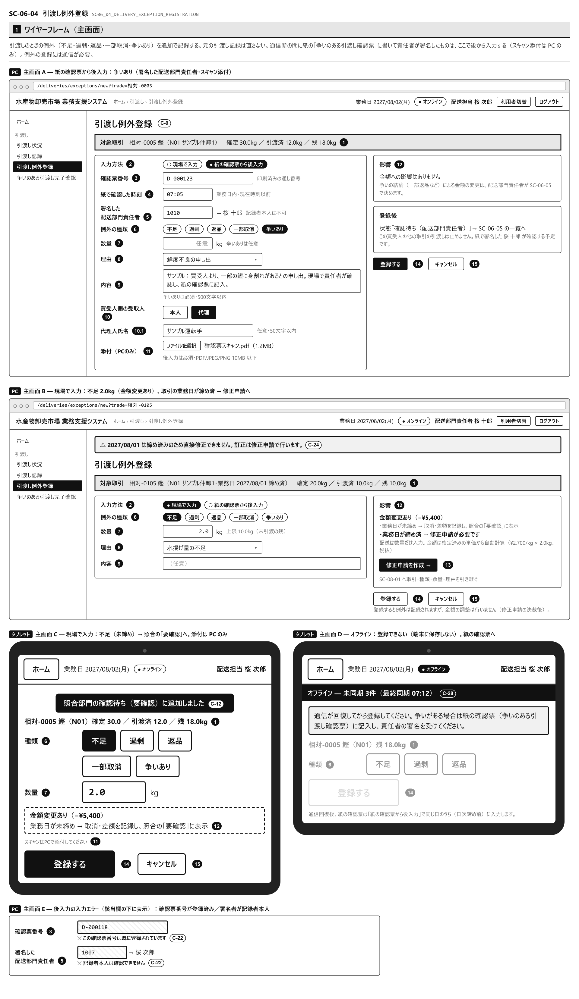

# SC-06-04 引渡し例外登録 — wireframe (màn mới, mức wireframe)

| Mục | Nội dung |
|---|---|
| Vai trò màn | **Nhập** — ghi ngoại lệ khi giao: thiếu / thừa / trả / hủy một phần / **tranh chấp**; cũng là nơi **nhập bù phiếu giấy 争いのある引渡し確認票** khi mất mạng (ADR-008 §2.4) |
| Vai ghi | DELIVERY, DEL-HEAD (P21). Đọc: SETTLE, STL-HEAD, OPS-HEAD |
| Thiết bị | PC/TAB. Tablet: ghi nhanh khi có mạng (ngoại lệ **không** ghi offline — ADR-008 §2.1); scan đính kèm chỉ ở PC (E-21) |

## 1. Prototype (as-is)

Không có (M16). Prototype chỉ có SC-06-02; không ảnh.

## 2. Wireframe to-be

> **Hình chuẩn (LAB-4):** nguồn hình là [`html/SC-06-04.html`](html/SC-06-04.html) — một file HTML cho mọi biến thể, render bằng `scripts/render-wireframes.py` ra [`png/SC-06-04.png`](png/SC-06-04.png) và [`pdf/wireframes-all.pdf`](pdf/wireframes-all.pdf); ảnh spec BM-51 lấy biến thể A. Khối ASCII dưới đây giữ làm mô tả bố cục; khi lệch, HTML + SPEC là bản đúng.




```
[1] 対象取引 相対-0005 鰹（N01 サンプル仲卸1） 確定 30kg ／ 引渡済 12kg ／ 残 18kg
[2] 入力方法 (●) 現場で入力   ( ) 紙の確認票から後入力
     └ 後入力のとき: [3] 確認票番号 [ D-000123 ]  [4] 紙で確認した時刻 [ 07:05 ]
                     [5] 署名した配送部門責任者 [ 社員番号 ____ ] → 桜 十郎
[6] 例外の種類  (不足) (過剰) (返品) (一部取消) (争いあり)
[7] 数量 [ 2 ] kg     [8] 理由 [ 鮮度不良の申し出 ▼ ]   [9] 内容 [                   ]
[10] 買受人側の受取人 [ 本人 ] [ 代理 ]（代理のときだけ氏名）
[11] 添付（PCのみ） [ ファイルを選択 ]  確認票スキャン.pdf（必須: 後入力のとき）
[12] 影響: 金額変更あり（−¥5,400）
     ・業務日が未締め → 取消・差額を記録し、照合の「要確認」に表示（締め前に照合部門が確認します）
     ・業務日が締め済 → 修正申請が必要です → [13]
[14] [ 登録する ]  [15] キャンセル
 登録後: 「争いあり」→ 状態「確認待ち（配送部門責任者）」→ SC-06-05 の一覧へ。他の取引の引渡しは止めない
```

## 3. Item

| No | Item | Loại | Bắt buộc | Quy tắc | Nguồn |
|---|---|---|---|---|---|
| 1 | GD + SL | Nhãn | — | | FR-DEL-01 |
| 2 | Cách nhập | Chọn | ✓ | Mặc định 現場; 後入力 khi trước đó mất mạng | ADR-008 §2.4 |
| 3 | Số phiếu giấy | Văn bản | Khi 後入力 | Số sê-ri in sẵn (bộ FORM); duy nhất; phiếu đã phát chưa nhập hiện ở checklist SC-07-02 [11] | ADR-008 §2.4 |
| 4 | Giờ xác nhận trên giấy | Giờ | Khi 後入力 | ≤ giờ hiện tại, trong 業務日 | ADR-008 §2.4 |
| 5 | DEL-HEAD đã ký | Mã nhân viên | Khi 後入力 + tranh chấp | Phải ≠ người ghi lần giao (PRM-111); chính người này sẽ xác nhận ở SC-06-05 | S1, ADR-008 §2.4 |
| 6 | Loại ngoại lệ | Nút chọn | ✓ | | FT-06-04 |
| 7 | SL | Số | ✓ (trừ 争いあり) | | — |
| 8 | Lý do | Chọn | ✓ | | — |
| 9 | Nội dung | Văn bản | Khi 争いあり | ≤ 500 | FR-DEL-04 |
| 10 | Người nhận phía mua | 2 nút + văn bản | — | 「本人」/「代理」, chọn 代理 mới hiện ô tên (khách #13) | PRM-086 |
| 11 | Đính kèm | File | Khi 後入力 | Chỉ PC; giới hạn dung lượng. Loại chứng từ 「紛争・引渡しの証憑」 → online 3 năm rồi lưu lạnh (TBL-ATTACH-01); xóa vật lý sau hạn phải có duyệt (B.7) | TBL-ATTACH-01, B.7, E-21, M11 |
| 12 | Ảnh hưởng tiền | Nhãn | — | Đổi tiền (不足 / 返品 / 一部取消) + **ngày chưa khóa** → bản ghi REVERSE / DELTA qua luồng giao **và** dòng ở tab 要確認 SC-07-01 + dòng ✖ ở checklist SC-07-02 [20] tới khi 照合事務局 bấm 「確認済」 (khách #4). Đổi tiền + **ngày đã khóa** → phải 修正申請 | BR-CLOSE-01, ADR-004, FR-SETTLE-01, OBJ-05 |
| 13 | Liên kết 修正申請 | Nút | — | → SC-08-01, mang mã GD | — |
| 14 | 登録する | Nút | — | Append-only; cần mạng — offline nút khóa (không xếp hàng đợi) | ADR-008 §2.1 |
| 15 | キャンセル | Nút | — | | — |

## 4. Trạng thái

| Trạng thái | Hiển thị |
|---|---|
| Mất mạng (tablet) | C-28 + câu 「通信が回復してから登録してください。争いがある場合は紙の確認票（争いのある引渡し確認票）に記入し、責任者の署名を受けてください」; form khóa, không lưu cục bộ. Có mạng lại → nhập bù phiếu giấy theo đường ADR-008 §2.4 (Q-DEL-01) |
| Số phiếu đã dùng | C-22 dưới [3] |
| [5] trùng người ghi giao | C-22: 「記録者本人は確認できません」 |
| Ngày chưa khóa + đổi tiền | [12] dòng 1; sau 登録 hiện C-12 「照合部門の確認待ち（要確認）に追加しました」 |
| Ngày đã khóa + đổi tiền | [12] dòng 2 + [13] (C-24) |

## 5. Khác biệt theo vai

DELIVERY, DEL-HEAD: toàn màn. SETTLE / STL-HEAD / OPS-HEAD: xem ở SC-07-03 / SC-07-04 / RPT-04.

## History of change

| No | Version | Action | Nội dung thay đổi | Ngày | Người sửa | Approve |
|---|---|---|---|---|---|---|
| 1 | 0.1.0 | Add new | Bản đầu, gồm đường nhập bù phiếu giấy theo ADR-008 §2.4 | 2026-11-25 | phuongnnm-23344 | |
| 2 | 0.2.0 | Update | Gate 1 / khách: ngoại lệ đổi tiền ở ngày chưa khóa → 要確認 SC-07-01 + checklist SC-07-02 (#4); 受取人 2 nút (#13); đính kèm theo loại chứng từ TBL-ATTACH-01 (M-08) | 2026-11-25 | phuongnnm-23344 | |
| 3 | 0.2.1 | Update | P3 gộp: ngoại lệ không ghi offline theo ADR-008 §2.1 — offline hiện C-28 + hướng dẫn phiếu giấy, form khóa; nhập bù khi có mạng (Q-DEL-01, khớp SC-06-04_SPEC) | 2026-11-25 | phuongnnm-23344 | |
| 4 | 0.2.2 | Update | LAB-4 wireframe HTML: nguồn hình `html/SC-06-04.html`, nhúng `png/SC-06-04.png` | 2026-11-25 | phuongnnm-23344 | |
