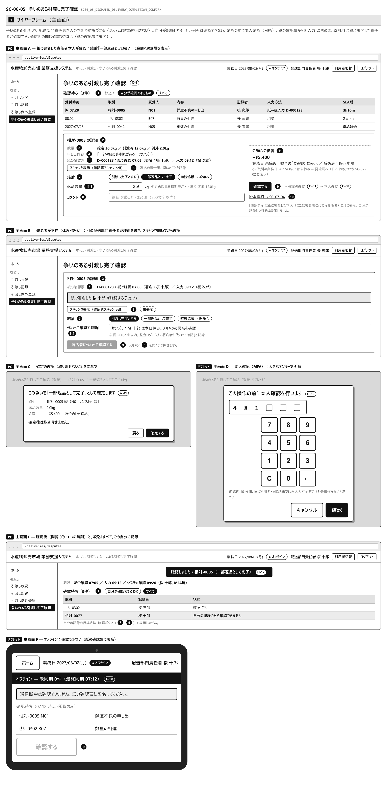

# SC-06-05 争いのある引渡し完了確認 — wireframe (màn mới, mức wireframe)

| Mục | Nội dung |
|---|---|
| Vai trò màn | **Quyết định** — 配送部門責任者 kết luận lần giao có tranh chấp (CAP-HUMAN-01) |
| Vai ghi | DEL-HEAD (◎, MFA — P22). **Cấm tự xác nhận** lần giao do chính mình ghi (S1, PRM-111). Đọc: SETTLE, STL-HEAD, OPS-HEAD |
| Thiết bị | PC/TAB — làm ở bến hoặc PC văn phòng; **không làm khi mất mạng** (đi đường giấy) |

## 1. Prototype (as-is)

Không có (M16): enum DEL_HEAD có nhưng không tài khoản demo, không màn. Không ảnh.

## 2. Wireframe to-be

> **Hình chuẩn (LAB-4):** nguồn hình là [`html/SC-06-05.html`](html/SC-06-05.html) — một file HTML cho mọi biến thể, render bằng `scripts/render-wireframes.py` ra [`png/SC-06-05.png`](png/SC-06-05.png) và [`pdf/wireframes-all.pdf`](pdf/wireframes-all.pdf); ảnh spec BM-51 lấy biến thể A. Khối ASCII dưới đây giữ làm mô tả bố cục; khi lệch, HTML + SPEC là bản đúng.




```
[1] 確認待ち（3件）  絞込: (自分が確認できるもの) (すべて)
┌──────────────────────────────────────────────────────────────────────────┐
│ 受付時刻 取引        買受人  内容           記録者   入力方法          SLA残   │
│ ▶07:20  相対-0005   N01   鮮度不良の申し出 桜 次郎  紙→後入力 D-000123  3h10m │
│  08:02  せり-0302   B07   数量の相違      桜 三郎  現場             2日4h  │
│  07/28  相対-0042   N05   箱数の相違      桜 次郎  現場             SLA超過 │
│ （既定の絞込「自分が確認できるもの」では自分の記録は表示しない。「すべて」で表示し、     │
│   「自分の記録のため確認できません」）                                              │
└──────────────────────────────────────────────────────────────────────────┘
┌─ [2] 相対-0005 の詳細 ────────────────────────────────────────────────────┐
│ [3] 確定 30kg / 引渡済 12kg / 例外 2kg   [4] 申し出内容「…」                    │
│ [5] 紙の確認票 D-000123: 紙で確認 07:05（署名: 桜 十郎）／ 入力 09:12（桜 次郎）    │
│     [6] スキャンを表示（確認票スキャン.pdf）                                     │
│ [7] 結論 (引渡し完了とする) (一部返品として完了) (継続協議 → 紛争へ)               │
│ [11.1] 返品数量 [ 2.0 ]kg（一部返品のとき・例外の数量を初期表示・上限 引渡済）       │
│ [11] 金額への影響（一部返品のとき）: −¥5,400 → 業務日 未締め: 要確認に表示 ／ 締め済: 修正申請 │
│ [8] コメント [                                          ]                   │
│ [8.1] 署名者に代わって確認する理由 [            ]（紙の署名者 ≠ 確認者 のときだけ・必須）  │
│ [9] [ 確認する ]  → C-31 → C-30 MFA     [10] 紛争詳細 → SC-07-04              │
└──────────────────────────────────────────────────────────────────────────┘
 完了後の記録表示: 「紙で確認 07:05 ／ 入力 09:12 ／ システム確認 09:20（桜 十郎、MFA済）」
```

## 3. Item

| No | Item | Loại | Quy tắc | Nguồn |
|---|---|---|---|---|
| 1 | Danh sách chờ | Bảng chọn | Mặc định 「自分が確認できるもの」 (loại dòng do chính mình ghi); cột SLA còn lại | FR-DEL-04, S1 |
| 2 | Khối chi tiết | Vùng | | — |
| 3 | SL | Nhãn | | — |
| 4 | Nội dung tranh chấp | Nhãn | | FT-06-04 |
| 5 | **Phiếu giấy** | Nhãn | Chỉ khi nhập bù: số phiếu, **「紙で確認 hh:mm」 và 「入力 hh:mm」** + người ký | ADR-008 §2.4 |
| 6 | Bản scan | Liên kết | Để đối chiếu chữ ký | E-21 |
| 7 | Kết luận | Nút chọn | Bắt buộc | CAP-HUMAN-01 |
| 8 | Bình luận | Văn bản | Bắt buộc khi 継続協議 | — |
| 8.1 | Lý do xác nhận thay người ký | Văn bản | Chỉ hiện ở dòng phiếu giấy khi người xem ≠ người ký [5]; bắt buộc, ≤ 200 ký tự (`E-DEL-022`). Bổ sung để khớp SC-06-05_SPEC | khách #16 |
| 9 | 確認する | Nút | Ẩn nếu người xem là người ghi lần giao; với phiếu giấy, mặc định **người đã ký** [5] xác nhận. Người ký vắng (nghỉ ca / nghỉ phép) → **配送部門責任者 khác** (hoặc 代行) được xác nhận với **lý do bắt buộc** + phải mở [6] đối chiếu bản scan; 監査ログ ghi "xác nhận thay người ký giấy". Vẫn cấm tự xác nhận lần giao do mình ghi. C-31 → C-30 MFA (khách #16) | S1, ADR-008 §2.4, ADR-002 |
| 11 | Ảnh hưởng tiền | Nhãn | Khi chọn 「一部返品として完了」: hiện số tiền thay đổi và đường đi — ngày chưa khóa → 要確認 SC-07-01 (dòng ✖ checklist SC-07-02 [20]); ngày đã khóa → 修正申請 (khách #17) | BR-CLOSE-01, FR-DEL-03 |
| 11.1 | 返品数量 | Ô số | Khi 一部返品: mặc định = SL ngoại lệ; > 0 và ≤ 引渡済; cần để tính [11]. Bổ sung để khớp SC-06-05_SPEC | khách #17 |
| 10 | Tranh chấp | Liên kết | → SC-07-04 | FT-07-05 |

## 4. Trạng thái

| Trạng thái | Hiển thị |
|---|---|
| Không có mục chờ | C-21 |
| Dòng do chính mình ghi | Nhãn 「自分の記録のため確認できません」, [9] ẩn |
| Phiếu giấy, người xem ≠ người ký | 「紙で署名した 桜 十郎 が確認する予定です」; [9] hiện dạng 「署名者に代わって確認する」 + ô lý do bắt buộc, chỉ bật sau khi đã mở [6] |
| Quá SLA | Dòng đỏ; vẫn xác nhận được |
| Mất mạng | C-28: 「通信断中は確認できません。紙の確認票に署名してください」 |
| Đã xác nhận | Chỉ đọc với 3 mốc giờ |

## 5. Khác biệt theo vai

DEL-HEAD (không phải người ghi): toàn màn. DEL-HEAD = người ghi: chỉ đọc dòng đó. DELIVERY: xem trạng thái ở SC-06-01. SETTLE / STL-HEAD / OPS-HEAD: chỉ đọc + SC-07-03.

## History of change

| No | Version | Action | Nội dung thay đổi | Ngày | Người sửa | Approve |
|---|---|---|---|---|---|---|
| 1 | 0.1.0 | Add new | Bản đầu, nhãn 「紙で確認 / 入力」 theo ADR-008 §2.4 | 2026-11-25 | phuongnnm-23344 | |
| 2 | 0.2.0 | Update | Khách #16: người ký giấy vắng → 配送部門責任者 khác xác nhận với lý do + đối chiếu scan; #17: [11] ảnh hưởng tiền khi 一部返品 | 2026-11-25 | phuongnnm-23344 | |
| 3 | 0.2.1 | Update | LAB-4 wireframe HTML: nguồn hình `html/SC-06-05.html`, nhúng `png/SC-06-05.png`; thêm item 8.1 (lý do xác nhận thay người ký) và 11.1 (返品数量) theo SPEC; dòng do chính mình ghi không hiện ở bộ lọc mặc định | 2026-11-25 | phuongnnm-23344 | |
