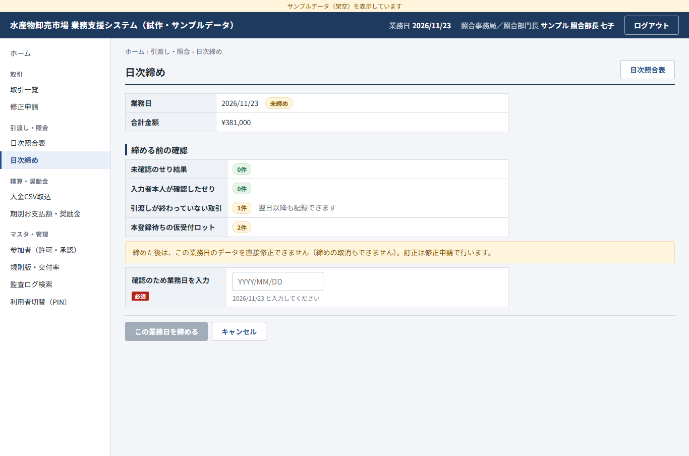

# SC-07-02 日次締め — wireframe

| Mục | Nội dung |
|---|---|
| Vai trò màn | **Quyết định** — khóa 業務日; sau khóa không ai sửa trực tiếp, chỉ qua 修正申請 (BR-CLOSE-01) |
| Vai ghi | STL-HEAD hoặc 代行 đã chỉ định (◎, MFA — P25, S8). Đọc: SETTLE |
| Thiết bị | PC. Mục tiêu khóa 10:00, muộn nhất 10:30 (PRM-030) |
| Ràng buộc | **Không có nút mở lại ngày đã khóa** ở bất kỳ màn nào (PRM-031, ADR-005) |

## 1. Prototype (as-is)



`/settlement/close`, stlhead@. Có: 業務日 + 合計, checklist 4 dòng, câu cảnh báo, ô gõ lại ngày, nút khóa mờ khi còn せり chưa xác nhận.

## 2. Wireframe to-be

```
[1] 業務日 2027/08/02(月)  未締め      [2] 合計（税抜）¥12,381,000（相対 ¥11,140,000 / せり ¥1,241,000）
┌─ [3] 締める前の確認 ────────────────────────────────────────────────────────────┐
│ 区分                                  件数   締めへの影響   対応                          │
│ [4] 未確認のせり結果                     1件   ✖ 締め不可    確認する → SC-05-02            │
│ [5] 入力者本人が確認したせり              1件   ⚠ 要確認      理由を見る → SC-07-01 要確認     │
│ [6] 確定待ちの取引（下書き・提出）         0件   ✖ 締め不可    —                              │
│ [7] 保留中の紙伝票後入力                 2件   ✖ 締め不可    判断する → SC-04-07            │
│ [8] 未同期の端末（最終同期時刻）          1台   ✖ 締め不可    TAB-03 07:12 → SC-03-07         │
│ [9] 未確認の当日訂正・取消               3件   ⚠ 要確認      確認する → SC-07-01            │
│ [10] 販売残のあるロット（持ち越し）        4件   ⚠ 持ち越し    一覧 → SC-03-03                 │
│ [11] 未入力の紙の争い引渡し確認票          1件   ⚠ 要確認      → SC-06-04                     │
│ [12] 引渡し残（翌日以降も記録可）         12件   ─ 締め可      一覧を確認 ☐ [13] 確認済み        │
└────────────────────────────────────────────────────────────────────────────────┘
[14] 締めた後は、この業務日のデータを直接修正できません（締めの解除もできません）。訂正は修正申請で行います。
[15] 代行で締める場合: 「照合部門長 桜 七子 の代行として締めます」（代行指定がある場合のみ表示）
[16] 確認のため業務日を入力 [ 2027/08/02 ]（/ と - のどちらも可）
[17] [ この業務日を締める ]  → C-31 確認 → C-30 MFA → 完了     [18] キャンセル
 完了後: 「2027/08/02 を締めました（桜 七子 10:04）」、会計CSV作成を開始（SC-11-14、11:00まで）
```

## 3. Item

| No | Item | Loại | Quy tắc | Nguồn |
|---|---|---|---|---|
| 1 | 業務日 + trạng thái | Nhãn | 未締め / 締め済 | FR-SETTLE-02 |
| 2 | Tổng | Nhãn | Tách 相対 / せり | FB LAB-2 #12 |
| 3 | Checklist | Bảng | Mỗi dòng: số, ảnh hưởng (✖ chặn / ⚠ cảnh báo / ─ không), **liên kết tới đúng màn xử lý** | PRM-119, FB LAB-2 #11 |
| 4 | せり chưa xác nhận | Dòng ✖ | | FR-SERI-02 |
| 5 | せり tự xác nhận | Dòng ⚠ | | S2, PRM-115 |
| 6 | GD 下書き / 提出 | Dòng ✖ | Phụ thuộc trạng thái FIG-012 (D10) | PRM-114 |
| 7 | 紙伝票後入力 đang giữ | Dòng ✖ | | FT-04-07 |
| 8 | Máy chưa đồng bộ | Dòng ✖ | Tên máy + giờ đồng bộ cuối | L4-A05, ADR-008 |
| 9 | 当日訂正 / 取消 chưa soát | Dòng ⚠ | | PRM-127 |
| 10 | Lô còn SL (持ち越し) | Dòng ⚠ | Cách xử lý 持ち越し tạm theo quy chế (E-12) | PRM-110, E-12 |
| 11 | Phiếu giấy tranh chấp chưa nhập | Dòng ⚠ | Số phiếu sê-ri đã phát mà chưa nhập bù | ADR-008 §2.4 |
| 12 | 引渡し残 | Dòng ─ | Chuyện hằng ngày, không chặn | FR-DEL-05 |
| 13 | Ô 「確認済み」 | Checkbox | Bắt buộc tick (không chặn bởi số lượng) | PRM-119 |
| 14 | Câu cảnh báo | Nhãn | Luôn hiện | BR-CLOSE-01 |
| 15 | Dòng 代行 | Nhãn | Audit ghi "thay cho ai" | S8, RACI-01 |
| 16 | Gõ lại ngày | Văn bản | Khớp 業務日; chấp nhận `/` và `-` | FB LAB-2 #8 |
| 17 | 締める | Nút | Mờ khi còn dòng ✖ hoặc [13] chưa tick hoặc [16] sai; C-31 → **C-30 MFA (10 phút, ADR-002)** | P25, ADR-002 |
| 18 | キャンセル | Nút | | — |

## 4. Trạng thái

| Trạng thái | Hiển thị |
|---|---|
| Đã khóa | Toàn màn chỉ đọc: 「締め済（桜 七子 10:04、MFA済）」; **không có nút mở lại**; liên kết 「訂正は修正申請へ」 |
| Còn dòng ✖ | [17] mờ, câu 「✖ の項目を解消すると締められます」 |
| Mất mạng | C-28: không khóa được |
| Người không có quyền / chưa có 代行 | C-25 (SETTLE xem checklist chỉ đọc) |
| MFA sai / hủy | Ở lại màn, không khóa |

## 5. Khác biệt theo vai

| Vai | Thấy |
|---|---|
| STL-HEAD / 代行 | Toàn màn |
| SETTLE | Checklist + liên kết, không [13], [16], [17] |
| OPS-HEAD | Xem trạng thái ngày ở SC-07-01 |

## 6. To-be khác prototype

| # | Prototype | To-be | Nguồn |
|---|---|---|---|
| 1 | 4 dòng checklist, không liên kết | 9 dòng có mức ảnh hưởng + liên kết | PRM-119, FB LAB-2 #11 |
| 2 | Không MFA (hộp xác nhận ghi 「試作では省略」) | C-30 MFA step-up | M02, ADR-002 |
| 3 | Không 代行 | [15] | S8 |
| 4 | Không có dòng máy chưa đồng bộ, phiếu giấy | [8], [11] | M04, ADR-008 |

## History of change

| No | Version | Action | Nội dung thay đổi | Ngày | Người sửa | Approve |
|---|---|---|---|---|---|---|
| 1 | 0.1.0 | Add new | Bản đầu | 2026-11-25 | phuongnnm-23344 | |
