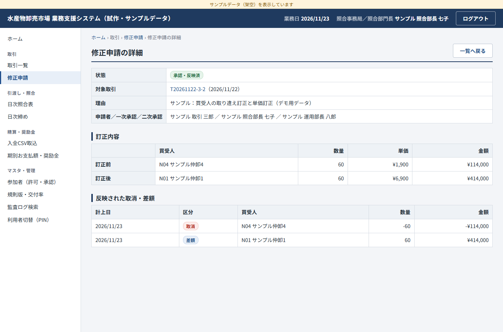

# SC-08-03 修正申請決裁・却下 — wireframe

| Mục | Nội dung |
|---|---|
| Vai trò màn | **Quyết định** — duyệt (決裁) / từ chối điều chỉnh sau khi chốt. Duyệt **không sửa GD gốc**: sinh bản ghi REVERSE + DELTA ghi sổ ở 業務日 chưa khóa sớm nhất; **kỳ của dòng = kỳ của GD gốc** (luật 4, ADR-004, ADR-007) |
| Vai ghi | Cấp 1: STL-HEAD (hoặc OPS-HEAD thay); cấp 2: OPS-HEAD (◎, MFA — P27, P28). Người lập không duyệt; một người không duyệt cả 2 cấp (S3) |
| Thiết bị | PC |
| Tên màn | LAB-1 ghi 「修正申請承認・却下」; LAB-4 đổi nhãn thành 「修正申請決裁・却下」 để chữ 承認 chỉ dùng cho 承認（売買参加者）(luật 2, PRM-121, PREMISE L4-D03). ID màn giữ nguyên |

## 1. Prototype (as-is)



`/corrections/[id]`, stlhead@, yêu cầu mẫu đã duyệt 2 cấp (dữ liệu 「サンプル」). Có: trạng thái, GD đích, lý do, 3 người, bảng 訂正前 / 訂正後, bảng 取消・差額 đã sinh.

## 2. Wireframe to-be (yêu cầu đang chờ cấp 1)

Ví dụ: GD 相対-0005 có 業務日 2027/08/02 → thuộc **kỳ 2027-08**. 修正申請 nộp 2027/09/14, lúc đó kỳ 2027-08 đã 期ロック (khóa sau 支払期日 2027/09/10).

```
[1] 状態 決裁待ち（1次）  [2] 必要な決裁 2段階（買受人変更あり／買受人別の変動額 最大 ¥447,120 ≥ 閾値 ¥100,000 — 規則版 第3版）
[3] 対象取引 相対-0005（業務日 2027/08/02・締め済・2027-08期）→ 取引詳細
[4] 種類 単価・買受人の訂正   [5] 理由 「買受人の取り違え…」   [6] 証憑 伝票スキャン.pdf（1件）
[7] 申請者 桜 三郎 09/14 08:40 ／ 1次 — ／ 2次 —        [8] 経過 1営業日（2営業日超で警告）
┌─ [9] 訂正内容 ────────────────────────────────────────────────────┐
│        買受人             数量   単価     金額（税抜）                │
│ 訂正前  N04 サンプル仲卸4   60   ¥1,900   ¥114,000                   │
│ 訂正後  N01 サンプル仲卸1   60   ¥6,900   ¥414,000                   │
│ 買受人別の変動額（税込 8%）: N04 −¥123,120 ／ N01 +¥447,120             │
└─────────────────────────────────────────────────────────────────┘
┌─ [10] 決裁すると作成される記録（元の取引は変更しません）──────────────────────┐
│ 計上業務日 2027/09/15（未締めの最も早い業務日）／ 対象期 2027-08（元取引の期）   │
│ 取消  N04  −60  −¥114,000 ／ 差額  N01  +60  +¥414,000                    │
│ [11] 影響: 2027-08期は期ロック済 → 2027-09期の請求額には入れず、               │
│      2027-09期の期ロック時に 2027-08期を再計算し奨励金差分を計上（完納判定は変えない）│
└─────────────────────────────────────────────────────────────────┘
[12] 却下理由 [                       ]（却下時必須）
[13] [ 1次決裁する ]   [14] [ 却下する ]   → C-31 → C-30 MFA
[15] 決裁履歴: 申請 09/14 08:40 桜 三郎 …（監査ログへ）
[16] [ 次の決裁待ちへ → ]（決裁・却下の後に表示）
```

## 3. Item

| No | Item | Loại | Quy tắc | Nguồn |
|---|---|---|---|---|
| 1 | Trạng thái | Nhãn | 決裁待ち（1次）/（2次）/ 決裁・反映済 / 却下 | FR-CORR-02, L4-D03 |
| 2 | Số cấp cần duyệt | Nhãn | So ngưỡng của **quy chế có version đang hiệu lực** (tạm 100.000 JPY, E-08) với **tiền thay đổi lớn nhất của một người mua** = max theo người mua của \|Σ chênh 税込\| — không dùng chênh net (đổi người mua cùng giá thì net = 0 nhưng tiền dời giữa hai người). **Đổi 買受人 → luôn 2 cấp**; `KANNO`, `INCENTIVE` luôn 2 cấp. Ghi số version. Đã trả lời khách #3 [Customer giả lập, 2026-11-25] | M13, D07, PREMISE §3.1, FR-CORR-02, ADR-004 |
| 3 | GD đích | Liên kết | → SC-04-04; hiện 業務日, nhãn 締め済, kỳ của GD | — |
| 4 | Loại | Nhãn | `TRADE` (SL / đơn giá / người mua / thiếu-trả) · `KANNO` (đổi 完納 — PRM-055) · `INCENTIVE` (sửa thưởng kỳ đã khóa do tỷ lệ áp sai) · `LATE_ENTRY` (後入力 cho ngày đã khóa — SC-03-07) | FT-08-01, ADR-007 |
| 5 | Lý do | Nhãn | | FORM-CORR-01 |
| 6 | Chứng từ | Liên kết | Xem file (loại chứng từ `CORRECTION_EVIDENCE`) | M11, TBL-ATTACH-01 |
| 7 | Người lập / cấp 1 / cấp 2 | Nhãn | Kèm "代行: thay cho …" nếu có | S3, S8 |
| 8 | Thời gian chờ | Nhãn | > 2 営業日 → vàng | FR-NOTIFY-03 |
| 9 | Bảng 訂正前 / 訂正後 | Bảng | Thêm dòng biến động theo từng người mua (税込, theo thuế suất của GD — thủy sản tươi 8%) | — |
| 10 | Bản ghi sẽ sinh | Bảng | REVERSE (người mua cũ) + DELTA (người mua mới). Hai trục: **計上業務日** = 業務日 chưa khóa sớm nhất (sổ ngày, 精算, IF-ACC-01); **対象期** = kỳ của GD gốc | ADR-004, ADR-007, PRM-120 |
| 11 | Ảnh hưởng 期のお支払額 / 奨励金 | Nhãn | Kỳ gốc còn mở → 「2027-08期の請求額に反映されます」; kỳ gốc đã 期ロック → không vào kỳ đang mở, DELTA ở 期ロック kế tiếp; không hồi tố 完納 (trừ loại `KANNO`) | PRM-043, ADR-007 |
| 12 | Lý do từ chối | Văn bản | Bắt buộc khi từ chối, ≤ 200 | — |
| 13 | Duyệt | Nút | Nhãn đổi theo cấp: 「1次決裁する」 / 「2次決裁する（反映）」; ẩn nếu người xem là người lập hoặc đã duyệt cấp 1 | S3, L4-D03 |
| 14 | Từ chối | Nút | | — |
| 15 | Lịch sử | Bảng | Liên kết SC-13-01 | FR-AUDIT-01 |
| 16 | Sang yêu cầu kế tiếp | Nút | Mở yêu cầu 決裁待ち kế tiếp của người xem; trong 10 phút MFA không hỏi lại mã (trừ khi idle quá hạn). Khách #29 (Muốn có) | L4-A07 |

## 4. Trạng thái

| Trạng thái | Hiển thị |
|---|---|
| Người xem là người lập | Nút [13] [14] ẩn; câu 「申請者本人は決裁できません」 |
| Đã duyệt cấp 1 bởi người xem | Câu 「1次と2次を同じ人は決裁できません」 |
| Chờ cấp 2 | [1] 「決裁待ち（2次）」, [7] có tên cấp 1 |
| Kỳ gốc còn mở | [11] 「元取引の期（2027-08）はまだ期ロック前のため、同期の請求額に反映されます」 |
| Đã phản ánh | Chỉ đọc; [10] hiện bản ghi thật (như prototype) |
| Bị từ chối | Chỉ đọc + lý do |
| GD đích có yêu cầu khác đang chờ | Không xảy ra (tối đa 1 yêu cầu chờ / GD) |
| Mất mạng | C-28 |

## 5. Khác biệt theo vai

| Vai | Thấy |
|---|---|
| STL-HEAD | Nút cấp 1 (khi không phải người lập) |
| OPS-HEAD | Nút cấp 2; nút cấp 1 khi thay STL-HEAD |
| TRADE / DELIVERY / SETTLE (người lập) | Chỉ đọc yêu cầu của mình + các yêu cầu khác theo 閲 |

## 6. To-be khác prototype

| # | Prototype | To-be | Nguồn |
|---|---|---|---|
| 1 | Ngưỡng 2 cấp hằng số 300.000, so với chênh net | Tham số quy chế có version, tạm 100.000; so với tiền thay đổi lớn nhất của một người mua; đổi người mua luôn 2 cấp; hiện ở [2] | M13, D07, khách #3 |
| 2 | Không MFA | C-30 | M02, ADR-002 |
| 3 | Không xem trước bản ghi sẽ sinh trước khi duyệt | [10], [11] (có 計上業務日 và 対象期 tách nhau) | FR-CORR-02, ADR-007 |
| 4 | Không chứng từ, không đếm thời gian chờ | [6], [8] | M11, FR-NOTIFY-03 |
| 5 | Nhãn 「承認」 | 「決裁」 cho duyệt nội bộ | luật 2, PRM-121 |

## History of change

| No | Version | Action | Nội dung thay đổi | Ngày | Người sửa | Approve |
|---|---|---|---|---|---|---|
| 1 | 0.1.0 | Add new | Bản đầu | 2026-11-25 | phuongnnm-23344 | |
| 2 | 0.2.0 | Update | Gate 1: đổi nhãn 承認 → 決裁 (M-06); ví dụ [10]/[11] tách 計上業務日 và 対象期 = kỳ GD gốc, sửa ví dụ kỳ sai (C-02); ngưỡng 2 cấp theo tiền thay đổi lớn nhất của một người mua, đổi 買受人 luôn 2 cấp (khách #3); thêm loại KANNO / INCENTIVE / LATE_ENTRY ở [4]; nút [16] 次の決裁待ちへ (khách #29). Ảnh prototype giữ nguyên | 2026-11-25 | phuongnnm-23344 | |
