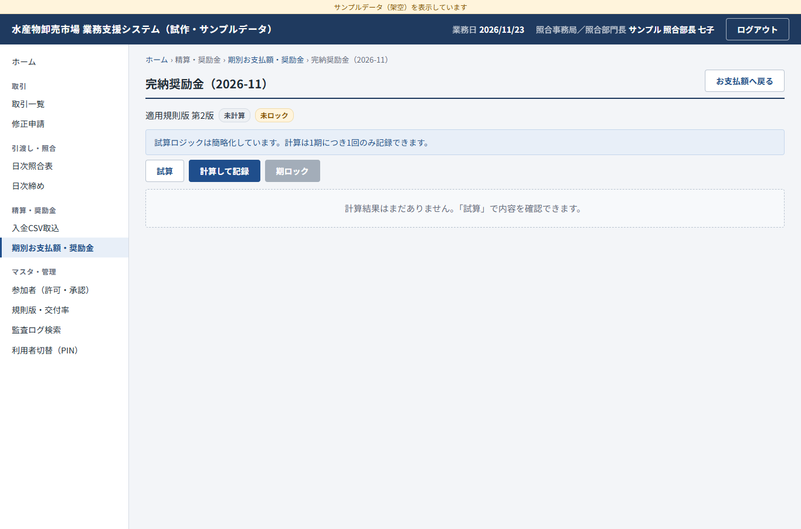
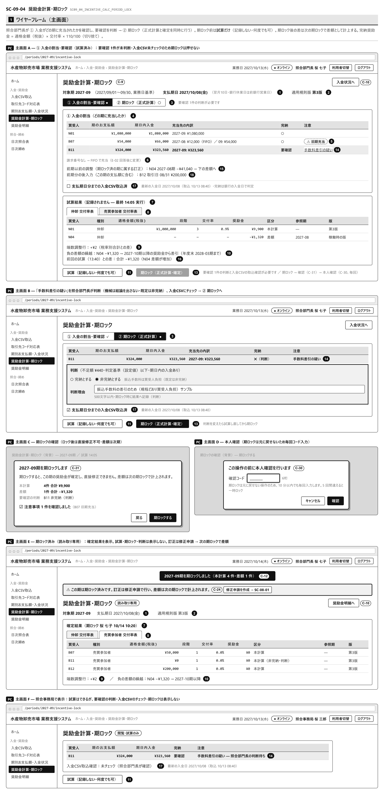

# SC-09-04 奨励金計算・期ロック — wireframe

| Mục | Nội dung |
|---|---|
| Vai trò màn | **Quyết định** — 2 bước: xác nhận 入金 đã gán đủ (và xử lý dòng 要確認) → **期ロック = tính chính thức + đóng băng trong cùng một transaction** (ADR-007 §2.1). Trước khóa chỉ có **試算** (không ghi kết quả). Sau khóa, mọi chênh lệch đi DELTA ở kỳ khóa kế tiếp (luật 4) |
| Vai ghi | STL-HEAD (◎, MFA — P30). Đọc: SETTLE, OPS-HEAD |
| Thiết bị | PC |

## 1. Prototype (as-is)



`/periods/[id]/incentives`, stlhead@, kỳ 2026-11 chưa tính. Có: version áp dụng, 試算 / 計算して記録 / 期ロック, câu 「試算ロジックは簡略化しています」. Ba bước tách (試算 → ghi kết quả khi kỳ còn mở → khóa) là lệch **Sai** N13 của Database Design — to-be bỏ bước giữa.

## 2. Wireframe to-be

> **Hình chuẩn (LAB-4):** nguồn hình là [`html/SC-09-04.html`](html/SC-09-04.html) — một file HTML cho mọi biến thể, render bằng `scripts/render-wireframes.py` ra [`png/SC-09-04.png`](png/SC-09-04.png) và [`pdf/wireframes-all.pdf`](pdf/wireframes-all.pdf); ảnh spec BM-51 lấy biến thể A. Khối ASCII dưới đây giữ làm mô tả bố cục; khi lệch, HTML + SPEC là bản đúng.




Số tiền ví dụ dùng thuế suất **8% (軽減税率, thủy sản tươi)**. Hệ số 110/100 của 奨励金 là quy tắc cố định của BR-INC-01 / 13-06, không theo thuế suất hàng.

```
[1] 対象期 2027-09（2027/09/01〜09/30、業務日基準）  支払期日 2027/10/08(金)（10日、銀行休業日は前銀行営業日）  [2] 適用規則版 第3版
[3] ステップ  ①入金の割当・要確認 ●  ②期ロック（正式計算）○
┌─ [4] ① 入金の割当（どの期に充当したか）────────────────────────────────────┐
│ 買受人  期のお支払額  期日内入金  充当先の内訳                    完納      注意          │
│ N01    ¥1,080,000   ¥1,080,000  2027-09: ¥1,080,000           ○                        │
│ B07    ¥   54,000   ¥   66,000  2027-08: ¥12,000（FIFO）/ 09: ¥54,000 ○  [5]⚠旧期充当  │
│ B11    ¥  324,000   ¥  323,560  2027-09: ¥323,560             要確認  [14]手数料差引の疑い│
│ [6] 請求番号なし → FIFO で充当（E-02 回答後に変更）                                     │
│ [15] 前期以前の調整（期ロック済の期に属する訂正）: N04 2027-08期 −¥41,040 → 下の差額へ │
│ [18] 前期分の後入力（この期の支払額に含む）: B12 取引日 08/31 ¥200,000                      │
│ [17] □ 支払期日分までの入金CSV取込済　最新の入金日 2027/10/08（取込 10/13 08:40）           │
└────────────────────────────────────────────────────────────────────────────┘
┌─ [7] 試算結果（記録されません — 最終 14:05 実行）────────────────────────────────┐
│ [8] タブ: (仲卸 交付率表) (売買参加者 交付率表)                                     │
│ 買受人 種別  適格金額(税抜) 段階  交付率  奨励金       区分   参照期   版              │
│ N01   仲卸   ¥1,000,000   3    0.9%   ¥9,900      本計算  —      第3版             │
│ N04   仲卸   —            —    —      −¥1,320     差額   2027-08 稼働時の版 │
│ [9] 端数調整行: +¥2（税率別合計との差）                                           │
│ [10] 負の差額の繰越: N04 −¥1,320 → 2027-10期以降の奨励金から差引（年度末 2028-03期まで）│
│ [16] 前回の試算（13:40）との差: 合計 −¥1,320（N04 差額が増加）                       │
└────────────────────────────────────────────────────────────────────────────┘
[11] [ 試算（記録しない・何度でも可） ]   [13] [ 期ロック（正式計算・確定） ]（C-31 → C-30 MFA）
```

## 3. Item

| No | Item | Loại | Quy tắc | Nguồn |
|---|---|---|---|---|
| 1 | Kỳ + 支払期日 | Nhãn | Kỳ = tháng theo **業務日** của GD gốc (GD 後入力 theo 取引日 thật). 支払期日 = ngày 10 tháng sau; rơi **ngày ngân hàng nghỉ** → lùi về **ngày ngân hàng mở trước** (vd. kỳ 2028-05: 2028/06/10 thứ Bảy — chợ mở, ngân hàng nghỉ → 2028/06/09) | L4-A04 (2), D05, ADR-007 |
| 2 | Version áp dụng | Nhãn | Version hiệu lực ngày 1 của kỳ | PRM-042 |
| 3 | Thanh 2 bước | Điều hướng | ② chỉ mở khi ① không còn dòng 要確認 chưa quyết | FT-09-07 |
| 4 | Bảng gán 入金 | Bảng | **Hiện tiền đã gán vào kỳ nào** để 照合 kiểm trước khi khóa. Cột 完納: ○ / ✖ / **要確認** | OPEN-L4-02, D03 |
| 5 | Cảnh báo gán kỳ cũ | Nhãn ⚠ | FIFO đem tiền kỳ mới trả nợ kỳ cũ → kỳ mới có thể mất 完納 | OPEN-L4-02, FB-CUS-225 |
| 6 | Ghi chú FIFO | Nhãn | Đổi khi E-02 trả lời | E-02 |
| 7 | Khối 試算 | Vùng | Luôn là **試算** trước khi khóa (tiêu đề ghi rõ 「記録されません」 + giờ chạy cuối). Không có trạng thái "đã tính, chưa khóa" | ADR-007 §2.1, N13 |
| 8 | Tab 2 bảng tỷ lệ | Tab | 仲卸 / 売買参加者, mỗi bảng 5 bậc | D01, BR-INC-01 |
| 9 | 端数調整 | Dòng | | PRM-053, D04 |
| 10 | Mang sang delta âm | Nhãn | Delta âm trừ dần vào thưởng các kỳ sau tới hết năm TC của kỳ ghi nhận; phần âm còn lại cuối năm → dòng `CARRY_EXPIRED`, hiện ở RPT-07 để 照合部門 xử lý | M08, D23, ADR-007 |
| 11 | 試算 | Nút | Không ghi kết quả; chạy bao nhiêu lần cũng được (khách #6). Mỗi lần ghi một dòng 監査ログ (giờ, mã băm đầu vào, tổng) để [16] so với lần trước. 入金 CSV đến muộn / gán sai trước khi khóa → sửa phân bổ rồi 試算 lại | khách #6, ADR-007 |
| 12 | (bỏ) 計算して記録 | — | Bỏ ở 0.2.0 — kết quả chính thức chỉ ghi trong transaction 期ロック (M-02, N13); giữ số theo quy tắc `_common-layout` | ADR-007 §2.1 |
| 13 | 期ロック | Nút | C-31 (「ロック後は直接修正できません。差額は次期の期ロックで計上されます」) → C-30 MFA (luôn hỏi lại mã — hành động không quay lại được). Trong **cùng transaction**: tính chính thức MAIN + DELTA mọi kỳ đã khóa có đầu vào đổi sau khi khóa (không giới hạn năm TC, theo **version của kỳ cũ**, không hồi tố 完納 — trừ 修正申請 KANNO), ghi kết quả + mã băm đầu vào, sinh 端数調整, đóng kỳ, xếp email | PRM-043, ADR-007 |
| 14 | 「手数料差引の疑い」 | Nhãn + hộp quyết | Thiếu ≤ mức đánh dấu ở file cấu hình và có 入金 trong hạn → **要確認**, máy **không** tự kết luận. 照合部門長 chọn 完納 / 非完納 + lý do (bắt buộc); gợi ý mặc định 非完納 (phí chuyển khoản do người mua chịu — PRM-040); quyết định ghi vào kết quả khi 期ロック (`kanno_basis = JUDGED`). Chờ 経理部 trả lời về phí chuyển khoản. Khách #7 | BR-INC-01, CAP-HUMAN-01, ADR-007 |
| 15 | 前期以前の調整 | Dòng thông tin | Điều chỉnh (修正申請 TRADE) thuộc kỳ đã 期ロック (gán theo kỳ của GD gốc) **không** cộng vào 期のお支払額 kỳ này; đi DELTA. GD 後入力 không ở đây — xem [18]. Hiện để 照合 thấy tiền đi đâu | ADR-007, OPEN-DB-08 |
| 16 | So với lần 試算 trước | Nhãn | Từ dòng 監査ログ của lần 試算 trước | khách #6 |
| 17 | 入金CSV取込済 | Checkbox | 照合部門長 tick khi đã nhập đủ 入金 CSV có 入金日 tới 支払期日; nhãn bên cạnh hiện 入金日 lớn nhất + giờ nhập; không tick → [13] mờ, server trả `E-INC-014`. 完納 theo 入金日 của ngân hàng, không theo ngày import (không phải ân hạn) | Q-INC-01 [Customer giả lập, 2026-11-25]; BR-INC-01 |
| 18 | 前期分の後入力 | Dòng thông tin | GD 後入力 của kỳ đã 期ロック **chuyển sang kỳ này**: cộng vào 期のお支払額, xét 完納 theo 支払期日 kỳ này, như tiền bình thường — một quy tắc cho người có / không có GD ở kỳ đã khóa | Q-INC-02 [Customer giả lập, 2026-11-25]; ADR-007 §2.3-7a |

## 4. Trạng thái

| Trạng thái | Hiển thị |
|---|---|
| Chưa có 入金 / kỳ chưa kết thúc | [4] C-21; [13] mờ |
| Còn dòng 要確認 chưa quyết | [13] mờ; câu 「要確認 1件の判断が必要です」 |
| Chưa tick [17] | [13] mờ; câu 「入金CSVの取込を確認してください」 |
| Có dòng ⚠ ở [4] | Không chặn; [13] hỏi 「⚠ 2件を確認しましたか」 |
| Đã khóa | Chỉ đọc; [7] đổi tiêu đề thành 「確定結果（期ロック 桜 七子 10/14 10:20）」; sửa → 修正申請 → DELTA ở 期ロック kế tiếp (C-24) |
| Mất mạng | C-28 |

## 5. Khác biệt theo vai

STL-HEAD: toàn màn. SETTLE: xem [4], [7], [17] (chỉ đọc), [18], nút [11]; không quyết [14], không tick [17], không [13]. OPS-HEAD: chỉ đọc. Vai khác: C-25.

## 6. To-be khác prototype

| # | Prototype | To-be | Nguồn |
|---|---|---|---|
| 1 | Một bảng tỷ lệ | Hai bảng 仲卸 / 売買参加者 | D01 |
| 2 | Bậc tra trên tiền 税込 | 適格金額 税抜; thưởng × 110/100 | D02 |
| 3 | 入金 gán theo cửa sổ ngày, không hiện gán vào đâu | Bảng phân bổ FIFO + [4], [5] | D03, OPEN-L4-02 |
| 4 | 1 thuế suất, không 端数調整, không mang delta âm | [9], [10] | D04, M08 |
| 5 | 支払期日 cố định ngày 10 | Theo quy chế + lịch ngân hàng | D05 |
| 6 | Không MFA | C-30 | M02 |
| 7 | 3 nút 試算 / 計算して記録 / 期ロック | 2 nút 試算 / 期ロック; kết quả chính thức chỉ ghi lúc khóa | N13, ADR-007 §2.1 |
| 8 | Thiếu tiền nhỏ tự đánh ✖ | 要確認 + người quyết | khách #7 |

## History of change

| No | Version | Action | Nội dung thay đổi | Ngày | Người sửa | Approve |
|---|---|---|---|---|---|---|
| 1 | 0.1.0 | Add new | Bản đầu | 2026-11-25 | phuongnnm-23344 | |
| 2 | 0.2.0 | Update | Gate 1: bỏ nút 計算して記録, [7] luôn là 試算 trước khóa, 期ロック = tính chính thức + đóng băng (M-02); 支払期日 lùi theo ngày ngân hàng (M-03); ví dụ tiền 8%, thưởng 9.900 (m-07); DELTA không giới hạn năm TC, CARRY_EXPIRED (C-01, m-05); dòng [15] 前期以前の調整 (C-02); 試算 chạy nhiều lần có audit + [16] (khách #6); 手数料差引の疑い = 要確認 (khách #7). Ảnh prototype giữ nguyên | 2026-11-25 | phuongnnm-23344 | |
| 3 | 0.2.1 | Update | Gate 1 recheck n-05: N01 bậc 3; 2027-07 ghi là kỳ migrate, version go-live | 2026-11-25 | phuongnnm-23344 | |
| 4 | 0.2.2 | Update | Khách Q-INC-01/02: thêm [17] tick 入金CSV取込済, [18] 前期分の後入力; [15] chỉ còn điều chỉnh | 2026-11-25 | phuongnnm-23344 |  |
| 5 | 0.2.3 | Update | LAB-4 wireframe HTML: nguồn hình `html/SC-09-04.html`, nhúng `png/SC-09-04.png` | 2026-11-25 | phuongnnm-23344 | |
| 6 | 0.2.4 | Update | W-m03: ví dụ chuyển sang kỳ 2027-09 (支払期日 2027/10/10 Chủ nhật → 10/08), [18] 後入力 = GD 08/31 của kỳ 2027-08 đã khóa (sau go-live, khớp TV-13); bỏ nhãn 移行期 ở [15] và bảng; HTML sửa cùng | 2026-11-25 | phuongnnm-23344 |  |
