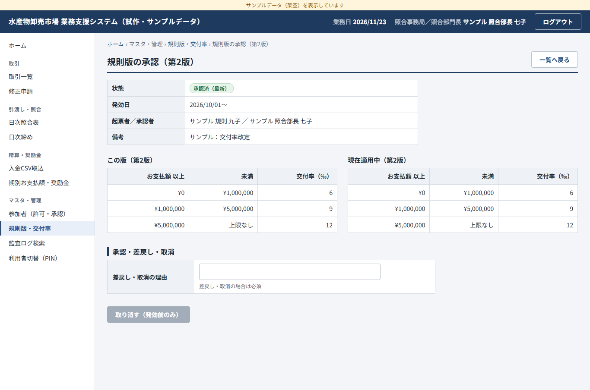

# SC-10-04 規則版承認・ロールバック — wireframe

| Mục | Nội dung |
|---|---|
| Vai trò màn | **Quyết định** (checker) — duyệt / trả về / hủy version quy chế, gồm version rollback |
| Vai ghi | STL-HEAD (◎, MFA — P32); maker (RULE) ≠ checker (S4). Nhánh N2 rollback khi đủ 4 lần: thêm OPS-HEAD duyệt có MFA |
| Thiết bị | PC |

## 1. Prototype (as-is)



`/rules/[id]/review`, stlhead@, version 第2版 đã duyệt. Có: trạng thái, 発効日, maker / checker, so sánh bảng tỷ lệ version này với version đang áp, ô lý do, nút 取り消す.

## 2. Wireframe to-be (version chờ duyệt)

```
[1] 状態 承認待ち   [2] 種別 通常改定 / ロールバック（第2版の内容に戻す）
[3] 発効日 2027/10/01（毎月1日のみ）   [4] 起票者 桜 九子（ルール管理者）
[5] 今年度（2027年度: 4月〜3月）の発効回数  2 / 4 回   ※移行時の初期版は数えない
┌─ [6] 変更点（この版 vs 現在適用中 第3版）───────────────────────────────────┐
│ 区分                    項目                     現在        この版   差   │
│ 交付率（仲卸）            段階2 ¥1,000,000〜       0.9%       1.0%    ▲  │
│ 交付率（売買参加者）       変更なし                                        │
│ 修正申請 2段階承認の閾値   金額                     ¥100,000    ¥150,000 ▲  │
│ 支払期日                 翌月10日（休市日は前営業日） 変更なし                │
│ 締め時刻 / ロット受付開始 / 引渡し精算一致ルール    変更なし                     │
└───────────────────────────────────────────────────────────────────┘
[7] 影響: 2027-10期以降に適用。締め済の期は変更しません（差は次期の差額で処理）
[8] 備考（起票理由）「…」
[9] 差戻し・取消・ロールバックの理由 [                 ]
[10] [ 承認する ]  [11] [ 差し戻す ]  [12] [ 取り消す（発効前のみ） ]   → C-31 → C-30 MFA

── [13] 5回目（通常改定）: 「今年度の発効回数が上限（4回）に達しています。この版は承認できません」[10] 無効
── [14] 4回到達後のロールバック（E-14 未回答 — 2つの分岐を設計、設定スイッチにはしない）
     N1 案: [13] と同じく承認不可
     N2 案（お客様現時点の意見 [Giả lập]）: 承認可。理由必須、照合部門長の承認 + 運用部門長の承認（MFA）、
            経営層へ自動通知、RPT-12 に回数として表示
```

## 3. Item

| No | Item | Loại | Quy tắc | Nguồn |
|---|---|---|---|---|
| 1 | Trạng thái | Nhãn | 下書き / 承認待ち / 適用中 / 置換済 / 取消 | GOV-RULE-01 |
| 2 | Loại | Nhãn | 通常改定 / ロールバック (ghi version đích) | ADR-006 |
| 3 | 発効日 | Nhãn | Chỉ ngày 1 của tháng, tương lai | PRM-042 |
| 4 | Maker | Nhãn | Người xem = maker → [10] ẩn (S4) | S4 |
| 5 | Bộ đếm năm TC | Nhãn | Theo năm TC (4→3) của 発効日; không tính bộ go-live và bản hủy trước hiệu lực | L4-A04 (3), D06 |
| 6 | Bảng khác biệt | Bảng | Gồm **cả tham số quy chế** (ngưỡng 2 cấp, 支払期日, giờ khóa, giờ nhận lô, quy tắc giao), không chỉ bảng tỷ lệ | D09, PREMISE §3.1 |
| 7 | Ảnh hưởng | Nhãn | Không sửa kỳ đã khóa | BR-CLOSE-01 |
| 8 | Lý do maker | Nhãn | | — |
| 9 | Lý do checker | Văn bản | Bắt buộc khi trả về / hủy / duyệt rollback | ADR-006 |
| 10 | 承認する | Nút | C-31 → C-30 MFA; bản trước → 置換済 | P32 |
| 11 | 差し戻す | Nút | Về 下書き cho maker | — |
| 12 | 取り消す | Nút | Chỉ trước 発効日 | — |
| 13 | Chặn lần thứ 5 | Banner | Version mới thứ 5 bị chặn ở **cả hai nhánh** | GOV-RULE-01, OPEN-L4-01 |
| 14 | Rollback khi đã đủ 4 | Banner + luồng | **Chưa chốt — chờ workshop E-14**; thiết kế vẽ N1 / N2 | OPEN-L4-01, R-L4-01 |

## 4. Trạng thái

| Trạng thái | Hiển thị |
|---|---|
| Người xem là maker | 「起票者本人は承認できません」 |
| Đủ 4 lần | [13] hoặc [14] |
| 3/4 lần | [5] vàng 「残り1回」 |
| Đã áp | Chỉ đọc (như prototype); [12] ẩn |
| N2 chờ OPS-HEAD | C-27 「承認待ち（運用部門長）」 |
| Mất mạng | C-28 |

## 5. Khác biệt theo vai

STL-HEAD: nút [10]–[12]. OPS-HEAD: chỉ thấy nút duyệt ở nhánh N2. RULE: chỉ đọc + sửa lại khi bị trả về (SC-10-02). Vai khác: C-25.

## 6. To-be khác prototype

| # | Prototype | To-be | Nguồn |
|---|---|---|---|
| 1 | So sánh chỉ bảng tỷ lệ một bảng | Hai bảng + tham số quy chế | D01, D09 |
| 2 | Bộ đếm tính cả bộ go-live | Không tính | D06 |
| 3 | Lần 5 chặn cả rollback | N1 / N2 chờ E-14 | M15, OPEN-L4-01 |
| 4 | Không MFA | C-30 | M02 |

## History of change

| No | Version | Action | Nội dung thay đổi | Ngày | Người sửa | Approve |
|---|---|---|---|---|---|---|
| 1 | 0.1.0 | Add new | Bản đầu | 2026-11-25 | phuongnnm-23344 | |
