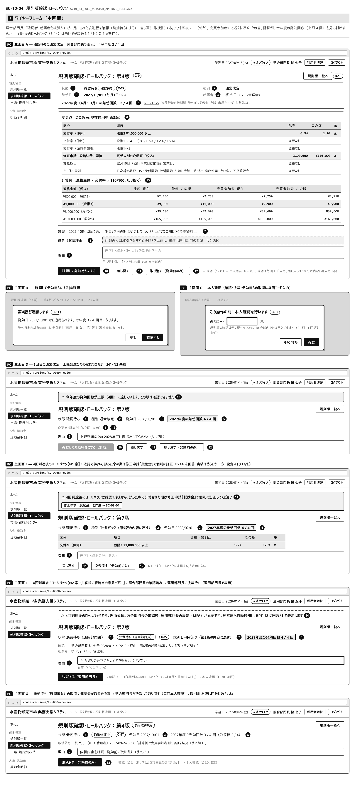

# SC-10-04 規則版確認・ロールバック — wireframe

| Mục | Nội dung |
|---|---|
| Vai trò màn | **Quyết định** (checker) — duyệt (確認) / trả về / hủy version quy chế, gồm version rollback |
| Vai ghi | STL-HEAD (◎, MFA — P32); maker (RULE) ≠ checker (S4). Nhánh N2 rollback khi đủ 4 lần: thêm OPS-HEAD 決裁 có MFA |
| Thiết bị | PC |
| Tên màn | LAB-1 ghi 「規則版承認・ロールバック」; LAB-4 đổi nhãn thành 「規則版確認・ロールバック」 để chữ 承認 chỉ dùng cho 承認（売買参加者）(luật 2, PRM-121, PREMISE L4-D03). ID màn giữ nguyên |

## 1. Prototype (as-is)


`/rules/[id]/review`, stlhead@, version 第2版 đã duyệt. Có: trạng thái, 発効日, maker / checker, so sánh bảng tỷ lệ version này với version đang áp, ô lý do, nút 取り消す.

## 2. Wireframe to-be (version chờ duyệt)

> **Hình chuẩn (LAB-4):** nguồn hình là [`html/SC-10-04.html`](html/SC-10-04.html) — một file HTML cho mọi biến thể, render bằng `scripts/render-wireframes.py` ra [`png/SC-10-04.png`](png/SC-10-04.png) và [`pdf/wireframes-all.pdf`](pdf/wireframes-all.pdf); ảnh spec BM-51 lấy biến thể A. Khối ASCII dưới đây giữ làm mô tả bố cục; khi lệch, HTML + SPEC là bản đúng.




```
[1] 状態 確認待ち   [2] 種別 通常改定 / ロールバック（第2版の内容に戻す）
[3] 発効日 2027/10/01（毎月1日のみ）   [4] 起票者 桜 九子（ルール管理者）
[5] 今年度（2027年度: 4月〜3月）の発効回数  2 / 4 回   ※移行時の初期版・発効前に取り消した版は数えない
┌─ [6] 変更点（この版 vs 現在適用中 第3版）───────────────────────────────────┐
│ 区分                    項目                         現在        この版   差   │
│ 交付率（仲卸）            段階3 ¥1,000,000〜           0.9%       1.0%    ▲  │
│ 交付率（売買参加者）       変更なし                                            │
│ 修正申請 2段階決裁の閾値   買受人別の変動額（税込）       ¥100,000    ¥150,000 ▲  │
│ 支払期日                 翌月10日（銀行休業日は前銀行営業日） 変更なし            │
│ 締め時刻 / ロット受付開始 / 取引開始 / 引渡し精算一致ルール   変更なし              │
│ [15] 計算例: 適格金額 ¥1,000,000 → 現在 ¥9,900 / この版 ¥11,000（×交付率×110/100）│
└───────────────────────────────────────────────────────────────────┘
[7] 影響: 2027-10期以降に適用。期ロック済の期は変更しません（訂正は次の期ロックで差額計上）
[8] 備考（起票理由）「…」
[9] 差戻し・取消・ロールバックの理由 [                 ]
[10] [ 確認して発効待ちにする ]  [11] [ 差し戻す ]  [12] [ 取り消す（発効前のみ） ]   → C-31 → C-30 MFA

── [13] 5回目（通常改定）: 「今年度の発効回数が上限（4回）に達しています。この版は確認できません」[10] 無効
── [14] 4回到達後のロールバック（E-14 未回答 — 2つの分岐を設計、設定スイッチにはしない）
     N1 案: [13] と同じく確認不可（誤った率で計算された期の奨励金は修正申請「奨励金」で個別に訂正）
     N2 案（お客様現時点の意見 [Giả lập]）: 確認可。理由必須、照合部門長の確認 + 運用部門長の決裁（MFA）、
            経営層へ自動通知、RPT-12 に回数として表示
```

## 3. Item

| No | Item | Loại | Quy tắc | Nguồn |
|---|---|---|---|---|
| 1 | Trạng thái | Nhãn | 下書き / 確認待ち / 発効待ち (APPROVED) / 適用中 / 置換済 / 取消 | GOV-RULE-01, ADR-006 |
| 2 | Loại | Nhãn | 通常改定 / ロールバック (ghi version đích) | ADR-006 |
| 3 | 発効日 | Nhãn | Chỉ ngày 1 của tháng, tương lai | PRM-042, TBL-RATE-01 |
| 4 | Maker | Nhãn | Người xem = maker → [10] ẩn (S4) | S4 |
| 5 | Bộ đếm năm TC | Nhãn | Đếm version 通常改定 + ロールバック ở trạng thái 発効待ち / 適用中 / 置換済 có 発効日 trong năm TC (4→3); không tính bộ go-live và bản hủy trước hiệu lực | L4-A04 (3), D06, ADR-006 §2.3 |
| 6 | Bảng khác biệt | Bảng | Gồm **cả tham số quy chế** (ngưỡng 2 cấp, 支払期日, giờ khóa, giờ nhận lô, giờ bắt đầu GD, quy tắc giao), không chỉ bảng tỷ lệ. 支払期日: ngày 10, rơi **ngày ngân hàng nghỉ** → lùi về **ngày ngân hàng mở trước** (khác "休市日 → 営業日 trước" ở bản 0.1.0) | D05, D09, PREMISE §3.1 |
| 7 | Ảnh hưởng | Nhãn | Không sửa kỳ đã khóa | BR-CLOSE-01 |
| 8 | Lý do maker | Nhãn | | — |
| 9 | Lý do checker | Văn bản | Bắt buộc khi trả về / hủy / duyệt rollback | ADR-006 |
| 10 | 確認して発効待ちにする | Nút | C-31 → C-30 MFA; version → 発効待ち; tới 発効日 → 適用中, bản trước → 置換済 | P32, ADR-006 |
| 11 | 差し戻す | Nút | Về 下書き cho maker | — |
| 12 | 取り消す | Nút | Chỉ trước 発効日. Version 下書き / 確認待ち: maker hoặc checker hủy, lý do. Version **発効待ち (đã duyệt)**: maker đề nghị hủy kèm lý do → checker STL-HEAD 決裁 + C-30 MFA (giữ maker-checker); bản hủy không tính lượt | ADR-006 §2.3-7a, m-09 |
| 13 | Chặn lần thứ 5 | Banner | Version mới thứ 5 bị chặn ở **cả hai nhánh** | GOV-RULE-01, OPEN-L4-01 |
| 14 | Rollback khi đã đủ 4 | Banner + luồng | **Chưa chốt — chờ workshop E-14**; thiết kế vẽ N1 / N2. Với N1, tỷ lệ sai đã duyệt vẫn là version của kỳ → engine không tự sinh DELTA; sửa tiền bằng 修正申請 loại 「奨励金」(INCENTIVE, 2 cấp) từng người × kỳ (R-L4-01). Workshop còn xem phương án rollback hồi tố về đầu kỳ chưa 期ロック (ADR-006 §3) | OPEN-L4-01, R-L4-01, ADR-006 |
| 15 | Ví dụ tính | Nhãn | Ví dụ cho vài mức tiền, để checker thấy tiền đổi thế nào trước khi duyệt (phát hiện sai trước 発効日 → hủy, không tốn lượt) | ADR-006 §2.5-10 |

## 4. Trạng thái

| Trạng thái | Hiển thị |
|---|---|
| Người xem là maker | 「起票者本人は確認できません」 |
| Đủ 4 lần | [13] hoặc [14] |
| 3/4 lần | [5] vàng 「残り1回」 |
| 発効待ち | Chỉ đọc + [12] (hủy có 決裁) |
| Đã áp | Chỉ đọc (như prototype); [12] ẩn |
| N2 chờ OPS-HEAD | C-27 「決裁待ち（運用部門長）」 |
| Mất mạng | C-28 |

## 5. Khác biệt theo vai

STL-HEAD: nút [10]–[12]. OPS-HEAD: chỉ thấy nút 決裁 ở nhánh N2. RULE: chỉ đọc + sửa lại khi bị trả về (SC-10-02), đề nghị hủy version 発効待ち. Vai khác: C-25.

## 6. To-be khác prototype

| # | Prototype | To-be | Nguồn |
|---|---|---|---|
| 1 | So sánh chỉ bảng tỷ lệ một bảng | Hai bảng + tham số quy chế + ví dụ tính | D01, D09 |
| 2 | Bộ đếm tính cả bộ go-live | Không tính | D06 |
| 3 | Lần 5 chặn cả rollback | N1 / N2 chờ E-14 | M15, OPEN-L4-01 |
| 4 | Không MFA | C-30 | M02 |
| 5 | Checker duyệt → ACTIVE ngay | 発効待ち → 適用中 vào ngày hiệu lực | N14 |
| 6 | Nhãn 「承認」 | 「確認」 (checker) / 「決裁」 (OPS-HEAD) | luật 2, PRM-121 |

## History of change

| No | Version | Action | Nội dung thay đổi | Ngày | Người sửa | Approve |
|---|---|---|---|---|---|---|
| 1 | 0.1.0 | Add new | Bản đầu | 2026-11-25 | phuongnnm-23344 | |
| 2 | 0.2.0 | Update | Gate 1: đổi nhãn 承認 → 確認 / 決裁 (M-06); 支払期日 lùi theo ngày ngân hàng (M-03); đếm quota theo 発効待ち / 適用中 / 置換済, hủy version đã duyệt cần checker 決裁 + MFA (m-09); thêm trạng thái 発効待ち (N14); N1 nêu đường sửa tiền bằng 修正申請 INCENTIVE (M-04); ví dụ tính [15]. Ảnh prototype giữ nguyên | 2026-11-25 | phuongnnm-23344 | |
| 3 | 0.2.1 | Update | Gate 1 recheck n-04: tham chiếu hủy version đã duyệt → ADR-006 §2.3-7a | 2026-11-25 | phuongnnm-23344 | |
| 4 | 0.2.2 | Update | P3 gộp: ví dụ [6] 「段階2 ¥1,000,000〜」 → 「段階3」 khớp bảng tỷ lệ giả INCENTIVE_DB §5 (bậc 3 = 1.000.000–<3.000.000) | 2026-11-25 | phuongnnm-23344 | |
| 5 | 0.2.3 | Update | LAB-4 wireframe HTML: nguồn hình `html/SC-10-04.html`, nhúng `png/SC-10-04.png` | 2026-11-25 | phuongnnm-23344 | |
