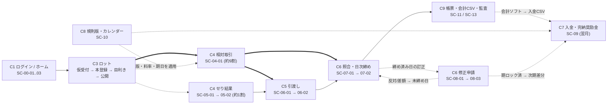
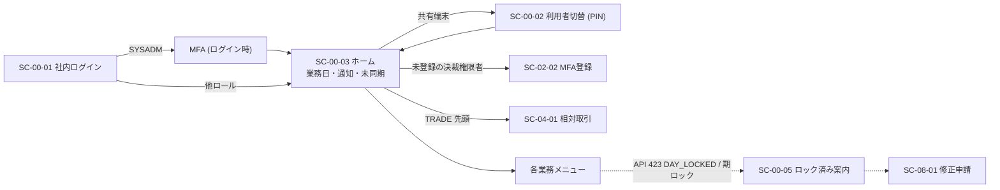
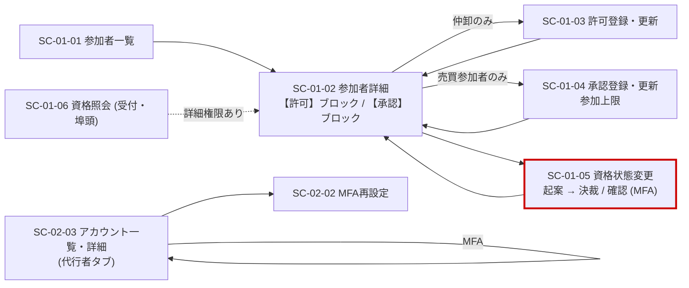
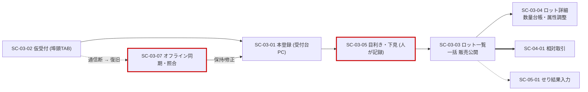
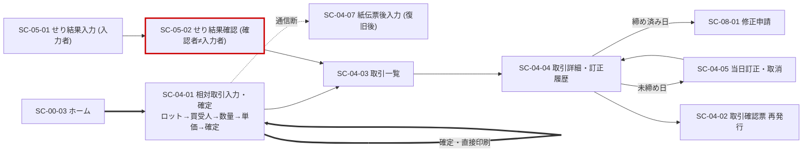
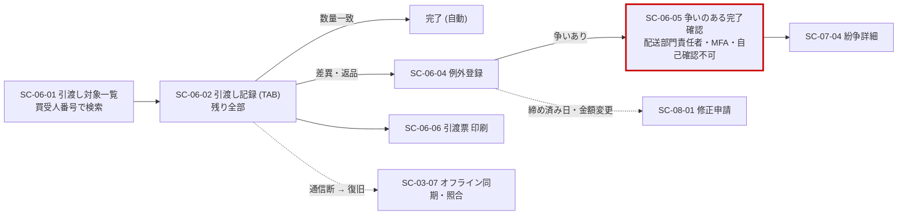
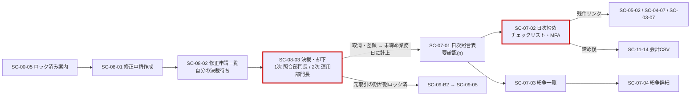
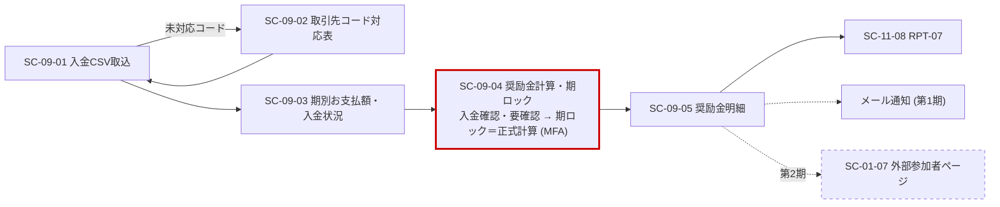
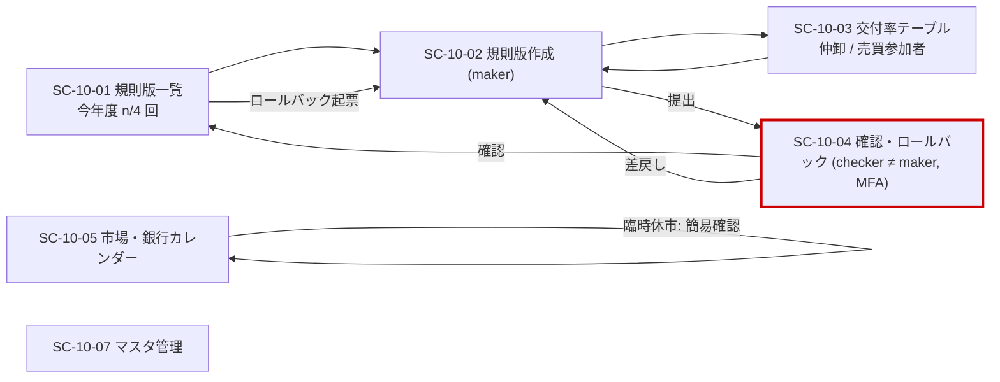
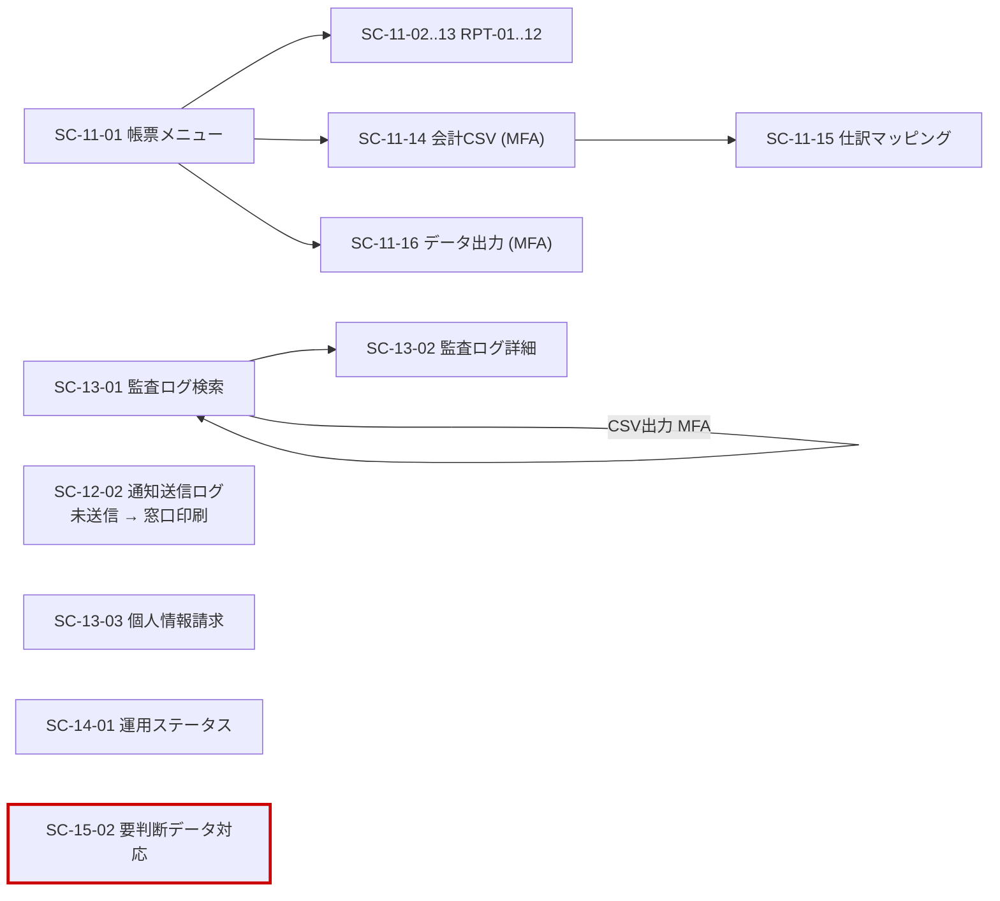

# 画面一覧・画面遷移 — 第1期 (70 màn)

Danh sách màn hình to-be của 第1期 theo gói R1 (PREMISE §1.2: 99 FT / 70 màn + 10 batch) và sơ đồ chuyển màn theo cụm. Nguồn ID, tên, vai, thiết bị: 画面一覧 LAB-1 bản 1.7 (`project/04_screen/screen-list.md`, không nằm trong repo này). Trạng thái prototype: danh sách màn LAB-2 bản 1.2 + báo cáo as-built P1 (`plans/reports/pl-261125-lab4-p1-prototype-as-built-extraction.md`).

Nhãn màn giữ tiếng Nhật vì hệ thống dùng tiếng Nhật; giải thích bằng tiếng Việt. **Duyệt nội bộ dùng chữ 決裁 / 確認, không dùng 承認** — chữ 承認 chỉ dành cho 承認（売買参加者）(luật 2, PRM-121). Vì vậy hai màn LAB-1 đổi nhãn (ID giữ nguyên, PREMISE L4-D03): SC-08-03 「修正申請承認・却下」 → 「修正申請決裁・却下」; SC-10-04 「規則版承認・ロールバック」 → 「規則版確認・ロールバック」.

## 0. Cách đọc

| Cột | Giá trị |
|---|---|
| Loại | `DS` danh sách / tìm · `CT` chi tiết · `NH` nhập / đăng ký · `DU` xác nhận / duyệt (**người quyết**) · `BC` báo cáo / xuất · `CĐ` cấu hình / master · `XT` xác thực · `IN` xem trước in |
| Vai | Vai **ghi / duyệt** theo role-list (TBL-ROLE-01). Quyền **đọc** theo cột 閲 của role-list (L4-A06), ghi ở spec từng màn. `INTAKE` 受付 · `JUDGE` 目利き · `TRADE` 取引 · `DELIVERY` 配送 · `SETTLE` 照合事務局 · `RULE` ルール管理 · `SYSADM` システム管理; quyền cộng thêm `STL-HEAD` 照合部門長 · `OPS-HEAD` 運用部門長 · `DEL-HEAD` 配送部門責任者 |
| Thiết bị | `PC` = PC + テンキー, đi hết bằng bàn phím (NFR-USE-01) · `TAB` = tablet cảm ứng, nút ≥ 48px, đeo găng (PRM-086) · `PC/TAB` = hai bố cục |
| Prototype | `Có` = có trang chạy thật ở LAB-2 · `Thành phần` = dựng dạng thành phần dùng chung · `Mới` = chưa có ở prototype, thiết kế mới ở LAB-4 |
| Mức thiết kế LAB-4 | `Spec` = 1 trong 10 màn cốt lõi (L4-D02): wireframe ở đây + Screen Specification BM-2-901-51 ở P3 · `WF` = wireframe chi tiết ở đây (4 màn bổ sung, PREMISE §2 dòng 3) · `List` = chỉ có dòng trong 画面一覧 này; logic nằm trong Function / Technical Design của cụm |

## 1. Tóm tắt

| Cụm | Nhóm ID | Màn 第1期 | Có ở prototype | Mới | Spec | WF | Ngoài 第1期 / đã gộp |
|---|---|---|---|---|---|---|---|
| C1 Vào hệ thống | SC-00 | 4 | 3 | 1 (thành phần) | — | — | SC-00-04 (gộp vào SC-00-03) |
| C2 Người tham gia & tài khoản | SC-01, SC-02 | 8 | 5 | 3 | SC-01-02 | — | SC-01-07, SC-02-01 (第2期); SC-02-05 (tab SC-02-03); SC-02-04 (統合) |
| C3 Lô | SC-03 | 6 | 5 | 1 | SC-03-01, SC-03-05 | SC-03-07 | SC-03-06 (gộp SC-03-04) |
| C4 Giao dịch — **相対 (luồng chính)** + せり | SC-04, SC-05 | 8 | 5 | 3 | SC-04-01, SC-05-02 | SC-04-05 | SC-04-06 (nút trên SC-04-05); SC-04-08 (bỏ); SC-05-03 (統合) |
| C5 Giao hàng | SC-06 | 5 | 1 | 4 | SC-06-02 | SC-06-04, SC-06-05 | SC-06-03 (bỏ bố cục PC) |
| C6 Đối soát · khóa ngày · 修正申請 | SC-07, SC-08 | 7 | 5 | 2 | SC-07-02, SC-08-03 | — | — |
| C7 精算 · 完納奨励金 | SC-09 | 5 | 3 | 2 | SC-09-04 | — | — |
| C8 Quy chế · lịch · master | SC-10 | 6 | 4 | 2 | SC-10-04 | — | SC-10-06 (file cấu hình, PRM-126) |
| C9 Báo cáo · thông báo · audit · vận hành · migrate | SC-11..SC-15 | 21 | 1 | 20 | — | — | SC-13-04, SC-15-01, SC-15-03 (bỏ); SC-11-07, SC-12-01 (統合) |
| **Tổng** | | **70** | **32** | **38** | **10** | **4** | **12 ngoài 第1期 + 4 統合** |

Kiểm đếm: 82 màn của 画面一覧 LAB-1 − 12 màn không tính ở 第1期 = **70** (cách đếm theo 機能一覧 §7.4, DEC-031). 4 ID 統合 không tính vào 82. Batch (10) không phải màn, liệt kê ở §4.

## 2. 画面一覧 — 70 màn 第1期

### C1 Vào hệ thống (SC-00)

| # | SC-ID | 画面名 | Tên (VI) | Loại | Vai | Thiết bị | Prototype | Mức | Ghi chú to-be |
|---|---|---|---|---|---|---|---|---|---|
| 1 | SC-00-01 | 社内ログイン | Đăng nhập nội bộ | XT | Mọi vai nội bộ | PC/TAB | Có | List | SYSADM MFA ngay khi đăng nhập; vai khác MFA step-up trước hành động ở PREMISE §3.2 (L4-A07). Prototype không MFA (M02) |
| 2 | SC-00-02 | 利用者切替（PIN） | Đổi người trên máy chung | XT | INTAKE, JUDGE, TRADE, DELIVERY (+ quyền trưởng) | PC/TAB | Có | List | PIN 4 số; offline có hạn N giờ, không duyệt khi offline (M03, E-18); đổi người = hết hiệu lực MFA |
| 3 | SC-00-03 | ホーム（業務メニュー） | Trang chủ theo vai | DS | Mọi vai nội bộ | PC/TAB | Có | List | Thêm khung thông báo (gộp SC-00-04, PRM-130), trạng thái mạng + số chưa đồng bộ (M04, M09). TRADE: lối tắt đầu = 相対. **Tablet:** lưới 4–6 nút to theo vai, thứ tự cố định, có số đếm việc chờ; nút 「ホーム」 bằng chữ (không 「≡」) — `_common-layout` C-13, C-14 (Q-WF-02 đã trả lời [Customer giả lập, 2026-11-25]) |
| 4 | SC-00-05 | エラー・ロック済み案内 | Báo bản ghi đã khóa (dùng chung) | CT | Mọi vai nội bộ | PC/TAB | Thành phần | List | Banner khi API trả 423 `DAY_LOCKED` / kỳ đã 期ロック → nút sang SC-08-01. Mẫu trạng thái dùng chung ở `_common-layout.md` |

### C2 Người tham gia & tài khoản (SC-01, SC-02)

| # | SC-ID | 画面名 | Tên (VI) | Loại | Vai | Thiết bị | Prototype | Mức | Ghi chú to-be |
|---|---|---|---|---|---|---|---|---|---|
| 5 | SC-01-01 | 参加者一覧・検索 | Danh sách người tham gia | DS | SETTLE | PC | Có | List | Lọc loại, trạng thái (有効 / 一時停止 / 失効 / 再審査), sắp hết hạn |
| 6 | SC-01-02 | 参加者詳細・編集 | Chi tiết người tham gia | NH | SETTLE (STL-HEAD) | PC | Có | **Spec** | **Hai khối tách riêng 許可 (仲卸) / 承認 (売買参加者)** (L4-D02); lịch sử 保証金 (D14) |
| 7 | SC-01-03 | 許可登録・更新（仲卸） | Đăng ký / cập nhật 許可 | NH | SETTLE (STL-HEAD) | PC | Có | List | Mở từ khối 許可 của SC-01-02; chỉ cho 仲卸 |
| 8 | SC-01-04 | 承認登録・更新（売買参加者） | Đăng ký / cập nhật 承認 + 参加上限 | NH | SETTLE (STL-HEAD) | PC | Có | List | Mở từ khối 承認 của SC-01-02; chỉ cho 売買参加者 |
| 9 | SC-01-05 | 資格状態変更（一時停止・再審査・期限前更新） | Đổi trạng thái tư cách / gia hạn | DU | SETTLE (nhập), STL-HEAD (起案 / 確認), OPS-HEAD (決裁) | PC | Mới | List | 決裁 có MFA; gia hạn không qua 再審査 (PRM-121); không dùng chữ 「承認」 cho bước nội bộ (S6) |
| 10 | SC-01-06 | 資格照会 | Tra tư cách nhanh | DS | INTAKE, TRADE, DELIVERY, … | PC/TAB | Mới | List | Màu + chữ (không chỉ màu); ghi đúng 許可 / 承認 |
| 11 | SC-02-02 | MFA登録・再設定 | Đăng ký / đặt lại MFA | XT | STL-HEAD, OPS-HEAD, DEL-HEAD, SYSADM, người 代行 | PC | Mới | List | Có phương án nhận mã cho người không có điện thoại riêng (L4-A07, ADR xác thực) |
| 12 | SC-02-03 | アカウント一覧・詳細 | Danh sách / chi tiết tài khoản | NH | SYSADM | PC | Có | List | Thêm tab 代行者 (gộp SC-02-05, PRM-129); MFA trước khi đổi vai / quyền |

### C3 Lô (SC-03)

| # | SC-ID | 画面名 | Tên (VI) | Loại | Vai | Thiết bị | Prototype | Mức | Ghi chú to-be |
|---|---|---|---|---|---|---|---|---|---|
| 13 | SC-03-01 | ロット本登録（受付台・PC） | Đăng ký chính thức lô | NH | INTAKE | PC | Có | **Spec** | Mã 出荷者 thay text tự do (D15); 業務日 gắn lô từ 01:00 (E-16) |
| 14 | SC-03-02 | ロット仮受付（埠頭・タブレット） | Tiếp nhận tạm lô ở bến | NH | INTAKE | TAB | Có | List | Offline lưu cục bộ + 「未同期 n件」 (M04); không chụp ảnh ở 第1期. Khách xin hình phác (khách #22) — **người dùng chốt thêm wireframe ở P3** (chỉ wireframe, không spec đầy đủ — PREMISE L4-D05) |
| 15 | SC-03-03 | ロット一覧・検索 | Danh sách lô | DS | INTAKE, JUDGE, TRADE | PC | Có | List | 販売公開 hàng loạt; 販売終了 / 持ち越し (D12, E-12) |
| 16 | SC-03-04 | ロット詳細 | Chi tiết lô + sổ SL | CT | INTAKE, JUDGE, TRADE, SETTLE | PC | Có | List | Gồm sửa thuộc tính lô (gộp SC-03-06, PRM-128): lý do, before/after |
| 17 | SC-03-05 | 目利き・下見結果入力 | Ghi kết quả 目利き・下見 | NH | JUDGE | PC/TAB | Có | **Spec** | **Người đánh giá nhập — không AI / OCR** (CAP-HUMAN-01) |
| 18 | SC-03-07 | オフライン同期・照合 | Đồng bộ & đối chiếu sau mất mạng | DU | INTAKE, DELIVERY | PC/TAB | Mới | **WF** | Xung đột → người chọn giữ / bỏ / sửa; không tự gộp (DEC-004, M04) |

### C4 Giao dịch (SC-04 相対 — luồng chính, SC-05 せり — ghi kết quả)

| # | SC-ID | 画面名 | Tên (VI) | Loại | Vai | Thiết bị | Prototype | Mức | Ghi chú to-be |
|---|---|---|---|---|---|---|---|---|---|
| 19 | SC-04-01 | 相対取引入力・確定 | Nhập & chốt GD 相対 | NH | TRADE | PC | Có | **Spec** | **Màn dùng nhiều nhất**; bắt buộc online; in thẳng 取引確認票 (M05); 参加上限 theo kỳ (M19) |
| 20 | SC-04-02 | 取引確認票（再発行・印刷プレビュー） | In lại phiếu xác nhận GD | IN | TRADE | PC | Mới | List | Chỉ in lại, có chữ 「再発行」 |
| 21 | SC-04-03 | 取引一覧・検索 | Danh sách GD | DS | TRADE, SETTLE | PC | Có | List | Mặc định lọc 相対; mới nhất lên đầu |
| 22 | SC-04-04 | 取引詳細（訂正履歴） | Chi tiết GD & lịch sử 訂正 | CT | TRADE, SETTLE | PC | Có | List | Hiện **một** nút đúng trạng thái ngày: 「当日訂正・取消」 → SC-04-05 khi ngày chưa khóa; 「修正申請」 → SC-08-01 khi đã khóa. Cạnh nút có câu lý do: 「未締めのため、その場で訂正できます（照合が確認します）」 / 「この業務日は締め済のため、修正申請（決裁が必要）になります」. Dòng đầu hiện 業務日 **của chính GD** + nhãn 「締め済」 (GD có thể thuộc ngày khác ngày đang mở). Người sửa khác người chốt gốc → hiện cả hai tên. Q-WF-03 đã trả lời [Customer giả lập, 2026-11-25] — khách #26 |
| 23 | SC-04-05 | 当日訂正（＋取消） | 訂正 / 取消 trong ngày | NH | TRADE | PC | Mới | **WF** | Gồm nút 取消 riêng (gộp SC-04-06, PRM-127); không duyệt 2 cấp; giữ lịch sử (M17, D11) |
| 24 | SC-04-07 | 紙伝票後入力 | Nhập bù phiếu giấy | NH | TRADE | PC | Mới | List | Lưới nhập; kiểm 許可 / 承認 theo giờ GD thật; dòng nghi trùng chờ người quyết |
| 25 | SC-05-01 | せり結果入力 | Nhập kết quả せり | NH | TRADE (入力者) | PC | Có | List | Chỉ ghi kết quả; không có màn đấu giá trực tiếp |
| 26 | SC-05-02 | せり結果確認 | Xác nhận kết quả せり theo phiên | DU | TRADE (確認者) | PC | Có | **Spec** | **Người quyết** (CAP-HUMAN-01); 確認者 ≠ 入力者 (S2); vượt 参加上限 chỉ 売買参加者 (L4-A04) |

### C5 Giao hàng (SC-06)

| # | SC-ID | 画面名 | Tên (VI) | Loại | Vai | Thiết bị | Prototype | Mức | Ghi chú to-be |
|---|---|---|---|---|---|---|---|---|---|
| 27 | SC-06-01 | 引渡し対象一覧 | Danh sách GD cần giao | DS | DELIVERY | PC/TAB | Mới | List | Prototype gộp ô tìm vào SC-06-02; to-be tách lại để PC văn phòng trả lời người mua gọi hỏi sau 08:00 (KPI-05). Tablet ở bến vào thẳng SC-06-02. SC-06-01 cũng mở được trên tablet ở **chế độ chỉ đọc** cho 配送部門責任者 đi kiểm lúc 09:30 (khách #30). Q-WF-01 đã trả lời [Customer giả lập, 2026-11-25]: tách |
| 28 | SC-06-02 | 引渡し記録（タブレット） | Ghi giao hàng (tablet) | NH | DELIVERY | TAB | Có | **Spec** | Offline lưu cục bộ (M04); nút 「例外」 → SC-06-04 |
| 29 | SC-06-04 | 引渡し例外登録 | Ghi ngoại lệ giao | NH | DELIVERY, DEL-HEAD | PC/TAB | Mới | **WF** | Thiếu / thừa / trả / hủy một phần + lý do + ảnh (PC) (M16) |
| 30 | SC-06-05 | 争いのある引渡し完了確認 | Xác nhận hoàn tất giao có tranh chấp | DU | DEL-HEAD | PC/TAB | Mới | **WF** | **Người quyết**, MFA, cấm tự xác nhận (S1, PRM-111) |
| 31 | SC-06-06 | 引渡票（印刷・再発行） | Phiếu giao — in / in lại | IN | DELIVERY | PC/TAB | Mới | List | |

### C6 Đối soát · khóa ngày · 修正申請 (SC-07, SC-08)

| # | SC-ID | 画面名 | Tên (VI) | Loại | Vai | Thiết bị | Prototype | Mức | Ghi chú to-be |
|---|---|---|---|---|---|---|---|---|---|
| 32 | SC-07-01 | 日次照合表 | Bảng đối soát ngày | DS | SETTLE | PC | Có | List | Tách 相対 / せり / 訂正; 要確認（n）: せり tự xác nhận, GD vượt 参加上限 có lý do (khách #10), 当日訂正 (≥ ngưỡng 2 cấp hoặc đổi 買受人 → phải bấm 「確認済」, khách #25), ngoại lệ giao làm đổi tiền ở ngày chưa khóa (phải 「確認済」, khách #4). Cột 「確認済」 để soát |
| 33 | SC-07-02 | 日次締め | Khóa ngày nghiệp vụ | DU | STL-HEAD (hoặc 代行) | PC | Có | **Spec** | Checklist + MFA; **không có nút mở lại** (BR-CLOSE-01) |
| 34 | SC-07-03 | 紛争一覧 | Danh sách tranh chấp | DS | SETTLE, DEL-HEAD | PC | Mới | List | Cột SLA còn lại / quá hạn |
| 35 | SC-07-04 | 紛争詳細・対応 | Chi tiết & xử lý tranh chấp | NH | SETTLE, DEL-HEAD | PC | Mới | List | Liên kết GD / lần giao / SC-06-05 |
| 36 | SC-08-01 | 修正申請作成（FORM-CORR-01） | Lập yêu cầu điều chỉnh | NH | TRADE, DELIVERY, SETTLE | PC | Có | List | Hiện trước ảnh hưởng tiền + số cấp duyệt (ngưỡng theo tiền thay đổi lớn nhất của một người mua; đổi 買受人 luôn 2 cấp); đính kèm (M11). Loại: TRADE / KANNO / INCENTIVE / LATE_ENTRY (後入力 cho ngày đã khóa, mở từ SC-03-07 / SC-04-07). Mở từ C-24 khi gặp 423 giữa chừng → **điền sẵn** nội dung đang nhập (khách #5) |
| 37 | SC-08-02 | 修正申請一覧 | Danh sách 修正申請 | DS | TRADE, DELIVERY, SETTLE, STL-HEAD, OPS-HEAD | PC | Có | List | Người duyệt: mặc định 「自分の決裁待ち」 |
| 38 | SC-08-03 | 修正申請決裁・却下 | Duyệt / từ chối 修正申請 | DU | STL-HEAD (cấp 1), OPS-HEAD (cấp 2) | PC | Có | **Spec** | **Người quyết**, MFA; ngưỡng 2 cấp lấy từ quy chế có version (M13, D07), so với tiền thay đổi lớn nhất của một người mua; nhãn LAB-1 「修正申請承認・却下」 đổi theo L4-D03 |

### C7 精算 · 完納奨励金 (SC-09)

| # | SC-ID | 画面名 | Tên (VI) | Loại | Vai | Thiết bị | Prototype | Mức | Ghi chú to-be |
|---|---|---|---|---|---|---|---|---|---|
| 39 | SC-09-01 | 入金CSV取込 | Nhập CSV 入金 | NH | SETTLE | PC | Có | List | Định dạng thật chờ E-01 / E-02; dòng lỗi → SC-09-02 |
| 40 | SC-09-02 | 取引先コード対応表 | Bảng ánh xạ 取引先コード | CĐ | SETTLE | PC | Mới | List | |
| 41 | SC-09-03 | 期別お支払額・入金状況 | Số phải trả & 入金 theo kỳ | DS | SETTLE, STL-HEAD | PC | Có | List | Gán 入金 vào kỳ qua bảng phân bổ (D03) |
| 42 | SC-09-04 | 奨励金計算・期ロック | Tính thưởng & khóa kỳ | DU | STL-HEAD | PC | Có | **Spec** | Hiện tiền đã gán vào kỳ nào trước khi khóa (OPEN-L4-02); 2 bảng tỷ lệ (D01); chỉ 試算 + 期ロック (tính chính thức trong cùng transaction với khóa — N13) |
| 43 | SC-09-05 | 奨励金明細 | Chi tiết thưởng người × kỳ | CT | SETTLE, STL-HEAD | PC | Mới | List | Version đã áp, delta, dư âm mang sang |

### C8 Quy chế · lịch · master (SC-10)

| # | SC-ID | 画面名 | Tên (VI) | Loại | Vai | Thiết bị | Prototype | Mức | Ghi chú to-be |
|---|---|---|---|---|---|---|---|---|---|
| 44 | SC-10-01 | 規則版一覧 | Danh sách version quy chế | DS | RULE, STL-HEAD | PC | Có | List | Bộ đếm 「今年度 n/4 回」 không tính bộ go-live (D06) |
| 45 | SC-10-02 | 規則版作成・編集 | Tạo / sửa version (maker) | NH | RULE | PC | Có | List | Chứa cả tham số quy chế §3.1 PREMISE, không chỉ bảng tỷ lệ (D09) |
| 46 | SC-10-03 | 交付率テーブル編集 | Sửa bảng 交付率 | NH | RULE | PC | Có | List | 2 tab 仲卸 / 売買参加者 (D01) |
| 47 | SC-10-04 | 規則版確認・ロールバック | Duyệt / rollback version (checker) | DU | STL-HEAD | PC | Có | **Spec** | maker ≠ checker, MFA; rollback khi đủ 4 lần: 2 nhánh chờ E-14 (OPEN-L4-01); nhãn LAB-1 「規則版承認・ロールバック」 đổi theo L4-D03 |
| 48 | SC-10-05 | 市場・銀行カレンダー | Lịch chợ – ngân hàng | CĐ | RULE (nhập), STL-HEAD (duyệt gọn) | PC | Mới | List | 臨時休市 / 臨時開市 không tính 4 lần/năm (M10). Cờ ngân hàng dùng cho 支払期日 (rơi ngày ngân hàng nghỉ → ngày ngân hàng mở trước) |
| 49 | SC-10-07 | マスタ管理（税率・品目・単位・出荷者） | Master thuế suất, 品目, đơn vị, 出荷者 | CĐ | RULE, SYSADM | PC | Mới | List | |

### C9 Báo cáo · thông báo · audit · vận hành · migrate (SC-11..SC-15)

| # | SC-ID | 画面名 | Tên (VI) | Loại | Vai | Thiết bị | Prototype | Mức | Ghi chú to-be |
|---|---|---|---|---|---|---|---|---|---|
| 50 | SC-11-01 | 帳票メニュー | Menu báo cáo | DS | SETTLE, STL-HEAD, OPS-HEAD (+ vai khác theo P36) | PC | Mới | List | Danh mục 12 báo cáo cố định; khung hiển thị chung (M12) |
| 51 | SC-11-02 | RPT-01 日次取引集計 | Tổng hợp GD theo ngày | BC | SETTLE | PC | Mới | List | Tách 相対 / せり |
| 52 | SC-11-03 | RPT-02 ロット履歴・取引状態ログ | Lịch sử lô & trạng thái GD | BC | SETTLE, INTAKE | PC | Mới | List | |
| 53 | SC-11-04 | RPT-03 失効済・失効間近参加者 | Người tham gia đã / sắp mất hiệu lực | BC | SETTLE, INTAKE | PC | Mới | List | Bản in cho quầy 受付 (thay trang người ngoài ở 第1期, L4-A08) |
| 54 | SC-11-05 | RPT-04 滞留引渡し・例外 | Giao tồn đọng & ngoại lệ | BC | DELIVERY, SETTLE | PC | Mới | List | |
| 55 | SC-11-06 | RPT-05 日次照合表 | Bảng đối soát ngày (xuất) | BC | SETTLE | PC | Mới | List | Bố cục FORM-SETTLE-01 |
| 56 | SC-11-08 | RPT-07 期別完納奨励金 | Kết quả thưởng theo kỳ | BC | SETTLE, STL-HEAD | PC | Mới | List | |
| 57 | SC-11-09 | RPT-08 ロック後調整ログ | Log điều chỉnh sau khóa | BC | SETTLE, STL-HEAD | PC | Mới | List | |
| 58 | SC-11-10 | RPT-09 紛争・SLA集計 | Tranh chấp & SLA | BC | SETTLE, DEL-HEAD | PC | Mới | List | |
| 59 | SC-11-11 | RPT-10 参加者別月次 | Báo cáo tháng theo người tham gia | BC | SETTLE, OPS-HEAD | PC | Mới | List | |
| 60 | SC-11-12 | RPT-11 取引種別別月次 | Báo cáo tháng theo loại GD | BC | SETTLE, OPS-HEAD | PC | Mới | List | 相対 / せり |
| 61 | SC-11-13 | RPT-12 ルール変更・適用版 | Thay đổi quy chế & version | BC | RULE, STL-HEAD | PC | Mới | List | Gồm số lần rollback (OPEN-L4-01 nhánh N2) |
| 62 | SC-11-14 | 会計連携CSV出力・会計照合用出力表（RPT-06） | Xuất CSV kế toán & RPT-06 | BC | SETTLE | PC | Mới | List | Batch đóng băng lúc tạo (PRM-123, M06); MFA khi xuất |
| 63 | SC-11-15 | 仕訳マッピング設定 | Ánh xạ 勘定科目 / 税区分 | CĐ | SETTLE, STL-HEAD | PC | Mới | List | |
| 64 | SC-11-16 | データ出力 | Xuất dữ liệu có cấu trúc | BC | SETTLE, SYSADM | PC | Mới | List | 3 loại CSV cố định (gói ④); MFA |
| 65 | SC-12-02 | 通知送信ログ | Log gửi thông báo | DS | SYSADM | PC | Mới | List | Gửi lại ≤ 3 lần; danh sách 「未送信」 cho 照合 (L4-A08) |
| 66 | SC-13-01 | 監査ログ検索 | Tìm audit log | DS | SETTLE, STL-HEAD, SYSADM | PC | Có | List | Xuất CSV có MFA; chỉ thêm, không sửa / xóa (M24) |
| 67 | SC-13-02 | 監査ログ詳細 | Chi tiết audit | CT | SETTLE, STL-HEAD, SYSADM | PC | Mới | List | before / after, 「代行: thay cho ai」 |
| 68 | SC-13-03 | 個人情報請求対応 | Xử lý yêu cầu APPI (giản lược) | NH | SYSADM, STL-HEAD | PC | Mới | List | Giản lược C-06 |
| 69 | SC-14-01 | 運用ダッシュボード | Trang trạng thái vận hành (rút gọn) | DS | SYSADM, STL-HEAD | PC | Mới | List | Rút gọn C-04: 1 trang trạng thái + email |
| 70 | SC-15-02 | 要判断データ対応 | Hàng đợi dòng migrate cần quyết | DU | SETTLE | PC | Mới | List | **Người quyết** từng dòng; đếm giờ / 40 giờ |

## 3. Màn không tính ở 第1期 (giữ ID để truy vết)

| SC-ID | 画面名 | Xử lý ở 第1期 | Nguồn |
|---|---|---|---|
| SC-00-04 | 通知一覧 | Khung thông báo trên SC-00-03 | PRM-130 (K7) |
| SC-01-07 | 外部参加者マイページ | 第2期; thay bằng email + danh sách in ở quầy | DEC-019, L4-A08, SEC-IAM-02 |
| SC-02-01 | 外部参加者ログイン（メールOTP） | 第2期 | như trên |
| SC-02-05 | 代行者指定 | Tab trong SC-02-03 | PRM-129 (K4) |
| SC-03-06 | ロット属性調整 | Sửa trên SC-03-04 | PRM-128 (K3) |
| SC-04-06 | 取引取消 | Nút riêng trên SC-04-05 | PRM-127 (K2) |
| SC-04-08 | シフト引継ぎ | Bỏ màn (C-01, ③) | DEC-031 |
| SC-06-03 | 引渡し記録（PC） | Bỏ bố cục PC; giao làm trên tablet | C-08 |
| SC-10-06 | 運用パラメータ・通知設定 | File cấu hình có nhật ký; tham số đụng tiền nằm trong quy chế có version | PRM-126 (K1), PREMISE §3.1 |
| SC-13-04 | 証憑アーカイブ復元申請 | Thủ tục qua IT, cam kết ≤ 2 営業日 | C-05 |
| SC-15-01 | 移行データ取込・検証 | Script + log | C-07 |
| SC-15-03 | 移行照合レポート | File đối chiếu để ký (ACC-04) | C-07 |
| SC-02-04 · SC-05-03 · SC-11-07 · SC-12-01 | (統合) | Đã gộp vào SC-02-03 · SC-04-04 · SC-11-14 · file cấu hình | 画面一覧 LAB-1 bản 1.1 |

Ngoài phạm vi hẳn (option / không làm, luật 6): portal người mua, màn đấu giá trực tiếp, AI đánh giá độ tươi, đọc 符丁 từ ảnh, **mở lại ngày đã khóa**, dashboard phân tích / dự báo — không có màn trong danh sách này.

## 4. Batch (không phải màn, để đối chiếu sơ đồ)

| ID | Việc | Màn liên quan |
|---|---|---|
| SC-01-B1 | 失効 tự động + cảnh báo sắp hết hạn | SC-01-01, SC-11-04 |
| SC-07-B1 | Mở 業務日 theo lịch: hàm 日次締め mở luôn 業務日 chợ kế tiếp; job lúc giờ nhận lô (`LOT_INTAKE_START_TIME`, tạm 01:00 JST) là lưới an toàn | SC-00-03, SC-10-05, SC-07-02 |
| SC-07-B2 | Tính 精算 ngày | SC-07-01 |
| SC-09-B1 | Tính 期のお支払額 + email | SC-09-03 |
| SC-09-B2 | Delta thưởng kỳ sau | SC-09-05 |
| SC-11-B1 | Báo cáo ngày + file kế toán (trước 11:00) | SC-11-14 |
| SC-12-B1 | Gửi / gửi lại thông báo | SC-12-02 |
| SC-14-B1 | Kiểm tra trước giờ mở (thay bằng cảnh báo giám sát) | SC-14-01 |
| SC-14-B2 | Backup / PITR | — |
| SC-15-B1 | Rehearsal migrate | SC-15-02 |

## 5. 画面遷移

### 5.0 Điều hướng

| Lớp | Nội dung |
|---|---|
| Toàn cục (header) | Tên hệ thống · **業務日** · trạng thái mạng / 未同期 n件 · **tên người đang dùng** (luôn thấy) · 利用者切替 · ログアウト |
| Menu nhóm (theo vai, chỉ hiện nhóm có quyền) | 取引 (相対 đứng đầu) · ロット · 引渡し · 照合・締め · 精算・奨励金 · 規則・マスタ · 帳票 · 管理 |
| Trong màn | Breadcrumb; liên kết ngữ cảnh (lô → GD, GD → giao, ngày đã khóa → 修正申請) |
| Độ sâu | Mọi màn nghiệp vụ hằng ngày ≤ 2 bước từ ホーム; SC-04-01 = 1 phím tắt |
| Tablet | Ẩn menu trái; ホーム dạng nút to theo vai (FB LAB-2 #13) |

Ký hiệu Mermaid: `==>` luồng chính (相対), `-->` luồng thường, `-.->` nhánh ngoại lệ / có điều kiện. Nút viền đỏ = điểm **người quyết** (CAP-HUMAN-01). Nút nét đứt = ngoài 第1期.

### 5.1 Tổng quan theo cụm — một 業務日

### 5.2 C1 入口 — ログイン・利用者切替・ホーム

### 5.3 C2 参加者・アカウント

### 5.4 C3 ロット

### 5.5 C4 取引 — 相対 (luồng chính) và せり

### 5.6 C5 引渡し

### 5.7 C6 照合・締め・修正申請

### 5.8 C7 精算・完納奨励金 (翌月)

### 5.9 C8 規則版・カレンダー・マスタ

### 5.10 C9 帳票・通知・監査・運用・移行

## 6. Điểm cần khách góp ý (màn / chuyển màn)

Ba câu dưới đây **đã trả lời [Customer giả lập, 2026-11-25]** (`customer-feedback-lab4-wireframes-261125.md`), đã áp vào màn và đóng ở `qa.md`.

| # | Điểm | Câu trả lời | Áp ở |
|---|---|---|---|
| Q-WF-01 | SC-06-01 tách khỏi SC-06-02 — người giao ở bến có cần danh sách riêng không? | **Tách** như giả định: tablet vào thẳng SC-06-02 có ô tìm; SC-06-01 cho PC văn phòng (KPI-05); Muốn có: SC-06-01 chỉ đọc trên tablet cho 配送部門責任者 | Dòng SC-06-01 |
| Q-WF-02 | Menu tablet: ホーム nút to theo vai thay menu trái | **Đồng ý**, điều kiện: 4–6 nút / vai, thứ tự cố định, số đếm việc chờ, chữ 「ホーム」/「メニュー」 thay 「≡」, tên người dùng + 利用者切替 luôn thấy | `_common-layout` C-13, C-14; dòng SC-00-03 |
| Q-WF-03 | Từ SC-04-04, nút 当日訂正 / 修正申請 hiện theo trạng thái ngày — người chốt có hiểu? | **Hiểu được**; thêm câu lý do cạnh nút, nhãn 業務日 + 締め済 của chính GD; gặp 423 khi đang nhập 当日訂正 thì giữ nội dung, mang sang SC-08-01 | Dòng SC-04-04, SC-08-01; WF SC-04-05 |

## History of change

| No | Version | Action | Nội dung thay đổi | Ngày | Người sửa | Approve |
|---|---|---|---|---|---|---|
| 1 | 0.1.0 | Add new | Bản đầu: 70 màn 第1期 theo 9 cụm, trạng thái prototype / mức thiết kế, 16 ID không tính, 10 batch, 10 sơ đồ chuyển màn | 2026-11-25 | phuongnnm-23344 | |
| 2 | 0.2.0 | Update | Gate 1: đổi nhãn duyệt nội bộ 承認 → 決裁 / 確認 (SC-08-02, SC-08-03, SC-10-04, sơ đồ C1, C2, C6, C8) và ghi quy tắc ở §0 (M-06, L4-D03); mermaid tách `:::human` khỏi mũi tên bằng dòng `class` (m-08); batch mở 業務日 theo D3 (M-01); SC-09-04 chỉ 試算 + 期ロック (M-02); dòng SC-00-03 (Q-WF-02, #32), SC-04-04 (Q-WF-03, #26), SC-06-01 (Q-WF-01, #30), SC-07-01 (#4, #10, #25), SC-08-01 (#5, LATE_ENTRY), SC-03-02 (#22 chưa làm); §6 ghi câu trả lời Q-WF-01..03 | 2026-11-25 | phuongnnm-23344 | |
| 3 | 0.2.1 | Update | SC-03-02: người dùng chốt thêm wireframe ở P3 (L4-D05, khách #22) | 2026-11-25 | phuongnnm-23344 | |
